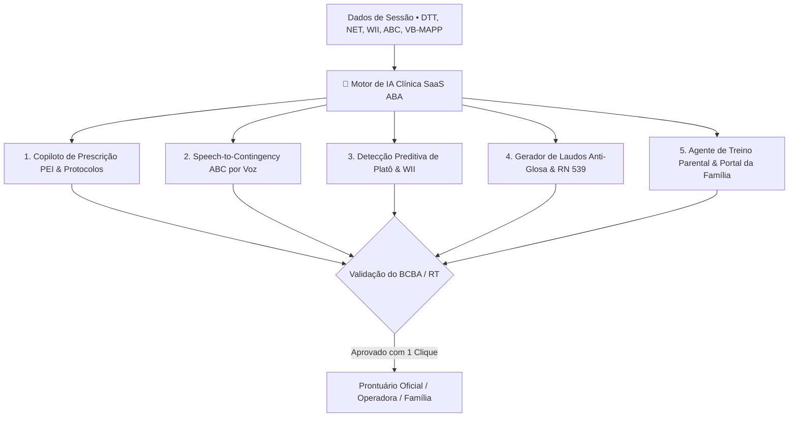
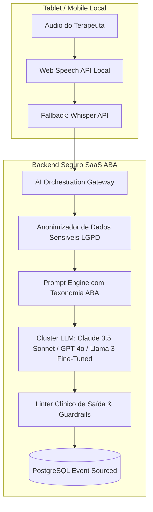

# 🧠 SaaS ABA — Arquitetura de Inteligência Artificial Clínica & Copiloto Comportamental (v2.4 Enterprise)

> **Especificação Técnica, Modelos de Linguagem (LLMs), Processamento de Linguagem Natural (NLP), Speech-to-Contingency, Predição de Platô Clínico e Governança Ética de IA para Intervenções em Neurodesenvolvimento (ABA)**

---

## 1. Sumário Executivo: A IA a Serviço da Ciência Comportamental

### 1.1. Filosofia: IA como Copiloto Aumentado do Supervisor (Human-in-the-Loop)
Na Análise do Comportamento Aplicada (ABA), todas as decisões terapêuticas devem ser estritamente fundamentadas em dados empíricos e sob responsabilidade técnica do profissional (**BCBA, Psicólogo CRP, Fonoaudiólogo CRFa ou Terapeuta Ocupacional CREFITO**).

A Inteligência Artificial do **SaaS ABA** não substitui o julgamento clínico. Ela atua como um **Copiloto Clínico e Operacional de Alta Precisão**, eliminando tarefas repetitivas que consomem de 30% a 40% do tempo dos profissionais:
1. **Redução de 85% no Tempo de Redação de Laudos**: Síntese instantânea de séries temporais em justificativas clínicas fundamentadas na **RN 539/2022 da ANS**.
2. **Ditado de Crises em < 5 Segundos**: Conversão de fala desestruturada em contingência **Antecedente-Comportamento-Consequência (ABC)** com classificação funcional.
3. **Detecção Precoce de Platô de Aprendizagem**: Alertas preditivos quando um alvo atinge estagnação estatística, sugerindo ajuste de esvanecimento de dicas antes de consolidar frustração na criança.
4. **Prescrição Assistida de PEI**: Mapeamento de marcos dos 6 Protocolos Padronizados (VB-MAPP, Denver ESDM, M-CHAT-R/F, ABLLS-R, CARS-2 e Socially Savvy) em programas de ensino estruturados com critérios de domínio parametrizados e agendamento de sondas D+10/20/30.
5. **Auditoria Semântica Anti-Glosa**: Detecção preventiva de termos ambíguos ou inconsistências em relatórios antes do envio para operadoras de saúde e minutas de recurso RN 539.

---

## 2. Os 5 Pilares do Motor de Inteligência Artificial do SaaS ABA



---

### 2.1. Pilar 1: Speech-to-Contingency (IA de Ditado por Voz para Registro ABC)

#### O Desafio Clínico:
Após uma crise de comportamento disruptivo ou agressivo, o terapeuta precisa acolher e regular a criança imediatamente. Se precisar preencher formulários com dezenas de campos, o registro é adiado para o fim do turno, resultando em perda de detalhes e viés de memória.

#### A Solução de IA:
O terapeuta aperta o botão de microfone e dita a ocorrência em linguagem natural por 5 a 10 segundos. O motor de NLP processa o áudio e gera a contingência trilinear estruturada:

```mermaid
sequenceDiagram
    participant T as Terapeuta / RBT (Voz)
    participant Client as Web Speech / Audio Recorder (Opus)
    participant LLM as Modelo NLP Estruturador
    participant UI as Modal ABC Estruturado

    T->>Client: "Enzo se jogou no chão e gritou por 3 min quando tirei o iPad; redirecionei para a rotina."
    Client->>LLM: POST /api/v1/ai/parse-abc (Prompt Especializado ABA)
    LLM-->>UI: Retorna JSON com Antecedente, Comportamento, Consequência, Função e Intensidade
    UI-->>T: Apresenta Campos Preenchidos para Confirmação em 1 Toque
```

#### Exemplo de Payload JSON de Saída da IA:
```json
{
  "transcription_raw": "Enzo se jogou no chão e gritou por 3 minutos quando pedi para guardar o iPad; retirei a atenção e redirecionei para o painel de rotina visual.",
  "structured_abc": {
    "antecedent": "Retirada do iPad / Transição de atividade de alta preferência",
    "behavior_topography": "Disrupção motora (jogar-se no chão) e vocalização alta (gritos contínuos)",
    "consequence_immediate": "Extinção planejada de atenção e redirecionamento neutro para rotina visual",
    "hypothesized_function": "Acesso a Tangível / Fuga de Transição",
    "suggested_intensity": 3,
    "duration_minutes": 3,
    "bip_compliance_status": "CONFORME_BIP_ATIVO",
    "recommended_replacement_behavior": "Ensinar mando funcional com cartão PECS 'Mais 2 minutos de iPad'"
  }
}
```

---

### 2.2. Pilar 2: Detecção Preditiva de Platô e Recomendação de Esvanecimento de Dicas

#### O Desafio Clínico:
Quando uma criança passa 6 sessões consecutivas com taxa de acerto independente estagnada em 20%, o terapeuta muitas vezes continua aplicando a mesma dica por inércia, gerando dependência de dica (*prompt dependency*) e frustração.

#### O Algoritmo de Decisão Clínica Baseada no WII:
O sistema monitora a série temporal do **Índice Ponderado de Independência (WII)** e a dispersão dos níveis de ajuda (IND, GP, VP, MP, PP, FP, INC):

$$\Delta \text{WII}_{k} = \frac{\sum_{i=1}^{k} \text{WII}_{t-i+1} - \sum_{i=1}^{k} \text{WII}_{t-2k+i}}{k}$$

- **Critério de Alerta de Platô**: Se $\Delta \text{WII} < 5\%$ nas últimas $N \ge 4$ sessões, o motor dispara recomendação:
  1. **Sugestão 1**: *Alteração de Hierarquia* (Mudar de *Least-to-Most* para *Most-to-Least* com *Errorless Learning*).
  2. **Sugestão 2**: *Quebra de Análise de Tarefas* (Fracionar o alvo em subpassos menores).
  3. **Sugestão 3**: *Reavaliação de Preferência* (Verificar se os itens reforçadores perderam valor motivador - Efeito de Saciação).

---

### 2.3. Pilar 3: Copiloto de Prescrição de PEI Baseado no VB-MAPP e ABLLS-R

O supervisor clínico seleciona os marcos deficitários na avaliação inicial (ex: *VB-MAPP Mando Nível 2 - Marco 6: Pede 20 itens diferentes com apoio gestual*).

A IA sugere automaticamente:
- **Estímulo Discriminativo ($S^D$ / MO)** formalizado.
- **Hierarquia de Dicas Inicial recomendada** com peso WII.
- **Critério de Domínio Parametrizado** (ex: 80% IND por 3 sessões consecutivas com 2 terapeutas).
- **Esteira de Manutenção Agendada** (Sondas automáticas em D+7, D+14, D+30 e D+90 pós-domínio).
- **Alvos de Generalização Cruzada** (Ambiente domiciliar, escolar e novos pares).

---

### 2.4. Pilar 4: Assistente de Redação de Laudos Periciais e Anti-Glosa (RN 539/2022)

#### O Desafio Clínico e Financeiro:
Auditores de operadoras de planos de saúde (Bradesco, Unimed, Amil, SulAmérica) glosam tratamentos com alegações genéricas como: *"Ausência de ganho funcional demonstrado"* ou *"Solicitação de redução de carga horária para 6 horas semanais"*.

#### A Ação do Assistente de Laudos com IA:
O motor cruza os dados empíricos reais dos últimos 3 a 6 meses do paciente e redige o parágrafo pericial defensivo:

> **Trecho de Laudo Gerado pela IA (Validado pelo BCBA em 1 Clique)**:
> *"No período avaliado (01/05 a 30/09/2026), o aprendiz Enzo Gabriel (CID-11: 6A02.0 / TEA Nível 2) totalizou 160 horas de intervenção multidisciplinar ABA. Conforme demonstrado no Gráfico 3.2 de Curvas Cumulativas, o aprendiz adquiriu 18 novos alvos de comunicação funcional (Mandos e Habilidades Receptivas), elevando seu Índice Ponderado de Independência (WII) de 42,1% para 83,4%. A manutenção da carga horária intensiva prescrita de 20 horas semanais é estritamente imperativa para consolidar a generalização de mandos no ambiente escolar e prevenir regressões comportamentais, em estrito cumprimento à Resolução Normativa nº 539/2022 da ANS que veda qualquer limitação de sessões prescritas pelo médico assistente."*

---

### 2.5. Pilar 5: Agente de Treino Parental & Resumo Semanal Acolhedor

O Portal da Família conta com um agente de IA especializado que:
1. **Traduz o Jargão Comportamental**: Converte termos técnicos (*"Extinção de mando com pareamento de reforçador diferencial DRI"*) em orientações carinhosas e práticas (*"Hoje o Enzo aprendeu a pedir água apontando para a garrafa em vez de chorar. Em casa, continue esperando ele apontar antes de entregar o copo!"*).
2. **Resumo Semanal em Áudio e Texto**: Notificação automática via WhatsApp aos pais com a celebração dos marcos alcançados na semana.
3. **Chatbot com Guardrails Éticos**: Tira dúvidas rotineiras sobre a rotina visual doméstica, balizado estritamente nas diretrizes prescritas pelo supervisor clínico responsável.

---

## 3. Arquitetura Técnica dos Modelos de IA e Privacidade de Dados



### 3.1. Anonimização Prévia e Conformidade LGPD
Antes de qualquer dado ser submetido aos modelos de linguagem:
1. **Filtro de PII (Personally Identifiable Information)**: Nomes de pacientes, CPFs, nomes de familiares e endereços são substituídos por tokens anônimos (`[PACIENTE_ID_101]`, `[APLICADOR_03]`).
2. **Isolamento de Tenant**: Nenhum dado clínico de clientes é utilizado para treinamento público de modelos de terceiros (Acordo B2B Enterprise com garantia de retenção zero de dados).
3. **Logs Auditáveis**: Cada geração de texto ou parsing de contingência registra o prompt sanitizado, resposta do modelo e a aprovação formal com assinatura do profissional responsável.

---

## 4. Custos e Unit Economics da Camada de IA

Devido ao uso de pipelines híbridos (transcrição de áudio compactada e prompts de poucos tokens com formatação JSON estrita), o custo de IA por clínica é extremamente reduzido:

| Módulo de IA | Frequência de Uso Média | Modelo / Provedor | Custo por Execução | Custo Estimado / Clínica / Mês |
| :--- | :--- | :--- | :--- | :--- |
| **Speech-to-ABC (Voz)** | 40 crises / mês / clínica | Whisper + Claude 3.5 Haiku | R$ 0,04 / evento | **R$ 1,60** |
| **Detecção de Platô & WII** | Algoritmo determinístico local | Motor TypeScript no Client | R$ 0,00 (Local-First) | **R$ 0,00** |
| **Redação de Laudos RN 539** | 25 laudos / mês / clínica | Claude 3.5 Sonnet / GPT-4o | R$ 0,22 / laudo | **R$ 5,50** |
| **Resumos do Portal da Família** | 100 resumos semanais / mês | LLM Compacto (Haiku / Llama 3) | R$ 0,02 / resumo | **R$ 2,00** |
| **TOTAL CUSTO IA / CLÍNICA / MÊS** | — | — | — | **R$ 9,10 / mês** |
| **Impacto no Ticket Médio (R$ 1.190)** | — | — | — | **< 0,8% do Faturamento** |

---

## 5. Conclusão: O Diferencial Competitivo Insuperável

A incorporação da Inteligência Artificial especializada no SaaS ABA consolida uma barreira de entrada intransponível:
- **Especialização de Domínio**: Enquanto sistemas genéricos usam IA apenas como chatbot de texto solto, o SaaS ABA conecta a IA diretamente aos cálculos de **WII, hierarquias de dicas, marcos VB-MAPP e exigências regulatórias da RN 539/2022**.
- **Segurança Human-in-the-Loop**: A IA acelera em 10x a produção de relatórios e registros, mas preserva 100% a governança e assinatura legal do Responsável Técnico.
