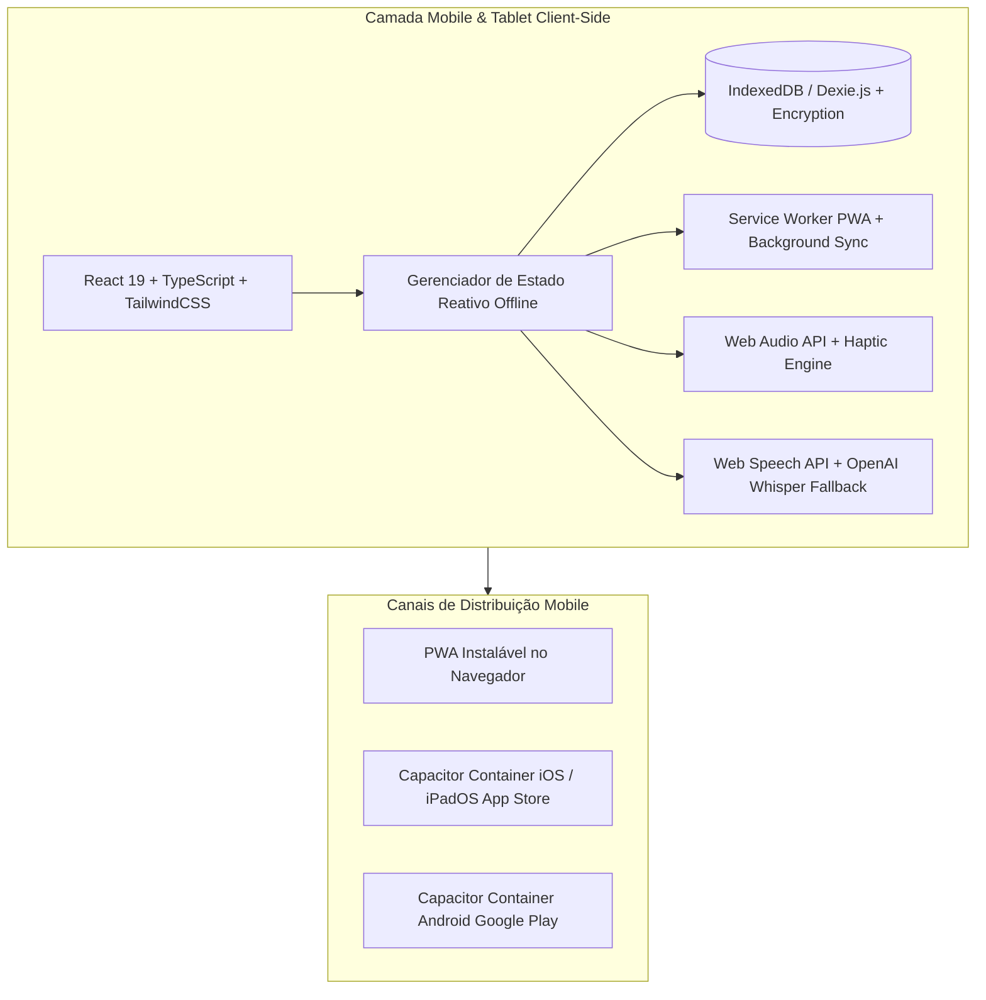
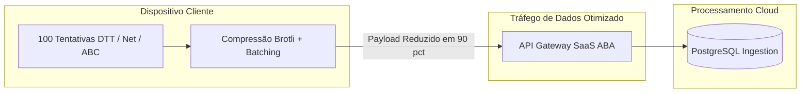
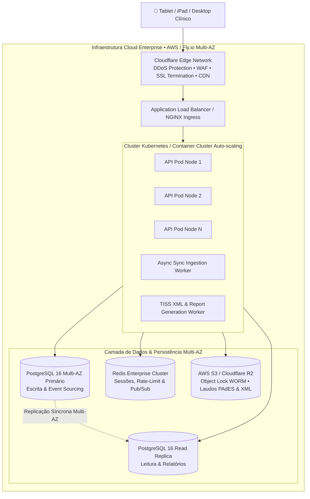
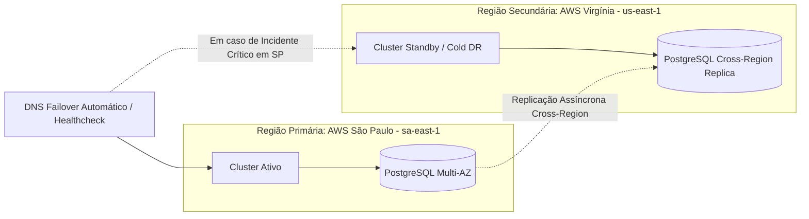
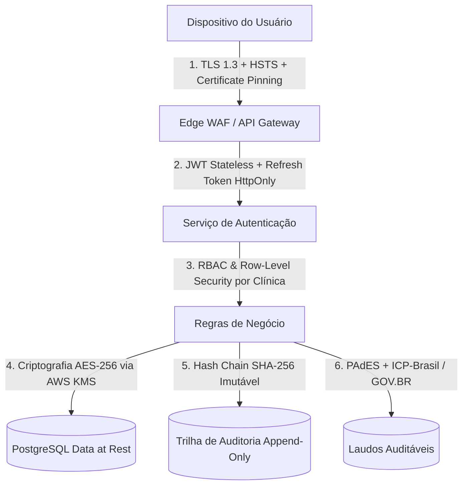
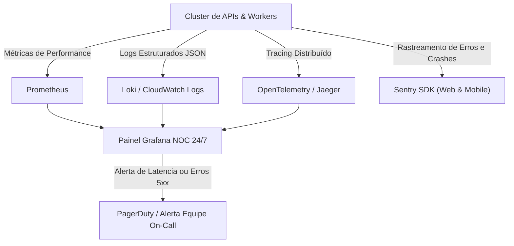

# 📱 SaaS ABA — Estratégia Mobile, Infraestrutura Cloud, Redundância & Segurança (v2.4 Enterprise)

> **Documento Institucional e Técnico de Arquitetura de Sistemas, Estratégia de Desenvolvimento Mobile, Engenharia de Nuvem, Alta Disponibilidade, Redundância Multi-Região e Conformidade Regulatória / LGPD**

---

## 1. Visão Geral da Arquitetura & Diretrizes Inegociáveis

A operação do **SaaS ABA** em clínicas de neurodesenvolvimento e intervenção comportamental no Transtorno do Espectro Autista (TEA) exige garantias de engenharia incomparáveis a prontuários eletrônicos generalistas:
1. **Latência de Coleta Instantânea (< 10ms)**: Durante a aplicação de Tentativas Discretas (*Discrete Trial Training - DTT*) e Ensino em Ambiente Natural (*NET*), a atenção da criança é volátil. O aplicador não pode esperar requisições de rede ou telas de carregamento.
2. **Operação 100% Offline (Local-First)**: Clínicas possuem salas acusticamente isoladas com atenuação de sinal Wi-Fi/4G e terapeutas realizam atendimentos domiciliares (*home care*) ou escolares sem conectividade confiável.
3. **Sincronização em Background Conflito-Zero**: Protocolo *Event Sourcing* com resolução determinística de conflitos (*Last-Write-Wins / CRDT-inspired*) sincroniza lotes compactados assim que a conexão é restabelecida.
4. **Blindagem Jurídica e Regulatória**: Assinatura digital touch dos pais com geolocalização, carimbo de tempo imutável, conformidade com a **LGPD (Lei 13.709/2018)** e validação de lotes **TISS XML v04.01.00** para operadoras de saúde e cumprimento da **RN 539/2022 da ANS**.

---

## 2. Estratégia de Desenvolvimento Mobile & Frontend

### 2.1. Escolha de Stack: PWA Avançado + Capacitor (Estratégia Híbrida de Alta Performance)

| Critério | PWA Avançado (Vite + React 19) | Capacitor (iOS / Android) | React Native Puro | Flutter |
| :--- | :---: | :---: | :---: | :---: |
| **Custo de Desenvolvimento & Time to Market** | **Altíssimo (Base de código 100% unificada)** | **Altíssimo (Mesma base Web)** | Médio (Código duplicado para Web) | Médio (Nova stack Dart) |
| **Instalação Sem Fricção nas Clínicas** | **Imediata (1 clique via navegador)** | App Store / Play Store | App Store / Play Store | App Store / Play Store |
| **Atualizações Instantâneas (Sem aprovação Apple/Google)** | **Sim (Deploy em 0 minutos)** | Apenas via CodePush/Web | Não | Não |
| **Acesso a Sensores (Áudio, Haptic, GPS, Câmera)** | Sim (APIs Modernas) | **Sim (Plugins Nativos)** | Sim | Sim |
| **Performance de Renderização & Latência** | **60-120 FPS (Local-First DOM)** | **60-120 FPS** | 60-120 FPS | 60-120 FPS |
| **Decisão de Arquitetura SaaS ABA** | **Canal Primário de Adoção** | **Canal Secundário (Lojas)** | Descartado | Descartado |

#### Racional da Decisão:
- **Base de Código Única (Single Source of Truth)**: O frontend desenvolvido em React 19, TypeScript e TailwindCSS roda de forma idêntica no iPad do terapeuta, no tablet Android, no celular dos pais e no desktop do supervisor clínico.
- **Distribuição Instantânea (PWA First)**: Clínicas com dezenas de estagiários instalam o app em menos de 10 segundos adicionando o atalho à tela de início, sem necessidade de gerenciar contas corporativas da Apple ou Google.
- **Empacotamento Nativo com Capacitor**: Permite distribuição opcional na App Store e Google Play Store para redes que exigem conformidade com MDM (*Mobile Device Management*).

---

### 2.2. Arquitetura de Armazenamento Local e Persistência Offline

```mermaid
sequenceDiagram
    participant T as Terapeuta (Toque no Tablet)
    participant UI as React UI Component
    participant IDB as IndexedDB (Local-First)
    participant SW as Service Worker Sync Queue
    participant Srv as Cloud Backend API (PostgreSQL)

    T->>UI: Registra Tentativa DTT [IND (+)] (<10ms)
    UI->>UI: Dispara Feedback Sonoro (Web Audio API)
    UI->>IDB: Grava Evento no IndexedDB (Append-Only)
    UI-->>T: Atualiza WII e Gráfico Instantaneamente
    
    rect rgb(20, 30, 45)
        Note over UI,SW: Execução Assíncrona em Segundo Plano
        UI->>SW: Enfileira Evento na Sync Queue
        alt Conexão Online Disponível
            SW->>Srv: POST /api/v1/sync/events (Lote Compactado)
            Srv-->>SW: 200 OK + Confirmação de IDs Sincronizados
            SW->>IDB: Marca Eventos como "Sincronizados"
        else Sem Conexão (Offline)
            SW->>SW: Aguarda evento navigator.onLine ou Workbox Sync
        end
    end
```

#### Mecanismos de Persistência Local:
1. **IndexedDB com Dexie.js**: Schema relacional em memória local com índices em `patientId`, `targetId`, `sessionDate` e `syncStatus`.
2. **Criptografia em Repouso no Cliente (Web Crypto API)**: Bancos de dados locais contendo dados clínicos sensíveis são criptografados com chave derivada de autenticação PBKDF2/AES-GCM.
3. **Limite de Quota e Garbage Collection**: Gerenciamento de até 500MB de cache local por dispositivo, preservando os últimos 90 dias de sessões ativas e histórico completo de PEI.

---

## 3. Gestão de Tráfego de Dados e Otimização de Rede

### 3.1. Estratégias de Redução Drástica de Consumo de Dados

| Técnica Implementada | Descrição Técnica | Redução Média de Tráfego |
| :--- | :--- | :---: |
| **Compactação de Payload HTTP** | Compressão **Brotli / Gzip** em todas as requisições da API REST | **~75%** |
| **Sincronização Diferencial (Delta Sync)** | O cliente envia apenas eventos novos gerados após o último `last_sync_seq_id` | **~90%** |
| **Compressão de Assinaturas Digitais** | Assinaturas touch vetorizadas em SVG compactado com precisão de 2 casas decimais | **~85%** (vs PNG) |
| **Throttling e Batching Inteligente** | Agrupamento de tentativas em lotes a cada 5 segundos ou 10 eventos | **~80%** (menos overhead HTTP) |
| **Áudio de Ditado ABC em Opus 16kbps** | Codec de voz ultracompacto para envio de relatos de crise | **~88%** (vs áudio PCM) |

---

## 4. Arquitetura de Nuvem, Hospedagem e Redundância Multi-Região

### 4.1. Topologia de Servidores e Camada de Computação

1. **Borda Global (Edge Layer - Cloudflare Enterprise)**:
   - Proteção contra ataques **DDoS L3/L4 e L7** com capacidade de mitigação de terabits por segundo.
   - **Web Application Firewall (WAF)** com regras OWASP Top 10 ativas para bloqueio de SQL Injection, XSS e CSRF.
   - Cache de borda para assets estáticos em mais de 300 data centers no mundo (tempo de carregamento < 50ms no Brasil).

2. **Cluster de Aplicação (Container Cluster Auto-scaling)**:
   - Microsserviços stateless containerizados com **Docker e Kubernetes (EKS / Fly.io)**.
   - **Auto-scaling Horizontal (HPA)** baseado em CPU e consumo de memória (escala de 2 para 20 pods em menos de 60 segundos durante picos de atendimento clínico das 08h às 18h).
   - Separação estrita de workers assíncronos: a geração pesada de laudos em PDF e exportação de lotes TISS XML não concorre com a rota crítica de sincronização de tentativas.

3. **Camada de Banco de Dados Relacional**:
   - **PostgreSQL 16 Multi-AZ** (Zona de Disponibilidade A primária + Zona de Disponibilidade B com replicação síncrona automática).
   - *Connection Pooling* via **PgBouncer** para suportar mais de 10.000 conexões simultâneas com baixo consumo de memória.
   - Read Replicas dedicadas para consultas analíticas de dashboards, curvas de aquisição e auditorias.

4. **Armazenamento de Objetos Auditáveis (WORM Storage)**:
   - **AWS S3 / Cloudflare R2** com política **Object Lock (Write Once, Read Many - WORM)**.
   - PDFs de laudos clínicos com assinatura digital e arquivos XML TISS enviados aos convênios são bloqueados contra deleção ou modificação por 5 anos (atendendo exigência legal do CFM e da ANS).

---

### 4.2. Estratégia de Redundância, Alta Disponibilidade e Disaster Recovery

#### Parâmetros de Continuidade de Negócios (RPO & RTO):

| Métrica de Recuperação | Alvo Contratual (SLA) | Estratégia Técnica de Implementação |
| :--- | :---: | :--- |
| **SLA de Disponibilidade** | **99,95%** | Arquitetura redundante Multi-AZ com failover de banco em < 30 segundos. |
| **RPO (*Recovery Point Objective*)** | **< 1 minuto** | Replicação síncrona Multi-AZ + *Continuous WAL Archiving* no S3. |
| **RTO (*Recovery Time Objective*)** | **< 15 minutos** | Automação com *Terraform / Infrastructure as Code* para subida imediata de pods em região secundária. |
| **Política de Backups Contínuos** | **35 Dias (PITR)** | *Point-In-Time Recovery* permitindo restauração do banco para qualquer segundo dos últimos 35 dias. |
| **Backup Frio Diário Imutável** | **5 Anos** | Snapshots diários exportados para bucket S3 Glacier com bloqueio de exclusão regulatório. |

---

## 5. Segurança da Informação, LGPD e Assinatura Digital

A proteção de dados de crianças atípicas e dados de saúde exige o mais alto padrão de segurança cibernética e conformidade legal.

### 5.1. Isolamento de Dados Multi-Tenant (Segregação Lógica Estrita)
- **Row-Level Security (RLS)** nativo no PostgreSQL: Cada consulta ao banco é automaticamente encapsulada com `clinic_id = current_setting('app.current_clinic_id')`.
- Impossibilidade física de vazamento cruzado de dados entre clínicas, mesmo em caso de erro no código da API.
- Criptografia individualizada de campos sensíveis (diagnóstico CID-11, CPF, dados de contato dos pais) com chaves de criptografia gerenciadas via **AWS KMS (Key Management Service)**.

---

### 5.2. Criptografia em Trânsito e em Repouso

1. **Criptografia em Trânsito**:
   - Protocolo **TLS 1.3** obrigatório com cifras seguras (*ECDHE-RSA-AES128-GCM-SHA256* / *CHACHA20-POLY1305*).
   - Cabeçalhos de segurança obrigatórios: `Strict-Transport-Security (HSTS)` com max-age de 2 anos, `Content-Security-Policy (CSP)`, `X-Frame-Options: DENY`, `X-Content-Type-Options: nosniff`.
2. **Criptografia em Repouso**:
   - Discos de banco de dados e volumes EBS criptografados com algoritmo **AES-256**.
   - Buckets de armazenamento de PDFs e arquivos XML com criptografia **SSE-KMS**.

---

### 5.3. Autenticação, Autorização e Gestão de Acessos (RBAC & 2FA)
- **Tokens JWT de Curta Duração (15 minutos)**: Enviados em headers de autorização para chamadas à API.
- **Refresh Tokens Seguros**: Armazenados exclusivamente em cookies `HttpOnly`, `Secure` e `SameSite=Strict`, com mecanismo de detecção e anulação em caso de reutilização indevida.
- **Autenticação em Dois Fatores (2FA / MFA)**: Obrigatória para perfis de Supervisor Clínico (BCBA) e Gestores de Faturamento via aplicativo autenticador (TOTP) ou SMS/WhatsApp OTP.
- **Matriz de Permissões Baseada em Funções (RBAC)**:
  - *BCBA / RT*: Acesso total clínico, alteração de fases de aprendizagem e emissão de laudos.
  - *RBT / AT*: Coleta de tentativas no tablet e visualização restrita ao PEI do paciente em atendimento.
  - *Faturamento*: Acesso exclusivo ao módulo financeiro, guias e lotes TISS XML.
  - *Família*: Acesso restrito via Portal dos Pais aos relatórios autorizados e assinatura de presença.

---

### 5.4. Trilha de Auditoria Imutável (*Audit Trail*)
Todas as operações de criação, leitura, exportação e modificação de dados clínicos geram um registro de auditoria imutável:
- **Campos Auditados**: `timestamp_utc`, `user_id`, `clinic_id`, `patient_id`, `ip_address`, `user_agent`, `action_type`, `payload_diff`, `sha256_hash`.
- **Encadeamento de Hashes (Hash Chain)**: Cada log de auditoria contém o hash criptográfico do log anterior, tornando matematicamente impossível fraudar ou deletar registros retroativos em perícias judiciais.

---

### 5.5. Assinatura Digital e Conformidade Regulatória (PAdES / ICP-Brasil / GOV.BR)
- **Padrão PAdES (PDF Advanced Electronic Signatures)**: Conformidade com a **Lei Federal nº 14.063/2020** e a **MP 2.200-2/2001**.
- **Suporte a Certificados ICP-Brasil (A1 e A3 / Nuvem)**: Integração com provedores de nuvem (BirdID, Vidaas, SafeID, Certisign).
- **Assinatura Eletrônica Avançada GOV.BR**: Suporte à validação de contas GOV.BR Níveis Prata e Ouro.
- **QR Code de Validação Pública**: Inclusão de carimbo de tempo imutável e URL pública para conferência de autenticidade por juízes, peritos e auditores de operadoras de planos de saúde.

---

## 6. Monitoramento, Observabilidade e Dimensionamento de Custos de Cloud

### 6.1. Stack de Observabilidade e Monitoramento 24/7

---

### 6.2. Dimensionamento de Custos de Infraestrutura por Escala de Clínicas

Graças à arquitetura **Local-First**, os custos de infraestrutura em nuvem crescem de forma sublinear em relação ao número de clínicas atendidas:

| Componente de Infraestrutura | 100 Clínicas (~3.000 Aprendizes) | 500 Clínicas (~15.000 Aprendizes) | 2.000 Clínicas (~60.000 Aprendizes) |
| :--- | :---: | :---: | :---: |
| **Cluster Kubernetes (EKS / Compute)** | R$ 1.200 / mês | R$ 3.800 / mês | R$ 11.500 / mês |
| **PostgreSQL RDS Multi-AZ + Replicas** | R$ 950 / mês | R$ 3.200 / mês | R$ 8.900 / mês |
| **Cloudflare Enterprise (WAF & DDoS)** | R$ 400 / mês | R$ 1.200 / mês | R$ 3.500 / mês |
| **S3 Object Lock (WORM) + Snapshots** | R$ 250 / mês | R$ 950 / mês | R$ 2.800 / mês |
| **Observabilidade (Grafana Cloud / Loki)**| R$ 350 / mês | R$ 1.100 / mês | R$ 2.900 / mês |
| **TOTAL MENSAL DE INFRAESTRUTURA** | **R$ 3.150 / mês** | **R$ 10.250 / mês** | **R$ 29.600 / mês** |
| **Custo de Infra por Clínica / Mês** | **R$ 31,50** | **R$ 20,50** | **R$ 14,80** |
| **Margem Bruta sobre a Infra** | **~93,8%** | **~95,6%** | **~96,4%** |
