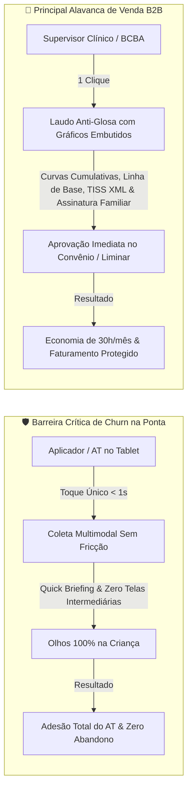
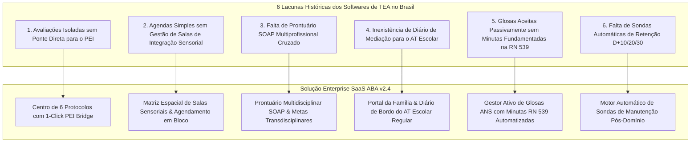
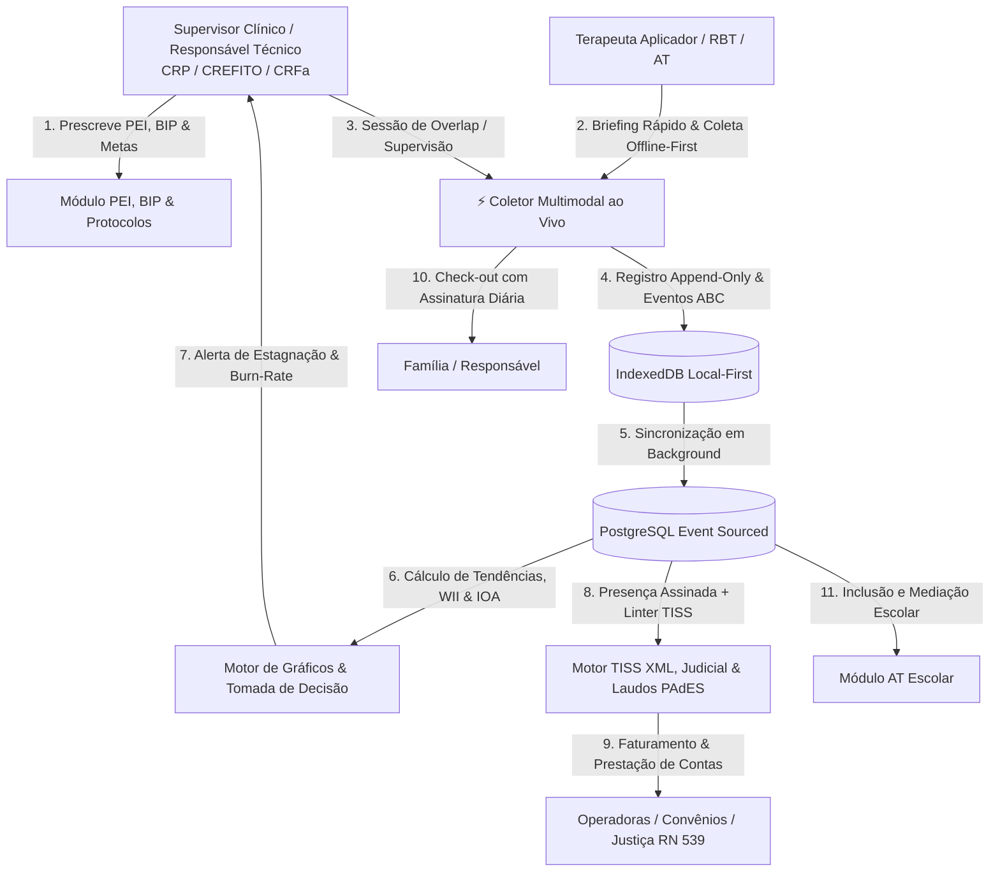
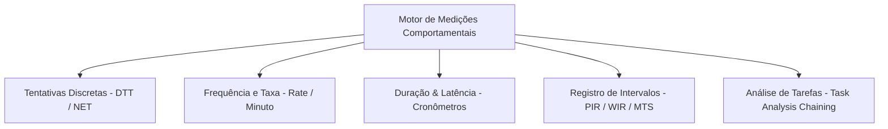
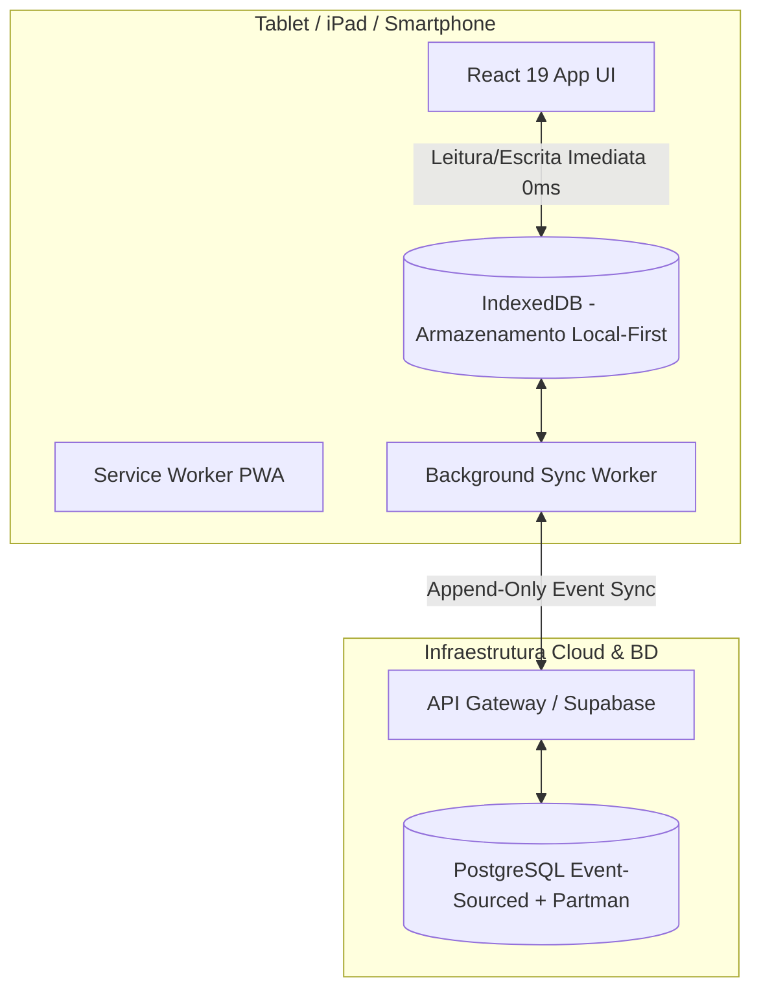

# 🧠 SaaS ABA — Documentação Técnica, Clínica e de Produto (v2.4 Enterprise)

> **Plataforma Enterprise B2B de Gestão Clínica, Coleta Comportamental Multimodal Local-First (DTT, NET, Task Analysis, Intervalos), Plano de Intervenção Comportamental (BIP), Faturamento TISS/ANS, Prestação de Contas Judicial (RN 539/2022) e Conformidade Anti-Glosa para Intervenções em Neurodesenvolvimento (ABA)**

---

## 1. Sumário Executivo e Tese de Negócio

### 1.1. O Problema de Mercado
A intervenção baseada em **Análise do Comportamento Aplicada (ABA)** é o padrão-ouro de eficácia científica para o Transtorno do Espectro Autista (TEA) e atrasos de neurodesenvolvimento. Protocolos intensivos prescrevem de **15 a 40 horas semanais** por aprendiz, mobilizando equipes multidisciplinares com supervisores clínicos (**BCBAs, Psicólogos com CRP, Fonoaudiólogos com CRFa e Terapeutas Ocupacionais com CREFITO**) e aplicadores comportamentais (**RBTs, estagiários e Acompanhantes Terapêuticos - ATs**).

No cenário brasileiro e internacional, as clínicas enfrentam cinco grandes gargalos operacionais, metodológicos e financeiros:
1. **Gargalo de Coleta em Pranchetas e Papel**: Cada sessão de 2 a 4 horas envolve entre 50 e 200 tentativas discretas ou medições de fluxo contínuo. Registrar em papel desvia a atenção visual da criança, atrasa a entrega de reforçadores e gera inconsistências de tabulação.
2. **Turnover de Aplicadores (> 40% ao ano)**: A alta rotatividade de estagiários e ATs faz com que novos terapeutas assumam sessões sem conhecer os reforçadores vigentes, as estratégias de regulação sensorial e as vias de comunicação funcional do aprendiz.
3. **Tempo Excessivo em Planilhas e Gráficos**: Supervisores dedicam de 25% a 35% de suas horas clínicas compilando dados brutos no Excel para analisar tendências e ajustar planos de ensino.
4. **Glosas de Planos de Saúde e Risco de Reembolso**: As operadoras de planos de saúde (Unimed, Bradesco, Amil, SulAmérica, NotreDame Intermédica) impõem auditorias rigorosas. Faturas são glosadas por inconsistência em **lotes XML TISS (SP/SADT)**, falta de comprovação de presença diária assinada pelos pais e relatórios sem gráficos comprobatórios de evolução.
5. **Complexidade de Liminares Judiciais e Reembolso Assistido**: Mais de 60% das clínicas de excelência operam via Reembolso ou Cumprimento de Liminar Judicial com base na **RN 539/2022 da ANS** (que proíbe a limitação de sessões para TEA), exigindo dossiês periciais detalhados para juízes e peritos.

---

### 1.2. Os Dois Pilares Inegociáveis do Produto (North Star Metrics)



#### 🛡️ Pilar 1: Regra dos &lt; 1 Segundo de Coleta (Blindagem Anti-Churn)
- **A Dor Real**: O terapeuta aplicador ou AT está em contato direto com uma criança de 3 a 7 anos, muitas vezes regulando comportamentos de fuga, crises sensoriais ou manuseando materiais de reforço tangível (massinha, bolhas, brinquedos).
- **O Risco de Churn**: Se o software exigir mais de 3 segundos para abrir menus, rolar a página ou preencher dropdowns complexos, o aplicador abandona o tablet e volta para a prancheta de papel.
- **A Solução Técnica**:
  - **Interface Ultra-Ergonômica de 1 Toque**: Botões táteis gigantes com zonas de toque (*hit targets*) generosas.
  - **Latência Zero na Coleta (Local-First)**: Gravação instantânea em memória local (`IndexedDB`), sem telas de *loading* ou dependência de rede.
  - **Atalhos Físicos de Teclado**: Teclas `1` a `8` para coletar sem olhar para a tela.
  - **Card de Boas-Vindas da Sessão (Quick Briefing)**: Visualização instantânea em 3 segundos dos top 3 reforçadores, gatilhos de sobrecarga sensorial e preferência de comunicação funcional antes de iniciar a sessão.
  - **Registro Rápido de Crise (ABC) + Ditado por Voz com IA**: 1 toque abre chips pré-selecionados e suporte a ditado de voz que converte a fala do terapeuta em contingência ABC estruturada em menos de 5 segundos.

#### 🚀 Pilar 2: Dossiê Clínico e Laudo Anti-Glosa em 1 Clique (Principal Alavanca de Venda e Retenção)
- **A Dor Real**: O supervisor clínico gasta dezenas de horas semanais extraindo dados brutos, montando gráficos no Excel e redigindo laudos justificativos para manter o tratamento custeado pelas operadoras de saúde ou justificar liminares.
- **A Alavanca Comercial**: O gestor da clínica adquire o SaaS ABA porque ele resolve a dor financeira mais crítica: **elimina 100% das glosas documentais e de assiduidade, assegura o cumprimento da RN 539/2022 da ANS e economiza até 30 horas/mês por supervisor**.
- **A Solução Técnica**:
  - **Gerador de Laudos em 1 Clique com Gráficos Embutidos**: Gráficos de linha de base, curvas cumulativas e desvanecimento de dicas renderizados diretamente dentro do documento PDF.
  - **Folha de Presença Diária com Assinatura da Família**: Coleta de assinatura digital na tela do tablet ou confirmação OTP/WhatsApp a cada sessão, com geolocalização e carimbo de data/hora (anula alegações de "sessão fantasma").
  - **Linter Pré-Envio de XML TISS**: Checagem sintática e semântica em tempo real antes da exportação do lote XML TISS v04.01.00 (valida CNES, conselho de classe, compatibilidade TUSS e carga horária).
  - **Módulo de Prestação de Contas Judicial e Reembolso Assistido**: Dossiê pericial com fundamentação jurídica na **RN 539/2022 da ANS** e recibos/notas com detalhamento de horas para juízes e operadoras.
  - **Assinatura PAdES e QR Code de Validação**: Em conformidade com a Lei 14.063/2020 e ICP-Brasil / GOV.BR Prata/Ouro.

---

### 1.3. Modelo de Negócio & Unit Economics

| Métrica | Projeção / Benchmark Brasil | Racional Econômico |
| :--- | :--- | :--- |
| **Ticket Médio (MRR)** | **R$ 590 a R$ 2.490 / mês / clínica** | Precificação em camadas por aprendizes ativos e módulos avançados (TISS XML, Liminares, IOA, Portal Família). |
| **Faturamento Médio por Aprendiz na Clínica** | R$ 3.500 a R$ 18.000 / mês | A assinatura do SaaS representa menos de **1,5% do faturamento** de um único paciente da clínica. |
| **Taxa de Retenção / Churn Anual** | **&lt; 2%** | *Moat* técnico e regulatório extremo: o histórico de PEI, séries temporais, BIPs e auditorias TISS residem no SaaS. |
| **Payback do Cliente (ROI)** | **Imediato (&lt; 20 dias)** | Eliminação de 100% das glosas de assiduidade e redução de 85% no tempo gasto em relatórios de supervisão. |

---

### 1.4. Benchmark Competitivo Nacional & Superação das 6 Lacunas de Mercado

Uma análise arquitetural aprofundada das 8 soluções dominantes no Brasil (NeoABA, ClinicABA, TEA360, Cliniconect, Sr. ABA/BPA, ComportaTudo, AkivaTEA e Blue Smiles) revelou 6 lacunas críticas que fragilizavam as operações clínicas:



| Concorrente Analisado | Limitação / Lacuna Técnica e Clínica | Superação no SaaS ABA Enterprise |
| :--- | :--- | :--- |
| **NeoABA** | Monopolizado em VB-MAPP/ABLLS; sem Denver, M-CHAT ou salas em bloco | **6 Protocolos Nativos** com conversão em 1 clique para o PEI e matriz de salas |
| **ClinicABA** | Prontuário PTABA rígido; sem padrão SOAP e sem contestação ativa RN 539 | **Prontuário SOAP Multi** (Fono, T.O., Psico, ABA) e **Gestor Ativo de Glosas** |
| **TEA360** | Coletor convencional; sem automação sistemática de retenção periódica | **Coletor Local-First < 1s** e **Motor de Manutenção 10/20/30 Dias** |
| **Cliniconect** | ERP hospitalar genérico; protocolos desconectados da criação de alvos | **1-Click PEI Bridge**: marco não atingido gera programa com 3 exemplares |
| **Sr. ABA (BPA)** | Agenda básica sem controle de recursos de integração sensorial | **Matriz de Salas Físicas** (Ayres, DTT 1 e 2, Denver, CAA) sem conflitos |
| **ComportaTudo** | Software voltado apenas para o consultório; sem canal para o AT escolar | **Diário de Bordo do AT Escolar** (permanência, socialização, recreio) |
| **AkivaTEA** | Terapias desarticuladas gerando múltiplos deslocamentos da família | **Agendamento em Bloco** (ABA+TO+Fono casados no mesmo turno) |
| **Blue Smiles** | Falta de múltiplos protocolos de triagem precoce simultâneos | Rastreio integrado com **M-CHAT-R/F, CARS-2 e Socially Savvy** |

---

## 2. Personas, Perfis e Hierarquia de Acesso



### 2.1. Matriz de Responsabilidades Regulatórias (Brasil)

| Perfil de Usuário | Atribuição Legal e Clínica | Dispositivo Principal | Permissões no Sistema |
| :--- | :--- | :--- | :--- |
| **Responsável Técnico (BCBA / Psicólogo CRP / Fonoaudiólogo CRFa / TO CREFITO)** | Prescrição do Plano de Ensino Individualizado (PEI) e Plano de Intervenção Comportamental (BIP), emissão de laudos de manutenção de carga horária, validação de sessões de aplicadores e assinatura digital ICP-Brasil / GOV.BR. | Desktop / Laptop | Acesso total clínico, aprovação de alvos, alteração de fases de aprendizagem, parametrização de BIP e emissão de lotes TISS / Dossiês Judiciais. |
| **Terapeuta Aplicador (RBT / Estagiário / AT Assistido)** | Visualização do Quick Briefing de sessão, execução diária das tentativas discretas e medições contínuas, manejo de reforçadores e estratégias do BIP, condução de análises de tarefas e registro de ABC com ditado por voz. | Tablet (iPad/Android) / Smartphone | Coletor multimodal em tempo real, visualização de $S^D$ ou Operação Motivadora (MO), instrução de correção de erro, consulta rápida ao BIP e coleta de assinatura dos pais. |
| **Acompanhante Terapêutico (AT Escolar)** | Mediação pedagógica, manejo de sobrecarga sensorial no recreio e coleta de dados de socialização com pares na escola regular. | Smartphone / Tablet | Formulário simplificado de inclusão escolar, registro de interações sociais e barreiras sensoriais. |
| **Família / Responsáveis** | Confirmação de presença diária com assinatura digital ou OTP, cumprimento das orientações do Treino Parental e registro de generalização de mandos no ambiente doméstico. | Smartphone (PWA / Portal) | Assinatura de presença, visualização simplificada de evolução e formulário de registro de generalização em casa. |
| **Gestor Administrativo & Faturamento** | Gestão de guias autorizadas, controle de burn-rate de horas, conciliação de faturas, execução do Linter Anti-Glosa e exportação de lotes XML TISS / Dossiês de Reembolso. | Desktop | Módulo financeiro, controle de guias ANS, monitor de queima de horas, linter TISS e conciliação de recebíveis. |

---

## 3. Taxonomia e Metodologia Clínica Avançada (ABA)

### 3.1. Hierarquia de Dicas Completa (Prompt Hierarchy)

| Código | Nível de Ajuda | Definição Metodológica | Peso Ponderado (WII) | Estratégia de Esvanecimento |
| :---: | :--- | :--- | :---: | :--- |
| **`IND`** | **Independente (+)** | Resposta correta, sem qualquer auxílio externo, dentro do tempo de latência esperado (&lt; 3s). | **1.0** (100%) | N/A |
| **`GP`** | **Ajuda Gestual** | Apontar, olhar direcionado ou gesticular em direção ao estímulo discriminativo correto. | **0.8** (80%) | *Least-to-Most* |
| **`VP`** | **Ajuda Verbal** | Dica vocal direta, instrução oral repetida ou fonema inicial da resposta verbal. | **0.6** (60%) | *Least-to-Most* |
| **`MP`** | **Dica de Modelo (Model)** | O aplicador demonstra a resposta motora ou verbal exata para que a criança imite imediatamente. | **0.5** (50%) | *Most-to-Least / Model-Lead* |
| **`POS`** | **Dica Posicional** | Aproximação física, destaque espacial ou realce visual do cartão/estímulo alvo. | **0.4** (40%) | *Stimulus Fading* |
| **`PP`** | **Físico Parcial** | Toque suave no cotovelo, pulso ou antebraço, conduzindo a trajetória inicial do movimento. | **0.3** (30%) | *Most-to-Least* |
| **`FP`** | **Físico Total** | Condução motora mão-sobre-mão completa durante toda a execução da resposta. | **0.1** (10%) | *Most-to-Least* |
| **`INC`** | **Incorreto / Sem Resposta (-)** | Erro, resposta desadaptativa, recusa ou tempo de latência excedido. | **0.0** (0%) | Dispara Procedimento de Correção |

---

### 3.2. Índice Ponderado de Independência (WII - Weighted Independence Index)
Além da taxa clássica de acerto independente ($\text{Acerto Ind}\% = \frac{N_{\text{IND}}}{N_{\text{Total}}} \times 100$), o SaaS ABA calcula o **WII**:

$$\text{WII} = \frac{\sum_{i} (N_i \times \text{Peso}_i)}{N_{\text{Total}}} \times 100$$

*Relevância Clínica*: Quando uma criança passa de *Físico Total (10%)* para *Ajuda Gestual (80%)*, o acerto independente bruto permanece em 0%, gerando uma falsa impressão de estagnação. O WII quantifica com precisão essa evolução da autonomia, comprovando progresso contínuo para a família e para o plano de saúde.

---

### 3.3. Ensino Natural (NET) e Mando (Comunicação Espontânea)
No **Ensino Naturalístico (NET)** e no ensino de **Mando (Solicitação Funcional)**:
- **Não existe instrução discriminativa ($S^D$) vocal do terapeuta**: Instruir "Diga água" transforma o comportamento em *Ecoico* ou *Intraverbal*, anulando a função do mando puro.
- O estímulo antecedente do mando é a **Operação Motivadora (MO / EO - Establishing Operation)**, gerada pelo estado de privação ou interesse espontâneo da criança pelo item/atividade.
- **Modelagem no Sistema**:
  - O campo `sd_instruction` é tornado opcional (`NULLABLE`).
  - São introduzidos os campos `motivating_operation` (ex: "Privação de acesso ao brinquedo favorito colocado fora de alcance visual") e `antecedent_setup` (disposição ambiental de captura de interesse).

---

### 3.4. Plano de Intervenção Comportamental (BIP / PAC) Integrado ao ABC
Para cada comportamento-problema mapeado na avaliação funcional, o sistema disponibiliza um **BIP (Behavior Intervention Plan)** conectado ao coletor:
1. **Estratégias Proativas / Antecedentes**: Adaptação ambiental, previsibilidade visual, rotinas de pausas programadas e enriquecimento de estímulos.
2. **Comportamento Substitutivo (DRA / DRI / FCT)**: Habilidade funcional alternativa ensinada para substituir o comportamento-alvo (ex: entregar o cartão PECS de "Ajuda" em vez de morder a mão).
3. **Estratégias Reativas / Manejo de Consequências**: Protocolo de segurança e conduta do aplicador durante crises (ex: bloqueio motor sem contato visual, extinção sensorial, desvio neutro).
- **Acesso na Ponta**: Durante a sessão no tablet, ao clicar no botão de crise ABC, o aplicador visualiza instantaneamente um card com o resumo do BIP ativo do paciente.

---

### 3.5. Turnover de Aplicadores: Briefing Clínico Instantâneo (Quick Briefing)
Para contornar o turnover superior a 40% nas clínicas e permitir a cobertura imediata de sessões por aplicadores substitutos, a abertura da sessão apresenta o **Card de Boas-Vindas da Sessão**:
- **Top 3 Reforçadores Vigentes**: Itens de alta preferência atualizados na semana (ex: Massinha azul, Bolhas de sabão, Vídeo de trem de 30s).
- **Gatilhos de Sobrecarga Sensorial**: Hipersensibilidades mapeadas (ex: Barulho de liquidificador, toque leve na nuca, transição abrupta sem aviso visual de 2 minutos).
- **Modalidade de Comunicação Funcional**: Modo preferencial ativo (ex: PECS Fase III, Fala oral com suporte gestual, Tablet CAA com app comunicador).

---

### 3.6. Modalidades de Medição Comportamental



1. **Tentativas Discretas (DTT / NET)**: Registro de tentativas com cálculo de porcentagem de acertos e WII por exemplar.
2. **Frequência e Taxa (Rate)**: Contagem de emissões com cálculo de taxa por minuto ou hora (ex: mandos espontâneos de água ou episódios de ecolalia).
3. **Duração e Latência**: Cronômetros com contagem de tempo de engajamento contínuo em tarefas ou tempo decorrido entre o estímulo e o início da resposta.
4. **Registro de Intervalos**:
   - *PIR (Partial Interval Recording)*: Ocorrência do comportamento em qualquer momento do intervalo (10s/15s/30s).
   - *WIR (Whole Interval Recording)*: Ocorrência ininterrupta durante 100% do intervalo.
   - *MTS (Momentary Time Sampling)*: Verificação pontual exatamente no término do intervalo.
5. **Análise de Tarefas (Task Analysis)**: Cadeias de passos sequenciais com encadeamento para frente (*forward chaining*), para trás (*backward chaining*) ou tarefa total (*total task presentation*) para atividades de vida diária (AVDs).

---

### 3.7. Fidedignidade entre Observadores (IOA - Interobserver Agreement)
Em sessões de supervisão presencial (overlap):
- O supervisor e o aplicador coletam dados simultaneamente no mesmo ambiente.
- O sistema calcula automaticamente o **Trial-by-Trial IOA**:

$$\text{IOA}\% = \frac{\text{Tentativas em Concordância Idêntica}}{\text{Total de Tentativas Coletadas}} \times 100$$

- Índices $\ge 80\%$ comprovam fidelidade de implementação do plano terapêutico exigida por operadoras e auditorias do BACB.

---

### 3.8. Motor Automático de Sondas de Manutenção em 10, 20 e 30 Dias Pós-Domínio
Ao atingir o critério clínico de dominância ($\ge 80\%$ de respostas independentes sem ajuda em 3 sessões consecutivas com mínimo de 5 tentativas por bloco):
1. O exemplar do programa de ensino é automaticamente promovido para o status **Dominado** (`mastered`).
2. O motor analítico agenda imediatamente 3 sondas obrigatórias de retenção temporal:
   - **Sonda D+10** (10 dias pós-domínio): Avaliação da retenção em curto prazo sem ajuda.
   - **Sonda D+20** (20 dias pós-domínio): Avaliação da retenção intermediária com alternância de aplicadores.
   - **Sonda D+30** (30 dias pós-domínio): Verificação de consolidação de longo prazo para alta de alvo.
3. **Alertas no Coletor DTT/NET**: Quando há sonda agendada para a data corrente, um banner destacado notifica o terapeuta aplicador com bloqueio de dicas prévias: *"🎯 Alvo em Manutenção (Sonda D+10): Testar retenção sem ajuda!"*.

---

### 3.9. Centro de 6 Protocolos Padronizados com 1-Click PEI Bridge
Para eliminar a digitação redundante entre a fase de avaliação diagnóstica e a montagem do currículo comportamental, a plataforma integra 6 matrizes padronizadas:
1. **VB-MAPP (Verbal Behavior Milestones Assessment and Placement Program):** 170 marcos evolutivos divididos nos Níveis 1, 2 e 3 (Mando, Tato, Ecoico, Intraverbal, Imitação Motora, Emparelhamento com Modelo, Habilidades Sociais e Brincar).
2. **Modelo Denver de Intervenção Precoce (ESDM):** Lista de checagem curricular para intervenção precoce naturalista em comunicação receptiva e expressiva, cognição e motricidade.
3. **M-CHAT-R/F (Modified Checklist for Autism in Toddlers):** Instrumento de triagem precoce (16 a 30 meses) com estratificação matemática imediata de risco (Baixo: 0-2 pts, Médio: 3-7 pts, Alto: 8-20 pts) e relatório pericial para neurologistas e pediatras.
4. **ABLLS-R (Assessment of Basic Language and Learning Skills):** 25 áreas funcionais de repertórios básicos de linguagem e aprendizagem.
5. **CARS-2 (Childhood Autism Rating Scale):** Escala padronizada de gravidade dos sintomas comportamentais.
6. **Socially Savvy:** Currículo de avaliação e intervenção em competências e interações sociais com pares em grupo.

- **Mecanismo da "Ponte PEI em 1 Clique" (`handleImportGapToPei`):**  
  Ao clicar em *"Importar Lacuna para o PEI"*, o sistema gera instantaneamente uma entidade `ProgramPEI` no currículo ativo do aprendiz, populando automaticamente o domínio científico, os critérios de maestria e 3 exemplares operacionais prontos para aplicação em mesa ou ambiente natural.

---

### 3.10. Agenda Multidisciplinar Inteligente com Matriz Espacial de Salas Sensoriais & Agendamento em Bloco
As clínicas de neurodesenvolvimento de alta complexidade dependem de espaços físicos especializados cujos conflitos de alocação inviabilizam o atendimento:
- **Mapeamento de Salas Físicas:**
  - *Sala de Integração Sensorial (Ayres):* Balanço de lycra, tirolesa, piscina de bolinhas, túnel propioceptivo e rolo vestibular.
  - *Salas de DTT 1 e 2:* Ambientes estruturados de baixo estímulo com isolamento acústico para treino discreto.
  - *Sala Denver / NET:* Espaço lúdico com cantos temáticos para estimulação incidental.
  - *Sala de Fonoaudiologia & CAA:* Pranchas de comunicação aumentativa, espelho articulatório e recursos mastigatórios.
- **Agendamento em Bloco (Block Booking):**  
  Permite agendar terapias casadas no mesmo turno (ex: 50 minutos de ABA + 50 minutos de T.O. + 50 minutos de Fonoaudiologia) para otimizar a rotina das famílias. O algoritmo valida simultaneamente a disponibilidade do terapeuta, o equipamento sensorial e a sala física, bloqueando sobreposições e disparando lembretes integrados via WhatsApp.

---

### 3.11. Prontuário Multidisciplinar SOAP com Metas Transdisciplinares & Dieta Sensorial
Seguindo as diretrizes dos Conselhos Federais (CFP, CREFITO, CFFa e CFM), a plataforma adota o padrão internacional **SOAP (Subjetivo, Objetivo, Avaliação, Plano)**:
- **Eixos Clínicos Estruturados:**
  - **S (Subjetivo):** Nível de regulação emocional da criança na transição, relato dos pais e ocorrências domiciliares recentes.
  - **O (Objetivo):** Procedimentos terapêuticos executados, alvos de PEI trabalhados e métricas quantitativas de resposta.
  - **A (Avaliação):** Resposta aos estímulos, tolerância à frustração, sobrecargas sensoriais observadas e nível de fadiga.
  - **P (Plano):** Conduta para o próximo encontro, ajustes de materiais e prescrições para o treino parental.
- **Metas Transdisciplinares Compartilhadas:**  
  Permite que fonoaudiólogos, terapeutas ocupacionais, psicólogos e supervisores ABA compartilhem metas sinérgicas (ex: *Regulação Vestibular prévia ao treino de Mando*), com visualização cruzada de evoluções, prescrição de **Dieta Sensorial** e assinatura digital no padrão ICP-Brasil.

---

### 3.12. Portal da Família ("Comunidade") & Diário de Bordo da Mediação Escolar do AT
Para fechar o triângulo terapêutico (Clínica • Casa • Escola):
- **Portal da Família:** Linha do tempo de conquistas com botão de celebração para os pais acompanharem os marcos dominados, associado ao **Diário de Generalização Domiciliar**, onde os responsáveis registram episódios em que a criança reproduziu habilidades funcionais em casa (qual alvo, contexto, tipo de ajuda e reforçador) com notificação imediata ao supervisor BCBA.
- **Diário de Bordo do AT Escolar:** Módulo dedicado ao Acompanhante Terapêutico na escola regular para registrar:
  - Tempo de permanência em carteira com engajamento acadêmico (minutos).
  - Número de interações sociais espontâneas com colegas durante o recreio.
  - Gatilhos sensoriais observados no ambiente escolar (sirene, refeitório barulhento).
  - Adaptações curriculares e materiais acessíveis implementados pela mediação.

---

## 4. Arquitetura Regulatória Anti-Glosa, Judicial e TISS (Brasil)

### 4.1. Módulo de Prestação de Contas Judicial e Reembolso Assistido
No Brasil, mais de 60% dos pacientes com TEA em clínicas de referência realizam tratamentos custeados por **Reembolso Assistido** ou por **Cumprimento de Liminar Judicial** contra planos de saúde e o SUS.
- **Fundamentação na RN 539/2022 da ANS**: A resolução tornou obrigatória a cobertura de qualquer método indicado pelo médico assistente para o tratamento de TEA, vedando expressamente a limitação de número de sessões.
- **Dossiê Consolidado de Reembolso / Liminar**:
  - Relatório pericial estruturado para magistrados e peritos judiciais.
  - Comprovação inequívoca de carga horária executada mês a mês.
  - Curvas de evolução clínica (WII e aquisição de alvos) comprovando a necessidade de manutenção da carga horária intensiva prescrita.
  - Recibos e notas fiscais integrados com CPF e registro de conselho de cada terapeuta executante.

---

### 4.2. Folha de Presença Diária com Assinatura da Família (Escudo Anti-Glosa)
O principal motivo de glosa por parte de operadoras de saúde (Bradesco, SulAmérica, Unimed, Amil) é a alegação de "sessão fantasma" ou "carga horária não realizada".
- **Fluxo de Check-in / Check-out com Assinatura**:
  - Ao término do atendimento, o tablet solicita a assinatura digital do responsável legal na tela (*touch signature* em vetor SVG).
  - Alternativa sem contato: Envio de código OTP de 4 dígitos via SMS/WhatsApp para validação pelo responsável no Portal da Família.
  - O registro armazena **carimbo de data/hora imutável** e **coordenadas de geolocalização** da clínica/domicílio.
  - Isso anula 100% das contestações de assiduidade em auditorias do convênio.

---

### 4.3. Linter e Validador Pré-Envio de XML TISS
Antes de gerar e exportar o lote XML TISS v04.01.00 para a operadora, o sistema executa um **Linter Anti-Glosa** automatizado que verifica:
1. **Validade do CNES da Clínica**: Presença e conformidade com o cadastro na operadora.
2. **Registro de Conselho de Classe do Executante**: Verificação de preenchimento obrigatório de CRP, CRFa, CREFITO ou CRM para cada profissional associado às sessões.
3. **Código TUSS e Compatibilidade da Guia**: Validação dos códigos `50000470` (Psicoterapia/ABA), `50000560` (Fonoaudiologia) e `50000640` (Terapia Ocupacional) contra a guia autorizada.
4. **Conformidade de Horas**: Confronto entre as horas autorizadas na guia e as horas executadas e comprovadas por assinatura.
5. **Alerta de Inconsistências Impeditivas**: O sistema bloqueia a exportação e destaca pendências em vermelho caso haja qualquer divergência suscetível a glosa.

---

### 4.4. Assinatura Digital Juridicamente Válida (PAdES / ICP-Brasil / GOV.BR)
- Emissão de laudos clínicos em formato **PDF/A-1b** com assinatura digital no padrão **PAdES (PDF Advanced Electronic Signatures)**.
- Integração com certificados digitais **ICP-Brasil (A1 e A3 / Nuvem via BirdID, Vidaas, Certisign)**.
- Suporte à assinatura eletrônica avançada **GOV.BR (Níveis Prata e Ouro)** conforme a **Lei Federal nº 14.063/2020**.
- Inclusão de **QR Code de Validação Jurídica** e carimbo do tempo imutável.

---

### 4.5. Gestor Ativo de Glosas ANS & Repasse Financeiro a Terapeutas
As glosas de operadoras de planos de saúde representam a maior sangria de fluxo de caixa das clínicas de neurodesenvolvimento:
- **Diagnóstico Automatizado de Glosas por Código:**  
  Identificação dos principais códigos TUSS/TISS de glosa praticados pelas operadoras (ex: *Glosa 1801 - Quantidade de sessões acima do limite contratual*; *Glosa 1805 - Falta de autorização prévia*; *Glosa 1409 - Documento comprobatório ausente*).
- **Gerador Automático de Minuta de Recurso Administrativo em 1 Clique:**  
  O sistema extrai os dados do paciente, número da guia TISS, datas de atendimento e fundamenta juridicamente o recurso com base no **Art. 2º da Resolução Normativa nº 539/2022 da ANS** (que vedou expressamente qualquer limitação de número de consultas e sessões com psicólogos, terapeutas ocupacionais e fonoaudiólogos para pacientes com TEA/TGD) e na tese fixada pelo **Superior Tribunal de Justiça (STJ)**. A minuta sai formatada com os anexos de presença assinada e gráficos de evolução.
- **Extrato Automatizado de Repasse por Terapeuta:**  
  Cálculo das horas clínicas aplicadas e horas de supervisão direta com aplicação de descontos de ISS retido na fonte, eliminando planilhas manuais no fechamento mensal da equipe técnica.

---

## 5. Arquitetura Técnica, Engenharia e Resolução de Conflitos Local-First



### 5.1. Estratégia de Resolução de Conflitos (Conflict Resolution)
No ambiente clínico de ABA, a sincronização entre dispositivos offline (tablets na ponta) e servidores cloud exige uma política rigorosa de consistência:

#### 1. Medições Clínicas (Tentativas DTT, Intervalos, Frequência, ABC): Modelo Append-Only (Event Sourcing)
- Tentativas coletadas offline são **eventos imutáveis carimbados no tempo**.
- Cada registro possui um `client_recorded_at`, `client_event_uuid` e `server_synced_at`.
- **Regra de Conflito**: Não existe *overwrite* de tentativas coletadas. Se o tablet passou 4 horas offline, ao reconectar, todos os eventos são inseridos sequencialmente no banco sem risco de substituição ou perda de dados.

#### 2. Configurações do PEI e BIP: Controle de Concorrência Otimista (OCC)
- Tabelas de configuração de programas (`programs_pei`) e planos de crise (`behavior_intervention_plans`) contêm uma coluna de controle de versão (`version INT DEFAULT 1`).
- Se um supervisor editar o critério de domínio no desktop enquanto o aplicador usa uma versão em cache no tablet, o envio de atualizações de configuração usa checagem `WHERE version = :client_version`. Caso haja conflito, o servidor notifica a divergência e aplica a versão mais recente do supervisor sem corromper as tentativas já coletadas pelo aplicador.

---

### 5.2. Gestão Operacional de Horas (Burn-Rate & Reposições)
- **Monitor de Burn-Rate de Horas**: Painel visual que calcula a velocidade de consumo das horas autorizadas no mês vs. dias úteis restantes.
- **Alertas Preventivos**: Notificação automática quando a assiduidade do paciente cai abaixo de 85% do autorizado, prevenindo corte de horas pelo plano na renovação da guia.
- **Fluxo Proativo de Reposição**: Reagendamento automático de sessões canceladas por motivos de saúde ou sobrecarga dentro do período de vigência da guia.

---

## 6. Modelagem de Dados Relacional Completa (PostgreSQL DDL v2.4)

Abaixo está o DDL SQL completo e corrigido, incorporando as tabelas dedicadas para medições não-DTT, planos de intervenção (BIP), matrizes de avaliação VB-MAPP, controle de presença com assinatura e partição default de segurança:

```sql
-- Habilita extensões necessárias
CREATE EXTENSION IF NOT EXISTS "uuid-ossp";

-- 1. Enums do Sistema
CREATE TYPE measurement_type_enum AS ENUM (
    'dtt_discrete_trial',
    'frequency_rate',
    'duration_latency',
    'interval_pir',
    'interval_wir',
    'interval_mts',
    'task_analysis'
);

CREATE TYPE prompt_level_enum AS ENUM (
    'IND',  -- Independente (+)
    'GP',   -- Ajuda Gestual
    'VP',   -- Ajuda Verbal
    'MP',   -- Dica de Modelo (Model Prompt)
    'POS',  -- Dica Posicional
    'PP',   -- Físico Parcial
    'FP',   -- Físico Total
    'INC'   -- Incorreto / Sem Resposta (-)
);

CREATE TYPE behavior_function_enum AS ENUM (
    'Fuga/Esquiva',
    'Acesso a Tangível',
    'Atenção Social',
    'Sensorial/Automático'
);

-- 2. Clínicas (Tenants)
CREATE TABLE tenants (
    id UUID PRIMARY KEY DEFAULT uuid_generate_v4(),
    name VARCHAR(255) NOT NULL,
    cnpj VARCHAR(20) UNIQUE NOT NULL,
    cnes_code VARCHAR(20), -- Cadastro Nacional de Estabelecimentos de Saúde
    plan_tier VARCHAR(50) DEFAULT 'enterprise',
    created_at TIMESTAMP WITH TIME ZONE DEFAULT NOW()
);

-- 3. Usuários / Profissionais Regulamentados
CREATE TABLE users (
    id UUID PRIMARY KEY DEFAULT uuid_generate_v4(),
    tenant_id UUID REFERENCES tenants(id) ON DELETE CASCADE,
    name VARCHAR(255) NOT NULL,
    email VARCHAR(255) UNIQUE NOT NULL,
    role VARCHAR(50) NOT NULL CHECK (role IN ('bcba_supervisor', 'rbt_therapist', 'multidisciplinary', 'clinic_admin', 'school_at')),
    council_type VARCHAR(20), -- 'CRP', 'CREFITO', 'CRFa', 'CRM', 'Outro'
    council_registration VARCHAR(100), -- ex: CRP 06/112450
    cpf VARCHAR(14) NOT NULL,
    created_at TIMESTAMP WITH TIME ZONE DEFAULT NOW()
);

-- 4. Pacientes / Aprendizes
CREATE TABLE patients (
    id UUID PRIMARY KEY DEFAULT uuid_generate_v4(),
    tenant_id UUID REFERENCES tenants(id) ON DELETE CASCADE,
    name VARCHAR(255) NOT NULL,
    preferred_name VARCHAR(100),
    birth_date DATE NOT NULL,
    diagnosis VARCHAR(255) NOT NULL,
    cid_code VARCHAR(50) NOT NULL, -- CID-11 6A02 / CID-10 F84.0
    insurance_plan VARCHAR(100),
    insurance_card_number VARCHAR(100),
    authorized_hours_week INT NOT NULL DEFAULT 20,
    responsible_professional_id UUID REFERENCES users(id),
    status VARCHAR(50) DEFAULT 'active',
    created_at TIMESTAMP WITH TIME ZONE DEFAULT NOW()
);

-- 5. Programas do PEI (Suporte a DTT e NET/Mando com OCC)
CREATE TABLE programs_pei (
    id UUID PRIMARY KEY DEFAULT uuid_generate_v4(),
    patient_id UUID REFERENCES patients(id) ON DELETE CASCADE,
    title VARCHAR(255) NOT NULL,
    domain VARCHAR(100) NOT NULL,
    protocol VARCHAR(50) NOT NULL, -- 'VB-MAPP', 'ABLLS-R', 'PEAK', 'Customizado'
    protocol_code VARCHAR(50),
    measurement_type measurement_type_enum DEFAULT 'dtt_discrete_trial',
    prompt_fading_strategy VARCHAR(50) DEFAULT 'least_to_most',
    error_correction_strategy VARCHAR(50) DEFAULT '4_step_correction',
    sd_instruction TEXT,                  -- NULLABLE para suporte a NET e Mandos
    motivating_operation TEXT,            -- Antecedente para Mandos espontâneos
    antecedent_setup TEXT,                -- Disposição ambiental / materiais
    target_response TEXT NOT NULL,
    mastery_criteria TEXT NOT NULL,
    mastery_threshold_percent INT DEFAULT 80,
    required_consecutive_sessions INT DEFAULT 3,
    maintenance_interval_days INT[] DEFAULT '{7, 14, 30, 90}',
    status VARCHAR(50) DEFAULT 'acquisition',
    version INT DEFAULT 1,                -- Controle de Concorrência Otimista (OCC)
    created_at TIMESTAMP WITH TIME ZONE DEFAULT NOW()
);

-- 6. Exemplares / Sub-Alvos / Passos de Análise de Tarefas
CREATE TABLE program_exemplars (
    id UUID PRIMARY KEY DEFAULT uuid_generate_v4(),
    program_id UUID REFERENCES programs_pei(id) ON DELETE CASCADE,
    step_order INT DEFAULT 0,             -- Ordem para encadeamento em Análise de Tarefas
    name VARCHAR(255) NOT NULL,
    status VARCHAR(50) DEFAULT 'baseline',
    trials_count INT DEFAULT 0,
    success_rate INT DEFAULT 0,
    weighted_independence_index NUMERIC(5,2) DEFAULT 0,
    mastered_at TIMESTAMP WITH TIME ZONE,
    created_at TIMESTAMP WITH TIME ZONE DEFAULT NOW()
);

-- 7. Plano de Intervenção Comportamental (BIP / PAC)
CREATE TABLE behavior_intervention_plans (
    id UUID PRIMARY KEY DEFAULT uuid_generate_v4(),
    patient_id UUID REFERENCES patients(id) ON DELETE CASCADE,
    target_behavior VARCHAR(255) NOT NULL, -- ex: "Autoagressão (bater na cabeça)"
    presumed_function behavior_function_enum NOT NULL,
    proactive_strategies TEXT NOT NULL,   -- Estratégias preventivas / adaptação ambiental
    replacement_behavior TEXT NOT NULL,   -- DRA / DRI / Comunicação Funcional (FCT)
    reactive_strategies TEXT NOT NULL,    -- Protocolo de crise / segurança
    is_active BOOLEAN DEFAULT TRUE,
    version INT DEFAULT 1,                -- OCC
    created_at TIMESTAMP WITH TIME ZONE DEFAULT NOW()
);

-- 8. Protocolos Estruturados e Matriz de Marcos (VB-MAPP / ABLLS-R)
CREATE TABLE assessment_protocols (
    id UUID PRIMARY KEY DEFAULT uuid_generate_v4(),
    patient_id UUID REFERENCES patients(id) ON DELETE CASCADE,
    protocol_type VARCHAR(50) NOT NULL,   -- 'VB-MAPP', 'ABLLS-R', 'PEAK'
    assessment_number INT NOT NULL,       -- 1 = Baseline, 2 = 6 Meses, 3 = 12 Meses...
    assessed_by UUID REFERENCES users(id),
    assessment_date DATE NOT NULL,
    total_score NUMERIC(6,2) DEFAULT 0,
    notes TEXT,
    created_at TIMESTAMP WITH TIME ZONE DEFAULT NOW()
);

CREATE TABLE assessment_milestones_scores (
    id UUID PRIMARY KEY DEFAULT uuid_generate_v4(),
    assessment_id UUID REFERENCES assessment_protocols(id) ON DELETE CASCADE,
    domain VARCHAR(100) NOT NULL,         -- 'Mando', 'Tato', 'Ecoico', 'VP-MTS'...
    milestone_code VARCHAR(20) NOT NULL,  -- ex: 'Mando 1-M', 'Tato 2-M'
    level INT NOT NULL CHECK (level BETWEEN 1 AND 3),
    score NUMERIC(3,1) NOT NULL CHECK (score IN (0.0, 0.5, 1.0)),
    notes TEXT
);

-- 9. Sondas de Manutenção e Generalização
CREATE TABLE maintenance_probes (
    id UUID PRIMARY KEY DEFAULT uuid_generate_v4(),
    program_id UUID REFERENCES programs_pei(id) ON DELETE CASCADE,
    exemplar_id UUID REFERENCES program_exemplars(id) ON DELETE CASCADE,
    scheduled_for DATE NOT NULL,
    probe_type VARCHAR(50) CHECK (probe_type IN ('maintenance_7d', 'maintenance_14d', 'maintenance_30d', 'maintenance_90d', 'generalization_environment', 'generalization_person')),
    status VARCHAR(50) DEFAULT 'pending' CHECK (status IN ('pending', 'passed', 'failed', 'cancelled')),
    result_score NUMERIC(5,2),
    completed_at TIMESTAMP WITH TIME ZONE
);

-- 10. Sessões Clínicas (Com Suporte a Overlap/IOA)
CREATE TABLE clinical_sessions (
    id UUID PRIMARY KEY DEFAULT uuid_generate_v4(),
    patient_id UUID REFERENCES patients(id) ON DELETE CASCADE,
    therapist_id UUID REFERENCES users(id),
    supervisor_id UUID REFERENCES users(id),
    is_overlap_supervision BOOLEAN DEFAULT FALSE,
    ioa_percentage NUMERIC(5,2),
    start_time TIMESTAMP WITH TIME ZONE NOT NULL,
    end_time TIMESTAMP WITH TIME ZONE,
    environment VARCHAR(100) DEFAULT 'Clínica',
    status VARCHAR(50) DEFAULT 'completed',
    general_notes TEXT,
    calculated_independence_rate NUMERIC(5,2),
    calculated_wii NUMERIC(5,2),
    created_at TIMESTAMP WITH TIME ZONE DEFAULT NOW()
);

-- 11. Tentativas Discretas (DTT Trials) - Com Particionamento e Partição Default
CREATE TABLE dtt_trials (
    id UUID DEFAULT uuid_generate_v4(),
    session_id UUID NOT NULL,
    patient_id UUID NOT NULL,
    program_id UUID NOT NULL,
    exemplar_id UUID NOT NULL,
    prompt_level prompt_level_enum NOT NULL,
    is_independent BOOLEAN NOT NULL,
    prompt_weight NUMERIC(3,2) NOT NULL DEFAULT 0.0,
    latency_seconds INT,
    client_event_uuid UUID,              -- Idempotência na sincronização offline
    client_recorded_at TIMESTAMP WITH TIME ZONE,
    recorded_at TIMESTAMP WITH TIME ZONE DEFAULT NOW(),
    PRIMARY KEY (id, recorded_at)
) PARTITION BY RANGE (recorded_at);

-- Partição DEFAULT de segurança para prevenir queda por ausência de partição de data
CREATE TABLE dtt_trials_default PARTITION OF dtt_trials DEFAULT;

-- 12. Medições Comportamentais Não-DTT (Frequência, Duração, Latência, PIR, WIR, MTS)
CREATE TABLE behavioral_measurements (
    id UUID PRIMARY KEY DEFAULT uuid_generate_v4(),
    session_id UUID REFERENCES clinical_sessions(id) ON DELETE CASCADE,
    patient_id UUID REFERENCES patients(id) ON DELETE CASCADE,
    program_id UUID REFERENCES programs_pei(id) ON DELETE CASCADE,
    measurement_type measurement_type_enum NOT NULL,
    interval_index INT,                  -- Para PIR / WIR / MTS (ex: intervalo 1, 2, 3...)
    interval_length_seconds INT,         -- ex: 15s, 30s
    occurred BOOLEAN,                    -- Para PIR / WIR / MTS
    frequency_count INT,                 -- Para Frequência e Taxa
    duration_seconds INT,                -- Para Duração e Latência
    client_event_uuid UUID,
    client_recorded_at TIMESTAMP WITH TIME ZONE,
    recorded_at TIMESTAMP WITH TIME ZONE DEFAULT NOW()
);

-- 13. Registro de Passos da Análise de Tarefas (Task Analysis)
CREATE TABLE task_analysis_trials (
    id UUID PRIMARY KEY DEFAULT uuid_generate_v4(),
    session_id UUID REFERENCES clinical_sessions(id) ON DELETE CASCADE,
    patient_id UUID REFERENCES patients(id) ON DELETE CASCADE,
    exemplar_id UUID REFERENCES program_exemplars(id) ON DELETE CASCADE, -- Passo da tarefa
    prompt_level prompt_level_enum NOT NULL,
    is_independent BOOLEAN NOT NULL,
    client_event_uuid UUID,
    client_recorded_at TIMESTAMP WITH TIME ZONE,
    recorded_at TIMESTAMP WITH TIME ZONE DEFAULT NOW()
);

-- 14. Registros Comportamentais (ABC Data) Vinculados ao BIP
CREATE TABLE abc_events (
    id UUID PRIMARY KEY DEFAULT uuid_generate_v4(),
    patient_id UUID REFERENCES patients(id) ON DELETE CASCADE,
    session_id UUID REFERENCES clinical_sessions(id) ON DELETE SET NULL,
    bip_id UUID REFERENCES behavior_intervention_plans(id) ON DELETE SET NULL,
    therapist_id UUID REFERENCES users(id),
    antecedent TEXT NOT NULL,
    behavior TEXT NOT NULL,
    consequence TEXT NOT NULL,
    presumed_function behavior_function_enum NOT NULL,
    intensity INT NOT NULL CHECK (intensity BETWEEN 1 AND 5),
    duration_minutes INT NOT NULL DEFAULT 1,
    environment VARCHAR(100),
    speech_to_text_raw TEXT,             -- Transcrição original do áudio do terapeuta
    notes TEXT,
    recorded_at TIMESTAMP WITH TIME ZONE DEFAULT NOW()
);

-- 15. Comprovação de Presença Diária com Assinatura da Família (Escudo Anti-Glosa)
CREATE TABLE session_presence_confirmations (
    id UUID PRIMARY KEY DEFAULT uuid_generate_v4(),
    session_id UUID UNIQUE REFERENCES clinical_sessions(id) ON DELETE CASCADE,
    patient_id UUID REFERENCES patients(id) ON DELETE CASCADE,
    responsible_parent_name VARCHAR(255) NOT NULL,
    parent_signature_svg TEXT,           -- Vetor da assinatura na tela do tablet
    parent_otp_code VARCHAR(10),         -- Validação alternativa por token WhatsApp/SMS
    checkin_geolocation POINT,           -- Coordenadas de validação de local
    confirmed_at TIMESTAMP WITH TIME ZONE DEFAULT NOW()
);

-- 16. Faturamento TISS, Prestação de Contas Judicial e Anti-Glosa
CREATE TABLE insurance_tiss_claims (
    id UUID PRIMARY KEY DEFAULT uuid_generate_v4(),
    tenant_id UUID REFERENCES tenants(id) ON DELETE CASCADE,
    patient_id UUID REFERENCES patients(id) ON DELETE CASCADE,
    responsible_professional_id UUID REFERENCES users(id),
    billing_type VARCHAR(50) DEFAULT 'tiss_network' CHECK (billing_type IN ('tiss_network', 'assisted_reimbursement', 'judicial_injunction_rn539')),
    billing_period_start DATE NOT NULL,
    billing_period_end DATE NOT NULL,
    authorized_hours INT NOT NULL,
    performed_hours INT NOT NULL,
    tuss_code VARCHAR(20) DEFAULT '50000470',
    tiss_xml_batch_data XML,
    linter_validation_status VARCHAR(50) DEFAULT 'passed' CHECK (linter_validation_status IN ('passed', 'warnings', 'blocking_errors')),
    linter_log JSONB,
    status VARCHAR(50) DEFAULT 'draft' CHECK (status IN ('draft', 'signed_pades', 'xml_exported', 'submitted_ans', 'paid', 'appealed_glosa')),
    signed_pades_pdf_url TEXT,
    court_process_number VARCHAR(100),   -- Número do processo para cumprimento de liminar
    created_at TIMESTAMP WITH TIME ZONE DEFAULT NOW()
);

-- 17. Trilha de Auditoria Imutável (Audit Trail - LGPD Art. 14)
CREATE TABLE audit_trail_logs (
    id UUID PRIMARY KEY DEFAULT uuid_generate_v4(),
    tenant_id UUID REFERENCES tenants(id) ON DELETE CASCADE,
    user_id UUID REFERENCES users(id),
    patient_id UUID REFERENCES patients(id),
    action VARCHAR(100) NOT NULL, -- 'VIEW_MEDICAL_RECORD', 'EXPORT_TISS_XML', 'EDIT_PEI', 'EXPORT_JUDICIAL_DOSSIER'
    ip_address VARCHAR(45) NOT NULL,
    user_agent TEXT,
    created_at TIMESTAMP WITH TIME ZONE DEFAULT NOW()
);

-- 18. Centro de Protocolos Padronizados & Itens de Avaliação
CREATE TABLE assessment_protocols (
    id UUID PRIMARY KEY DEFAULT uuid_generate_v4(),
    patient_id UUID REFERENCES patients(id) ON DELETE CASCADE,
    protocol_type VARCHAR(50) NOT NULL CHECK (protocol_type IN ('VB-MAPP', 'Denver-ESDM', 'M-CHAT-R/F', 'ABLLS-R', 'CARS-2', 'Socially-Savvy')),
    assessed_date DATE NOT NULL,
    assessor_name VARCHAR(255) NOT NULL,
    overall_score NUMERIC(6, 2) NOT NULL DEFAULT 0,
    max_possible_score NUMERIC(6, 2) NOT NULL DEFAULT 0,
    risk_level VARCHAR(50),               -- Baixo, Moderado, Alto (para M-CHAT e CARS)
    radar_data JSONB,                     -- Pontuação desagregada por domínios
    summary_notes TEXT,
    created_at TIMESTAMP WITH TIME ZONE DEFAULT NOW()
);

CREATE TABLE protocol_score_items (
    id UUID PRIMARY KEY DEFAULT uuid_generate_v4(),
    protocol_id UUID REFERENCES assessment_protocols(id) ON DELETE CASCADE,
    item_code VARCHAR(50) NOT NULL,       -- Ex: 'Mando 1M', 'Receptivo 1.1'
    domain VARCHAR(100) NOT NULL,
    title VARCHAR(255) NOT NULL,
    score NUMERIC(4, 2) NOT NULL DEFAULT 0,
    max_score NUMERIC(4, 2) NOT NULL DEFAULT 1,
    is_gap BOOLEAN NOT NULL DEFAULT FALSE,
    converted_to_pei_program_id UUID REFERENCES pei_programs(id),
    notes TEXT
);

-- 19. Salas de Integração Sensorial & Agendamento em Bloco
CREATE TABLE sensory_rooms (
    id UUID PRIMARY KEY DEFAULT uuid_generate_v4(),
    tenant_id UUID REFERENCES tenants(id) ON DELETE CASCADE,
    name VARCHAR(100) NOT NULL,
    room_type VARCHAR(50) NOT NULL CHECK (room_type IN ('sensory_integration', 'dtt_individual', 'denver_net', 'speech_caa', 'group_social')),
    capacity INT NOT NULL DEFAULT 1,
    available_equipment TEXT[] NOT NULL DEFAULT '{}',
    color_code VARCHAR(20) DEFAULT '#6366f1'
);

CREATE TABLE room_schedules (
    id UUID PRIMARY KEY DEFAULT uuid_generate_v4(),
    room_id UUID REFERENCES sensory_rooms(id) ON DELETE CASCADE,
    patient_id UUID REFERENCES patients(id) ON DELETE CASCADE,
    therapist_id UUID REFERENCES users(id),
    discipline VARCHAR(50) NOT NULL CHECK (discipline IN ('ABA', 'Fonoaudiologia', 'Terapia Ocupacional', 'Psicologia', 'Fisioterapia')),
    date DATE NOT NULL,
    start_time TIME NOT NULL,
    end_time TIME NOT NULL,
    is_block_booking BOOLEAN NOT NULL DEFAULT FALSE,
    block_id UUID,                        -- Agrupa sessões casadas no mesmo turno
    status VARCHAR(50) DEFAULT 'confirmed' CHECK (status IN ('confirmed', 'completed', 'cancelled', 'conflict'))
);

-- 20. Prontuário Multidisciplinar Estruturado no Padrão SOAP
CREATE TABLE multidisciplinary_soap_notes (
    id UUID PRIMARY KEY DEFAULT uuid_generate_v4(),
    patient_id UUID REFERENCES patients(id) ON DELETE CASCADE,
    therapist_id UUID REFERENCES users(id),
    discipline VARCHAR(50) NOT NULL,
    date DATE NOT NULL,
    session_start_time TIME NOT NULL,
    session_end_time TIME NOT NULL,
    subjective TEXT NOT NULL,             -- S: Estado emocional e regulação na transição
    objective TEXT NOT NULL,              -- O: Intervenções, alvos e métricas alcançadas
    assessment TEXT NOT NULL,             -- A: Resposta sensorial, fadiga e engajamento
    plan TEXT NOT NULL,                   -- P: Conduta e orientações domiciliares
    shared_goals_linked TEXT[] DEFAULT '{}',
    sensory_diet_applied TEXT,
    digital_signature_hash TEXT,          -- ICP-Brasil / PAdES
    created_at TIMESTAMP WITH TIME ZONE DEFAULT NOW()
);

-- 21. Central Financeira: Repasse a Terapeutas & Gestor Ativo de Glosas RN 539
CREATE TABLE therapist_payables (
    id UUID PRIMARY KEY DEFAULT uuid_generate_v4(),
    therapist_id UUID REFERENCES users(id),
    billing_period_start DATE NOT NULL,
    billing_period_end DATE NOT NULL,
    hourly_rate NUMERIC(10, 2) NOT NULL,
    clinical_hours NUMERIC(6, 2) NOT NULL DEFAULT 0,
    supervision_hours NUMERIC(6, 2) NOT NULL DEFAULT 0,
    gross_amount NUMERIC(10, 2) NOT NULL DEFAULT 0,
    tax_withholding_amount NUMERIC(10, 2) NOT NULL DEFAULT 0, -- ISS
    net_payable_amount NUMERIC(10, 2) NOT NULL DEFAULT 0,
    status VARCHAR(50) DEFAULT 'draft' CHECK (status IN ('draft', 'approved', 'paid'))
);

CREATE TABLE claim_glosas (
    id UUID PRIMARY KEY DEFAULT uuid_generate_v4(),
    claim_id UUID REFERENCES insurance_tiss_claims(id) ON DELETE CASCADE,
    glosa_code VARCHAR(50) NOT NULL,      -- Ex: '1801', '1805', '1409'
    glosa_description TEXT NOT NULL,
    glosa_value NUMERIC(10, 2) NOT NULL,
    legal_defense_basis VARCHAR(100) DEFAULT 'ANS RN 539/2022',
    appeal_letter_draft TEXT,             -- Minuta completa de recurso com jurisprudência STJ
    appeal_status VARCHAR(50) DEFAULT 'pending_review' CHECK (appeal_status IN ('pending_review', 'submitted', 'reimbursed', 'rejected')),
    created_at TIMESTAMP WITH TIME ZONE DEFAULT NOW()
);

-- 22. Portal da Família, Generalização em Casa & Diário de Bordo do AT Escolar
CREATE TABLE family_milestone_posts (
    id UUID PRIMARY KEY DEFAULT uuid_generate_v4(),
    patient_id UUID REFERENCES patients(id) ON DELETE CASCADE,
    title VARCHAR(255) NOT NULL,
    description TEXT NOT NULL,
    category VARCHAR(50) DEFAULT 'conquista_clinica' CHECK (category IN ('conquista_clinica', 'treino_parental')),
    therapist_id UUID REFERENCES users(id),
    likes_count INT NOT NULL DEFAULT 0,
    created_at TIMESTAMP WITH TIME ZONE DEFAULT NOW()
);

CREATE TABLE home_generalization_logs (
    id UUID PRIMARY KEY DEFAULT uuid_generate_v4(),
    patient_id UUID REFERENCES patients(id) ON DELETE CASCADE,
    date DATE NOT NULL,
    recorded_by_parent VARCHAR(255) NOT NULL,
    skill_target_trained VARCHAR(255) NOT NULL,
    context_description TEXT NOT NULL,
    prompt_needed VARCHAR(100) NOT NULL,
    reinforcer_used VARCHAR(255) NOT NULL,
    success BOOLEAN NOT NULL DEFAULT TRUE,
    supervisor_reviewed BOOLEAN NOT NULL DEFAULT FALSE
);

CREATE TABLE school_at_logs (
    id UUID PRIMARY KEY DEFAULT uuid_generate_v4(),
    patient_id UUID REFERENCES patients(id) ON DELETE CASCADE,
    at_therapist_id UUID REFERENCES users(id),
    date DATE NOT NULL,
    school_name VARCHAR(255) NOT NULL,
    grade_class VARCHAR(100) NOT NULL,
    seat_engagement_minutes INT NOT NULL DEFAULT 0,
    peer_social_interactions_count INT NOT NULL DEFAULT 0,
    sensory_overload_triggers TEXT[] DEFAULT '{}',
    curricular_adaptation_notes TEXT,
    general_observations TEXT,
    created_at TIMESTAMP WITH TIME ZONE DEFAULT NOW()
);

-- 23. Motor de Sondas Automáticas de Retenção e Manutenção Temporal
CREATE TABLE maintenance_probe_schedules (
    id UUID PRIMARY KEY DEFAULT uuid_generate_v4(),
    exemplar_id UUID REFERENCES target_exemplars(id) ON DELETE CASCADE,
    patient_id UUID REFERENCES patients(id) ON DELETE CASCADE,
    mastered_date DATE NOT NULL,
    probe_day VARCHAR(20) NOT NULL CHECK (probe_day IN ('D+10', 'D+20', 'D+30')),
    scheduled_date DATE NOT NULL,
    completed_date DATE,
    accuracy_percentage NUMERIC(5, 2),
    status VARCHAR(50) DEFAULT 'scheduled' CHECK (status IN ('scheduled', 'probed', 'retained', 'failed_needs_remedy'))
);

-- Índices de Alta Performance
CREATE INDEX idx_dtt_trials_fast_query ON dtt_trials(patient_id, program_id, recorded_at);
CREATE INDEX idx_behavioral_measurements_session ON behavioral_measurements(session_id, program_id);
CREATE INDEX idx_task_analysis_session ON task_analysis_trials(session_id, exemplar_id);
CREATE INDEX idx_abc_events_analysis ON abc_events(patient_id, presumed_function, recorded_at);
CREATE INDEX idx_sessions_patient_time ON clinical_sessions(patient_id, start_time);
CREATE INDEX idx_presence_session ON session_presence_confirmations(session_id);
CREATE INDEX idx_audit_logs_tenant ON audit_trail_logs(tenant_id, created_at);
CREATE INDEX idx_assessment_protocols_patient ON assessment_protocols(patient_id, protocol_type);
CREATE INDEX idx_room_schedules_date_room ON room_schedules(date, room_id);
CREATE INDEX idx_soap_notes_patient ON multidisciplinary_soap_notes(patient_id, date);
CREATE INDEX idx_glosas_claim ON claim_glosas(claim_id, glosa_code);
CREATE INDEX idx_maintenance_probes_date ON maintenance_probe_schedules(scheduled_date, status);
```

---

## 7. Inteligência Artificial Clínica Nativa & Copiloto BCBA (v2.4 Ativa)

1. **Ditado Clínico por Voz para Crises ABC (Speech-to-Contingency)**:
   - *Cenário*: Imediatamente após conter uma crise de desregulação, o terapeuta ativa o microfone no tablet e relata o episódio verbalmente: *"Ele se jogou no chão e chorou por 3 minutos quando pedi para guardar o iPad; retirei a atenção e redirecionei para o painel de rotina visual."*
   - *Processamento pela IA*: O modelo processa o áudio e preenche instantaneamente:
     - **Antecedente**: *"Negação de item / Retirada do iPad"*
     - **Comportamento**: *"Comportamento disruptivo (chão/choro) - 3 minutos"*
     - **Consequência**: *"Redirecionamento para painel de rotina visual"*
     - **Função Presumida Sugerida**: *"Acesso a Tangível / Fuga de Transição"*
   - O terapeuta apenas revisa e confirma com 1 toque na tela.

2. **Assistente de Redação de Laudos Periciais e Anti-Glosa com IA**:
   - Geração de parágrafos periciais completos cruzando dados empíricos de WII e séries temporais com a fundamentação jurídica na **RN 539/2022 da ANS** e CID-11.

3. **Detecção Preditiva de Estagnação & Esvanecimento de Dicas**:
   - Algoritmo que detecta dependência de dicas (*prompt dependency*) quando um alvo atinge $\Delta \text{WII} < 5\%$ por mais de 4 sessões consecutivas, alertando o supervisor para trocar a estratégia de esvanecimento (*Least-to-Most* para *Most-to-Least / Errorless Learning*).

4. **Copiloto de Prescrição PEI & Protocolos (VB-MAPP / ABLLS-R)**:
   - Prescrição assistida de alvos, estímulos ($S^D$ / MO) e esteira de manutenção agendada (D+7 a D+90).

> 📘 **Documento Técnico de IA**: Consulte a especificação completa de modelos, prompts e anonimização LGPD em [ARQUITETURA_IA_CLINICA_SAAS_ABA.md](file:///Users/calvin/source/SaaSABA/ARQUITETURA_IA_CLINICA_SAAS_ABA.md).

---

## 8. Documentos Técnicos, Comerciais e Arquiteturais Complementares

| Documento | Escopo e Conteúdo | Link de Acesso |
| :--- | :--- | :--- |
| **Arquitetura de IA Clínica & Copiloto** | Modelos LLM, Speech-to-Contingency, detecção de platô, guardrails e custos de inferência. | [ARQUITETURA_IA_CLINICA_SAAS_ABA.md](file:///Users/calvin/source/SaaSABA/ARQUITETURA_IA_CLINICA_SAAS_ABA.md) |
| **Arquitetura Mobile, Infra & Segurança** | PWA + Capacitor, IndexedDB Local-First, Multi-AZ AWS, RPO/RTO, WORM 5 anos e LGPD/PAdES. | [ARQUITETURA_MOBILE_INFRA_SEGURANCA_SAAS_ABA.md](file:///Users/calvin/source/SaaSABA/ARQUITETURA_MOBILE_INFRA_SEGURANCA_SAAS_ABA.md) |
| **Plano Comercial, Custos & Crescimento** | TAM/SAM/SOM Brasil, precificação Starter/Pro/Enterprise, DRE 36 meses e Unit Economics. | [PLANO_COMERCIAL_FINANCEIRO_SAAS_ABA.md](file:///Users/calvin/source/SaaSABA/PLANO_COMERCIAL_FINANCEIRO_SAAS_ABA.md) |

---

## 9. Conclusão
A **versão 2.4 Enterprise** consolida o **SaaS ABA** como a solução definitiva para o mercado de neurodesenvolvimento:
1. **No Chão da Clínica (Pilar 1)**: Garante adesão incondicional dos aplicadores com coleta em &lt; 1s, Quick Briefing anti-turnover, guia rápido do BIP em crises e ditado por voz com IA.
2. **Na Gestão e Sustentabilidade Financeira (Pilar 2)**: Fornece proteção anti-glosa com assinatura diária da família, Linter pré-envio de TISS, dossiê pericial para cumprimento da **RN 539/2022 da ANS** e geração de laudos completos com gráficos em 1 clique.
3. **Na Camada de Inteligência Artificial**: Copiloto clínico integrado para detecção de platô, prescrição VB-MAPP e redação jurídica com anonimização LGPD rigorosa.
4. **Na Engenharia de Software**: Resiliência local-first sem conflitos (Append-Only Event Sourcing + OCC) e infraestrutura Multi-AZ com SLA de 99,95%.

