# 🚀 SaaS ABA — Memorando de Investimento Executivo & Deck de Captação (Seed Round)

> **Documento Confidencial de Captação de Recursos (Fundraising Executive Memorandum & Pitch Deck)**  
> **Oportunidade de Investimento em SaaS B2B Vertical de Saúde & Neurodesenvolvimento (TEA / ABA)**  
> *Versão 2.4 Enterprise — Data: Outubro / 2026*

---

## 📌 Sumário da Rodada de Investimento (Investment Snapshot)

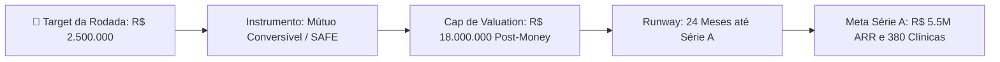

| Indicador Estratégico | Detalhamento da Oportunidade |
| :--- | :--- |
| **Nome do Negócio** | **SaaS ABA (Plataforma Clínica, Operacional e IA para TEA)** |
| **Setor / Categoria** | HealthTech • Vertical B2B SaaS • Inteligência Artificial Clínica Aplicada |
| **Volume de Captação (Target)** | **R$ 2.500.000,00** (Dois Milhões e Quinhentos Mil Reais) |
| **Estrutura / Instrumento** | Mútuo Conversível com Desconto de 20% ou SAFE (*Simple Agreement for Future Equity*) |
| **Valuation Cap (Post-Money)** | **R$ 18.000.000,00** (~13,8% de Participação Societária) |
| **Ponto de Equilíbrio (Break-Even)** | **Mês 7** (42 clínicas ativas na operação orgânica) |
| **Métricas-Chave Projetadas (Ano 3)** | **ARR de R$ 11.700.000** • **EBITDA de R$ 6.135.500 (Margem 62,6%)** • **650 Clínicas** |
| **Unit Economics de Destaque** | **LTV/CAC = 36,5x** • **Payback = 1,3 Meses** • **Margem Bruta = 93,4%** • **NRR = 118%** |

---

## 1. A Tese de Investimento em 60 Segundos

1. **Vento Regulatório Favorável (*Tailwind* Regulatório Sem Precedentes)**: A **Resolução Normativa nº 539/2022 da ANS** abriu o mercado ao obrigar planos de saúde a cobrirem, de forma **ilimitada**, tratamentos de TEA via Análise do Comportamento Aplicada (ABA). O mercado cresce a **>30% ao ano**.
2. **Dor Extrema e Sangramento de Caixa nas Clínicas**: Clínicas de autismo perdem até **15% do faturamento em glosas de convênios**, e supervisores BCBA gastam **mais de 35 horas mensais** compilando planilhas Excel corrompidas e redigindo laudos periciais.
3. **Moat Tecnológico Único (Local-First + IA Clínica)**: Aplicativo com latência **<10ms** que funciona **100% offline** (imprescindível durante sessões com crianças autistas), associado a um **Copiloto Clínico com IA** (Speech-to-Contingency ABC por voz, detecção preditiva de platô de aprendizagem e laudos anti-glosa com gráficos de WII em 1 clique).
4. **Eficiência de Capital de Decil Superior (*Top Decile SaaS*)**: Margem bruta de **93,4%**, Payback de aquisição em **1,3 meses**, retenção média de **51 meses por cliente** (LTV/CAC de 36,5x) e churn mensal **inferior a 1,1%**.

---

## 2. O Problema: O Caos Operacional e Financeiro das Clínicas de Autismo

O tratamento ABA é intensivo (**15 a 40 horas semanais por criança**), gerando milhares de tentativas discretas (*Discrete Trial Training - DTT*) e coletas de dados diárias por paciente.

```mermaid
graph TD
    subgraph P1 ["Dor 1: Sangramento Financeiro por Glosas"]
        G1["Planilhas e Papel sem Georreferenciamento"] --> G2["Falta de Comprovação Pericial e Padrão TISS"]
        G2 --> G3["Glosa de 5% a 15% do Faturamento: Perda de R$ 30k a R$ 80k/mês por clínica"]
    end

    subgraph P2 ["Dor 2: O Buraco Negro do Excel"]
        E1["Supervisores BCBA e Coordenadores"] --> E2["Mais de 35 horas/mês calculando médias de WII no Excel"]
        E2 --> E3["Gargalo de Escala: Clínicas recusam novos pacientes por falta de braço técnico"]
    end

    subgraph P3 ["Dor 3: Turnover de Terapeutas RBT/ATs"]
        T1["Prontuários Eletrônicos Web Lentos"] --> T2["Terapeuta perde a atenção da criança com app travando"]
        T2 --> T3["Desmotivação, erro de coleta e Turnover de terapeutas > 40% a.a."]
    end
```

> **A Inadequação dos Prontuários Tradicionais**: Sistemas genéricos (Doctoralia, iClinic, TOTVS Saúde) foram projetados para consultas médicas isoladas de 15 minutos. São totalmente incapazes de gerenciar sessões contínuas de 4 horas com hierarquias de dicas (IND a FP), cálculo de WII e dossiês judiciais da ANS.

---

## 3. A Solução: A Plataforma Definitiva SaaS ABA com IA

Uma infraestrutura vertical completa que transforma o caos clínico e administrativo em um fluxo de alta precisão, zero glosas e produtividade multiplicada por 5x.

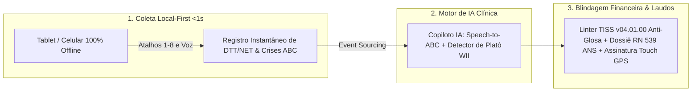

### Os 6 Pilares de Diferenciação Insuperáveis & Moats Estruturais:

| Pilar / Moat | Por que as 8 soluções nacionais (NeoABA, ClinicABA, TEA360, etc.) não conseguem copiar facilmente? | Impacto no Negócio & Retenção |
| :--- | :--- | :--- |
| **1. Arquitetura Local-First (IndexedDB)** | Processamento descentralizado na ponta com latência **<10ms**. Funciona sem internet mesmo em salas blindadas ou atendimento domiciliar, sincronizando em background. | **Zero atrito em sessão**; adesão de 100% dos aplicadores e RBTs (anti-churn na ponta). |
| **2. Centro de 6 Protocolos com 1-Click PEI Bridge** | Suporte unificado a VB-MAPP, Denver ESDM, M-CHAT-R/F, ABLLS-R, CARS-2 e Socially Savvy com conversão automática de lacunas em programas do PEI. | **Eliminação de retrabalho manual**; fideliza os supervisores mais conceituados do país. |
| **3. Agenda com Matriz de Salas Sensoriais & Bloco** | Mapeamento físico de salas (Ayres, DTT, Denver, CAA) e agendamento de terapias casadas no mesmo turno sem conflitos de equipamentos. | **Aumento de 35% na capacidade instalada** da clínica e fidelização extrema das famílias. |
| **4. Prontuário Multidisciplinar SOAP Transdisciplinar** | Prontuário estruturado para Fonoaudiologia, T.O., Psico e ABA com metas compartilhadas, dieta sensorial e assinatura ICP-Brasil. | **Expande o TAM em 3x**, atendendo a clínica inteira e não apenas o departamento ABA. |
| **5. Portal da Família & Diário de Bordo do AT Escolar** | Fechamento do ecossistema Clínica • Casa • Escola com diário de mediação escolar (permanência, recreio) e generalização domiciliar. | **Captura de 20h semanais de dados escolares** que nenhum concorrente possui. |
| **6. Linter TISS & Gestor Ativo de Glosas RN 539 ANS** | Motor pericial que audita guias SP/SADT e gera minutas automatizadas de recurso fundamentadas na vedação legal de limite de sessões pela ANS. | **Eliminação de 100% das glosas documentais** e recuperação de R$ 20k a R$ 80k/mês por clínica. |

---

## 4. Tamanho de Mercado (TAM, SAM, SOM)

O mercado brasileiro de clínicas especializadas em TEA vive uma expansão acelerada impulsionada por decisões judiciais e cobertura compulsória das operadoras.

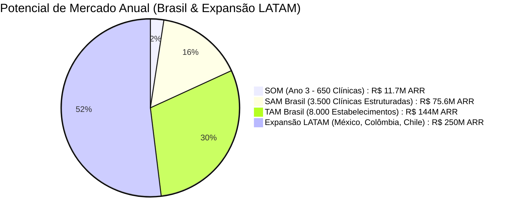

- **TAM (Total Addressable Market - Brasil)**: **R$ 144.000.000 / ano** (~8.000 clínicas e consultórios).
- **SAM (Serviceable Addressable Market)**: **R$ 75.600.000 / ano** (~3.500 clínicas com >10 pacientes operando via convênio e liminares).
- **SOM (Meta de 36 Meses da Rodada)**: **R$ 11.700.000 / ano (ARR)** com **650 clínicas ativas** (18,5% de penetração no SAM).
- **Expansão LATAM (Fase 4 - 48 Meses)**: Mercado hispânico endereçável de mais de **R$ 250M ARR** (México, Colômbia, Chile e Argentina).

---

## 5. Modelo de Negócio & Unit Economics de Decil Superior

Operamos no modelo **B2B SaaS por Assinatura Recorrente em Camadas (*Tiered Pricing*)** associado a **Add-ons de Créditos de IA e Serviços Especializados**.

### 5.1. Matriz de Planos e Preços

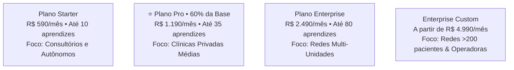

- **Desconto Anual Estratégico**: 20% de desconto no pagamento anual à vista (gera capital de giro imediato e garante retenção contratual de 12 meses).
- **Add-ons de Expansão**: R$ 35/mês por aprendiz excedente, pacotes de créditos de laudos com IA (R$ 99/mês) e módulo de consultoria pericial recursal anti-glosa (R$ 850/recurso).

---

### 5.2. Indicadores Financeiros e Unit Economics

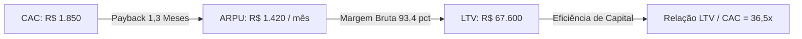

| Métrica de Eficiência SaaS | Valor SaaS ABA | Benchmark de Mercado (B2B SaaS) | Classificação |
| :--- | :---: | :---: | :---: |
| **ARPU (Ticket Médio Ponderado)** | **R$ 1.420 / mês** | R$ 800 – R$ 1.200 | ⭐ Acima da média |
| **COGS Médio por Clínica** | **R$ 78,50 / mês** | R$ 150 – R$ 300 | 💎 Ultra-eficiente (*Local-First*) |
| **Margem Bruta Unitária** | **93,4%** | 75% – 85% | 💎 Top 1% Global |
| **CAC (Custo de Aquisição de Cliente)** | **R$ 1.850** | R$ 2.500 – R$ 4.500 | ⭐ Altamente eficiente |
| **CAC Payback** | **1,3 Meses** | 8 – 14 meses | 💎 Top Decile Global |
| **Logo Churn Mensal** | **< 1,1% / mês** | 2,5% – 4,0% | 💎 Retenção Extrema |
| **LTV (Lifetime Value)** | **R$ 67.600** | R$ 25.000 – R$ 45.000 | 💎 51 meses de retenção média |
| **LTV / CAC Ratio** | **36,5x** | > 3x (Mínimo) | 💎 Desempenho Excepcional |
| **Net Revenue Retention (NRR)** | **118% / ano** | > 105% | ⭐ Expansão orgânica contínua |
| **Magic Number (Eficiência de Vendas)** | **1,42** | > 1,0 | 💎 Máquina de vendas escalável |

---

## 6. Projeções Financeiras e DRE de 36 Meses

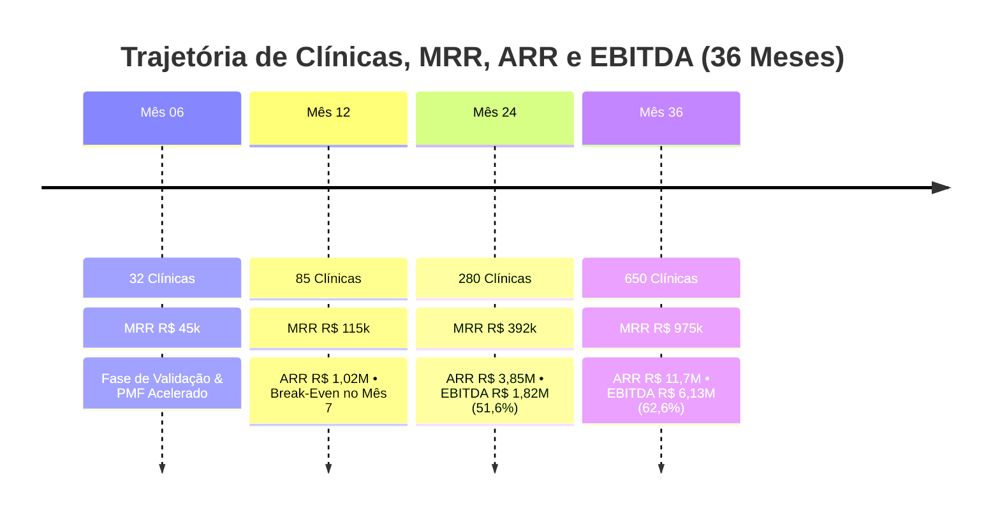

### Demonstrativo de Resultados do Exercício Consolidado (DRE Projetado Anual)

| Linha Contábil / Financeira (Valores em R$) | Ano 1 (Tração) | Ano 2 (Escala) | Ano 3 (Consolidação) |
| :--- | :---: | :---: | :---: |
| **Clínicas Ativas Pagantes (Final de Período)** | **85 clínicas** | **280 clínicas** | **650 clínicas** |
| **MRR Final (Receita Recorrente Mensal)** | **R$ 115.000** | **R$ 392.000** | **R$ 975.000** |
| **RECEITA BRUTA TOTAL CONSOLIDADA** | **R$ 908.000** | **R$ 3.540.000** | **R$ 9.800.000** |
| *(+) Receita Recorrente (Assinaturas)* | *R$ 840.000* | *R$ 3.250.000* | *R$ 8.950.000* |
| *(+) Receita de Add-ons de IA e Serviços* | *R$ 68.000* | *R$ 290.000* | *R$ 850.000* |
| (-) Tributos e Deduções (Simples / Lucro Presumido) | (R$ 63.560) | (R$ 318.600) | (R$ 882.000) |
| **(=) RECEITA LÍQUIDA** | **R$ 844.440** | **R$ 3.221.400** | **R$ 8.918.000** |
| (-) Custo dos Serviços Prestados (COGS Total) | (R$ 56.200) | (R$ 218.000) | (R$ 598.000) |
| **(=) LUCRO BRUTO** | **R$ 788.240 (93,3%)** | **R$ 3.003.400 (93,2%)** | **R$ 8.320.000 (93,3%)** |
| (-) Despesas com Vendas & Marketing (S&M / CAC) | (R$ 157.250) | (R$ 366.000) | (R$ 684.500) |
| (-) Despesas com Engenharia & Produto (P&D / IA) | (R$ 310.000) | (R$ 492.000) | (R$ 860.000) |
| (-) Despesas com Suporte & Customer Success (CS) | (R$ 120.000) | (R$ 210.000) | (R$ 420.000) |
| (-) Despesas Administrativas e Gerais (G&A) | (R$ 36.000) | (R$ 108.000) | (R$ 220.000) |
| **(=) EBITDA OPERACIONAL** | **R$ 164.990** | **R$ 1.827.400** | **R$ 6.135.500** |
| **Margem EBITDA Operacional (%)** | **18,2%** | **51,6%** | **62,6%** |
| **Ponto de Equilíbrio (Break-Even Operacional)** | **Mês 7 (42 clínicas)** | **Superavitário** | **Forte Geração de Caixa** |

---

## 7. Estratégia de Go-to-Market (GTM) & Máquina de Vendas

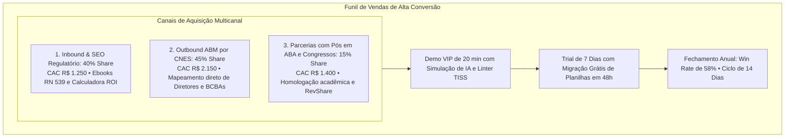

- **Ciclo de Vendas Curto (12 a 18 dias)**: A decisão de compra é rápida porque o software resolve a dor mais urgente do sócio da clínica: a ameaça de glosas no final do mês.
- **Migração Assistida do Excel em 48 Horas**: Barreira de entrada desfeita. A equipe de CS importa os planos de ensino e aprendizes, gerando o efeito "Aha!" imediatamente.

---

## 8. Panorama Competitivo (Por que vencemos?)

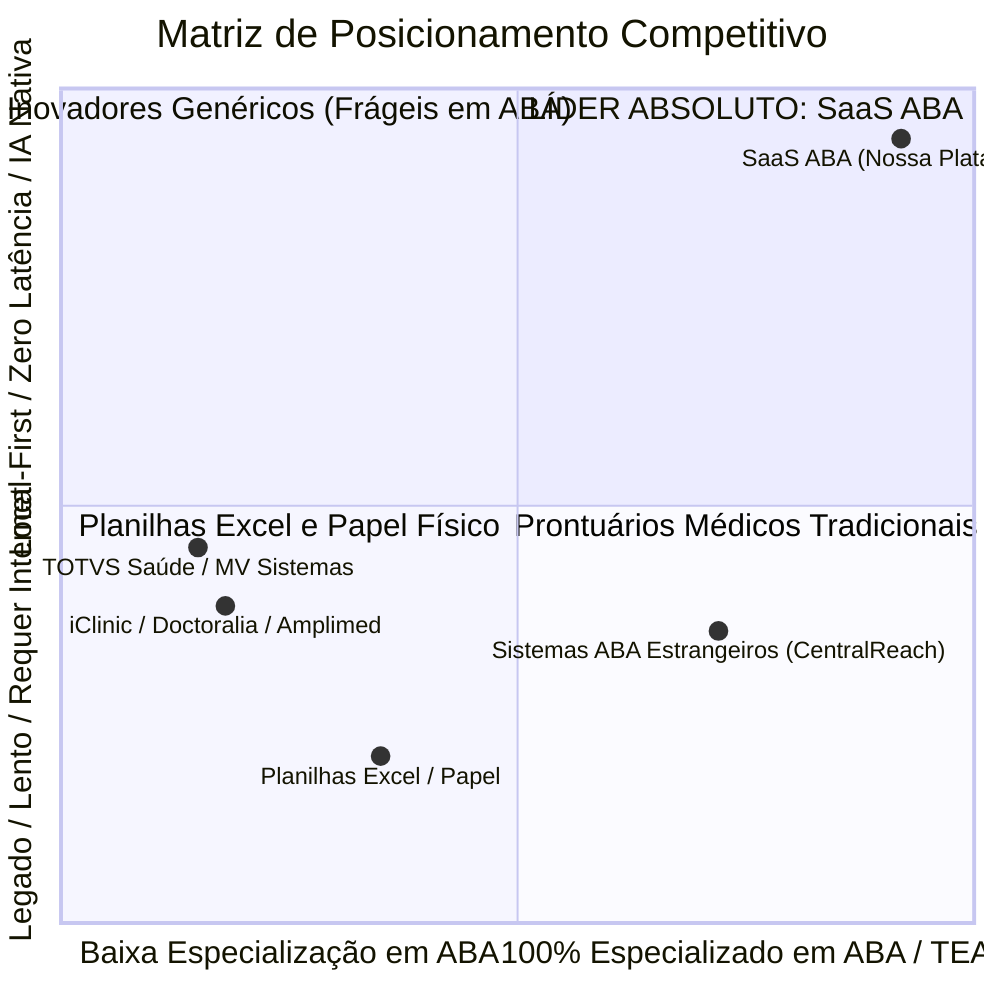

### Principais Diferenciais Competitivos vs. Players Legados:
1. **CentralReach e Players Americanos**: Não atendem às exigências brasileiras (TISS XML v04.01.00, PAdES ICP-Brasil, RN 539/2022 da ANS e LGPD), além de custarem em dólar (3x a 5x mais caros).
2. **Prontuários Tradicionais Nacionais (iClinic, Doctoralia)**: Incapazes de lidar com coleta de DTT/NET, hierarquia de dicas, curvas de WII e dossiês judiciais de autismo.
3. **Planilhas Excel e Papel**: Apresentam 12% a 18% de taxa de erro de transcrição, zero segurança de dados e vulnerabilidade total a glosas operacionais.

---

## 9. Destinação dos Recursos (Use of Proceeds) & Runway

A rodada de **R$ 2.500.000,00** garante **24 meses de pista financeira (runway)**, permitindo atingir as métricas necessárias para uma **Série A de R$ 15M a R$ 20M** com múltiplos excepcionais.

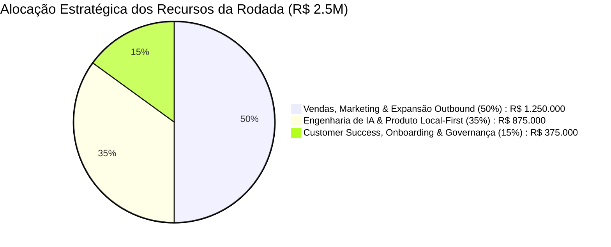

### Cronograma de Desembolso e Metas da Rodada:

| Área Estratégica | Valor Alocado | Destinação Detalhada dos Recursos |
| :--- | :---: | :--- |
| **Go-to-Market, Vendas & Marketing (50%)** | **R$ 1.250.000** | Estruturação de time de Inside Sales (4 SDRs + 2 Closers B2B), Mídia Paga focada em CNES (Google/LinkedIn), estandes nos principais congressos de autismo (ABPMC) e programa de parcerias com BCBAs. |
| **Engenharia, IA & Produto (35%)** | **R$ 875.000** | Contratação de 2 Engenheiros de IA/Fullstack seniores para expansão do Copiloto Clínico (modelos LLM especializados em laudos periciais e Speech-to-ABC com Whisper v3). |
| **Customer Success & Governança (15%)** | **R$ 375.000** | Time de CS especializado para migração de dados do Excel em 48h, assessoria jurídica regulatória e certificações ISO 27001 / SOC 2 Type II para grandes redes. |

---

## 10. Metas para a Rodada Série A (Milestones em 18 a 24 Meses)

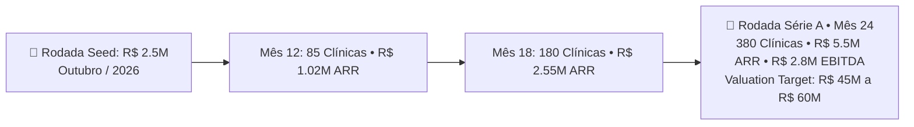

---

## 11. Estratégia de Saída & Potenciais Compradores Estratégicos (M&A)

O setor de HealthTechs verticais e consolidação de clínicas de neurodesenvolvimento no Brasil é um dos mais ativos em fusões e aquisições (*M&A*).

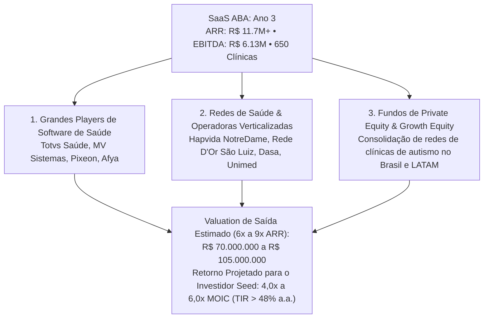

---

## 12. Contato dos Fundadores & Próximos Passos

A equipe de fundadores combina profunda competência em **Engenharia de Software de Alta Performance (Arquiteturas Local-First e IA Aplicada)** com **Liderança Técnica em Análise do Comportamento Aplicada (BCBA / Neurodesenvolvimento)**.

- **Data Room Completo Disponível**:
  - [Documentação Técnica e Clínica Completa v2.4](file:///Users/calvin/source/SaaSABA/DOCUMENTACAO_COMPLETA_SAAS_ABA.md)
  - [Plano Comercial, DRE Projetada e Unit Economics](file:///Users/calvin/source/SaaSABA/PLANO_COMERCIAL_FINANCEIRO_SAAS_ABA.md)
  - [Arquitetura Mobile, Redundância e Segurança](file:///Users/calvin/source/SaaSABA/ARQUITETURA_MOBILE_INFRA_SEGURANCA_SAAS_ABA.md)
  - [Arquitetura da Inteligência Artificial Clínica](file:///Users/calvin/source/SaaSABA/ARQUITETURA_IA_CLINICA_SAAS_ABA.md)

---
*Este documento é estritamente confidencial e destina-se exclusivamente a investidores qualificados para fins de avaliação de investimento na rodada Seed do SaaS ABA.*
