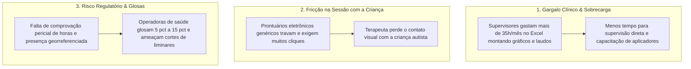
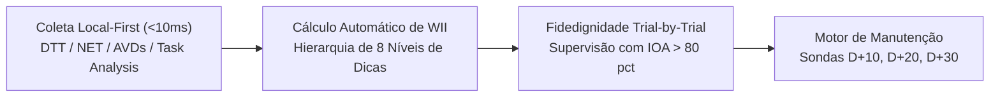
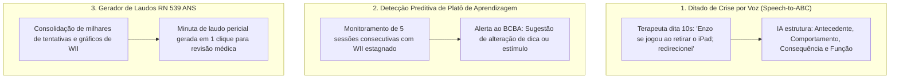

# 🧠 SaaS ABA — Dossiê de Avaliação Técnico-Científica & Parecer de Especialista

> **Documento Institucional para Avaliação Clínica, Metodológica, Regulatória e de Mercado por Médicos Psiquiatras da Infância, Neuropediatras, Psicólogos Comportamentais (BCBA/QBA), Fonoaudiólogos, Terapeutas Ocupacionais e Especialistas em TEA**  
> *Versão 2.4 Enterprise — Outubro / 2026*

---

## 1. Carta de Apresentação ao Especialista

**Prezado(a) Colega Especialista,**

Convidamos você a avaliar a plataforma **SaaS ABA**, uma infraestrutura tecnológica desenvolvida para estruturar, acelerar e proteger a prática da **Análise do Comportamento Aplicada (ABA)** e intervenções intensivas no **Transtorno do Espectro Autista (TEA)** e atrasos no neurodesenvolvimento.

Como médico(a) ou psicólogo(a) que prescreve, supervisiona ou acompanha pacientes em intervenção precoce e intensiva, sua visão clínica, ética e mercadológica é de fundamental importância para validar:
1. **O Rigor Científico e Metodológico** dos módulos de DTT, NET, cálculo de independência (WII), controle de dicas, inventários padronizados (VB-MAPP, Denver ESDM, M-CHAT-R/F, ABLLS-R, CARS-2 e Socially Savvy com 1-Click PEI Bridge), agenda com salas sensoriais de Ayres e prontuário multidisciplinar SOAP (Fono, T.O., Psico e ABA).
2. **A Eficácia dos Laudos Evolutivos e Dossiês Judiciais** para manutenção de carga horária intensiva frente a convênios e juizados (conforme a **RN 539/2022 da ANS**).
3. **A Ética, Segurança e Limites da Inteligência Artificial Clínica** (*Speech-to-Contingency ABC*, detecção de platôs de aprendizagem e anonimização LGPD).
4. **A Usabilidade pelos Aplicadores (RBTs/ATs) e o Impacto no Engajamento da Família**.

---

## 2. A Dor no Ecossistema Clínico Atual (O Diagnóstico da Realidade)

---

## 3. Arquitetura Metodológica Baseada em Evidências (PBE)

O SaaS ABA foi desenhado em estrita conformidade com as diretrizes do **BACB (Behavior Analyst Certification Board)** e as melhores práticas internacionais:

### 3.1. Hierarquia de Dicas e o Índice Ponderado de Independência (WII)
Ao contrário de softwares genéricos que registram apenas "Acerto / Erro" (visão dicotômica perigosa que esconde o desvanecimento de ajuda), o SaaS ABA implementa o **WII (*Weighted Independence Index*)** em 8 níveis:

$$\text{WII} = \frac{\sum (N_i \times P_i)}{N_{\text{total}}}$$

| Código | Nível de Dica / Ajuda | Peso Estatístico ($P_i$) | Significado Clínico no Neurodesenvolvimento |
| :---: | :--- | :---: | :--- |
| **`IND`** | **Independente (+)** | **1.0** (100%) | Emissão espontânea sem dica, latência < 3s. |
| **`GP`** | **Ajuda Gestual** | **0.8** (80%) | Apontar, olhar direcionado ou gesticular em direção ao estímulo. |
| **`VP`** | **Ajuda Verbal** | **0.6** (60%) | Dica vocal direta, instrução oral repetida ou fonema inicial. |
| **`MP`** | **Dica de Modelo** | **0.5** (50%) | Demonstração da ação para imitação motora ou vocal imediata. |
| **`POS`** | **Dica Posicional** | **0.4** (40%) | Realce espacial ou aproximação do estímulo correto. |
| **`PP`** | **Físico Parcial** | **0.3** (30%) | Guia física leve no antebraço ou cotovelo. |
| **`FP`** | **Físico Total** | **0.1** (10%) | Condução motora mão-sobre-mão integral. |
| **`INC`** | **Incorreto / Sem Resposta (-)** | **0.0** (0%) | Dispara procedimento de correção de erro imediato. |

---

## 4. Inovação: Inteligência Artificial Clínica Ética (*Human-in-the-Loop*)

### 4.1. Segurança, Sigilo Profissional e Conformidade LGPD:
- **Zero Treinamento com Dados de Pacientes**: Acordo corporativo com retenção zero de dados em provedores de LLM.
- **Anonimização Prévia de PII**: Nomes, CPFs, laudos anteriores e contatos dos responsáveis são mascarados com tokens anônimos antes de qualquer chamada de IA.
- **Revisão Humana Obrigatória (*Human-in-the-Loop*)**: Nenhuma prescrição de PEI ou laudo evolutivo é emitido sem a leitura, edição e assinatura digital do profissional responsável (CRP, CRM, CRFa ou CREFITO).

---

## 5. Dossiê de Prestação de Contas & Blindagem Judicial (RN 539 da ANS)

As operadoras e peritos judiciais exigem comprovação detalhada da eficácia do tratamento para manter o custeio:
1. **Comprovação de Presença Inquestionável**: Assinatura touch dos pais na tela do tablet ao término da sessão, com **registro de geolocalização por GPS** e carimbo de tempo imutável.
2. **Gráficos Longitudinalmente Integrados**: Curvas de linha de base, aquisição cumulativa e desvanecimento de dicas renderizados diretamente dentro do laudo PDF assinado via **PAdES / ICP-Brasil / GOV.BR**.
3. **Linter TISS XML v04.01.00**: Validação prévia de guias SP/SADT, evitando glosas por divergência de conselho profissional ou carga horária.

---

## 6. Formulário Abrangente de Avaliação e Parecer do Especialista

Solicitamos sua avaliação técnica e clínica detalhada nas dimensões abaixo (Escala de 1 a 5, onde **1 = Inadequado / Baixo**, **3 = Regular / Suficiente** e **5 = Excelente / Padrão-Ouro**):

---

### Bloco A: Rigor Clínico, Psicométrico e Metodológico em ABA
*Como você avalia a robustez científica e metodológica da plataforma?*

| Critério Avaliado | Nota (1 a 5) | Comentários / Sugestões do Especialista |
| :--- | :---: | :--- |
| **1. Relevância do WII em 8 Níveis** (captura precisa do desvanecimento de ajuda vs. acerto/erro binário) | `[ 1 2 3 4 5 ]` | |
| **2. Coleta em <1s e modo 100% offline no tablet** (zero telas de loading para manter foco na criança) | `[ 1 2 3 4 5 ]` | |
| **3. Protocolo de Supervisão com IOA Trial-by-Trial** (fidedignidade entre supervisor e aplicador) | `[ 1 2 3 4 5 ]` | |
| **4. Esteira de Manutenção e Generalização Pós-Domínio** (sondas D+7, D+14, D+30 e D+90) | `[ 1 2 3 4 5 ]` | |
| **5. Suporte aos Protocolos Padronizados** (VB-MAPP, ABLLS-R, AFLS, Modelo Denver/ESDM e AVDs) | `[ 1 2 3 4 5 ]` | |
| **6. Monitoramento de Comportamentos Desafiadores** (frequência, duração, latência e análise funcional ABC) | `[ 1 2 3 4 5 ]` | |

---

### Bloco B: Inteligência Artificial Clínica, Ética e Tomada de Decisão
*Como você avalia a utilidade, os guardrails éticos e a segurança da IA aplicada?*

| Critério Avaliado | Nota (1 a 5) | Comentários / Sugestões do Especialista |
| :--- | :---: | :--- |
| **7. Ditado de Crises ABC por Voz (*Speech-to-Contingency*)** (redução de viés de memória no final do turno) | `[ 1 2 3 4 5 ]` | |
| **8. Detecção Preditiva de Platô de Aprendizagem** (alerta precoce de estagnação de alvos do PEI) | `[ 1 2 3 4 5 ]` | |
| **9. Sugestão Inteligente de Desvanecimento de Ajuda** (recomendações de transição de dicas baseadas em dados) | `[ 1 2 3 4 5 ]` | |
| **10. Governança Ética e Revisão Humana Obrigatória** (*Human-in-the-Loop* antes de qualquer emissão) | `[ 1 2 3 4 5 ]` | |
| **11. Anonimização de Dados Sensíveis e LGPD** (mascaramento de PII e retenção zero em modelos LLM) | `[ 1 2 3 4 5 ]` | |
| **12. Assistente de Treino Parental com IA** (tradução de termos técnicos para linguagem acolhedora aos pais) | `[ 1 2 3 4 5 ]` | |

---

### Bloco C: Laudos Periciais, Regulação ANS (RN 539) e Integração Multidisciplinar
*Como você avalia o impacto dos relatórios para justificar a manutenção da conduta médica e terapêutica?*

| Critério Avaliado | Nota (1 a 5) | Comentários / Sugestões do Especialista |
| :--- | :---: | :--- |
| **13. Qualidade Pericial dos Laudos para a RN 539/2022 ANS** (gráficos embutidos de WII e linhas de base) | `[ 1 2 3 4 5 ]` | |
| **14. Eficácia do Dossiê para Juízes e Peritos Judiciais** (sustentação inequívoca de liminares e reembolsos) | `[ 1 2 3 4 5 ]` | |
| **15. Escudo Anti-Glosa de Assiduidade** (assinatura touch dos responsáveis com carimbo de GPS e data/hora) | `[ 1 2 3 4 5 ]` | |
| **16. Linter Pré-Envio de XML TISS v04.01.00** (prevenção de inconsistências de conselho e código TUSS) | `[ 1 2 3 4 5 ]` | |
| **17. Integração Multidisciplinar no Mesmo Prontuário** (Psicologia, Fonoaudiologia, T.O. e Psicomotricidade) | `[ 1 2 3 4 5 ]` | |

---

### Bloco D: Usabilidade na Ponta e Redução de Turnover de Terapeutas (RBTs/ATs)
*Como você avalia o impacto ergonômico e operacional no dia a dia da equipe clínica?*

| Critério Avaliado | Nota (1 a 5) | Comentários / Sugestões do Especialista |
| :--- | :---: | :--- |
| **18. Card de Boas-Vindas da Sessão (*Quick Briefing*)** (resumo de reforçadores e gatilhos sensoriais em 3s) | `[ 1 2 3 4 5 ]` | |
| **19. Atalhos Táteis e Teclado 1 a 8** (coleta sem desviar a atenção visual da criança) | `[ 1 2 3 4 5 ]` | |
| **20. Curva de Aprendizado para Estagiários e Novos ATs** (facilidade de treinamento e onboarding) | `[ 1 2 3 4 5 ]` | |
| **21. Redução da Sobrecarga Administrativa dos Terapeutas** (eliminação de horas extras preenchendo fichas) | `[ 1 2 3 4 5 ]` | |

---

### Bloco E: Engajamento Familiar, Treino Parental e Inclusão Escolar
*Como você avalia as pontes criadas entre clínica, família e escola?*

| Critério Avaliado | Nota (1 a 5) | Comentários / Sugestões do Especialista |
| :--- | :---: | :--- |
| **22. Portal dos Pais com WhatsApp OTP** (transparência da evolução e celebração de marcos semanais) | `[ 1 2 3 4 5 ]` | |
| **23. Registro de Generalização no Ambiente Doméstico** (família alimentando mandos e habilidades em casa) | `[ 1 2 3 4 5 ]` | |
| **24. Módulo de Acompanhante Terapêutico Escolar (AT Escolar)** (mediação e barreiras sensoriais na escola) | `[ 1 2 3 4 5 ]` | |

---

## 7. Questões Estratégicas e Parecer Qualitativo do Especialista

**1. Comparativo Clínico**: Na sua prática como médico ou supervisor, como os relatórios estruturados do SaaS ABA se comparam aos laudos e relatórios que você costuma receber de clínicas (frequentemente em Word/PDF manual ou planilhas Excel)?  
`[ Resposta livre: ]`

---

**2. Escalas e Protocolos Adicionais**: Quais escalas diagnósticas, comportamentais ou farmacológicas você considera que deveriam ter integração nativa no SaaS ABA (ex: M-CHAT-R/F, CARS-2, PEP-3, Vineland-3, Escala SRS-2 ou monitoramento de efeitos adversos psicofarmacológicos)?  
`[ Resposta livre: ]`

---

**3. O Maior Gargalo do Setor**: Em sua opinião, qual é hoje o principal obstáculo para que clínicas de TEA mantenham a qualidade técnica em alta escala (ex: escassez de supervisores BCBA, falta de dados confiáveis, alta rotatividade de aplicadores ou pressão financeira de operadoras)?  
`[ Resposta livre: ]`

---

**4. Recomendação Profissional**: Você indicaria a homologação e o uso do SaaS ABA para clínicas de sua rede de encaminhamento ou para profissionais supervisionados por você?  
- `( ) Sim, recomendação prioritária e irrestrita`  
- `( ) Sim, com sugestões de pequenas melhorias pontuais`  
- `( ) Apenas para clínicas de grande porte`  
- `( ) Não recomendo no momento`  
*Justificativa:* `__________________________________________________________________`

---

**5. Conselho Consultivo Científico (*Clinical Advisory Board*)**: Você teria interesse em participar do Conselho Científico Consultivo do SaaS ABA, contribuindo com discussões semestrais sobre inovação, ética e protocolos clínicos de neurodesenvolvimento?  
- `( ) Sim, tenho interesse em participar`  
- `( ) Talvez, mediante alinhamento futuro de agenda`  
- `( ) No momento não tenho disponibilidade`

---

## 8. Identificação e Assinatura do Especialista Parecerista

- **Nome Completo**: `_________________________________________________________________________`
- **Titulação Acadêmica**: `( ) Especialista  ( ) Mestre  ( ) Doutor  ( ) Pós-Doutor`
- **Área Principal de Atuação**:  
  - `( ) Psiquiatria da Infância e Adolescência`  
  - `( ) Neuropediatria / Neurologia Infantil`  
  - `( ) Psicologia Comportamental / Análise do Comportamento (BCBA / QBA / Especialista)`  
  - `( ) Fonoaudiologia Neurofuncional / Comunicação Alternativa (PECS)`  
  - `( ) Terapia Ocupacional / Integração Sensorial de Ayres`  
  - `( ) Diretor(a) Clínico(a) / Gestor(a) de Centro de Neurodesenvolvimento`
- **Registro Profissional (CRM / CRP / CRFa / CREFITO)**: `________________________________________`
- **Instituição / Clínica / Hospital Principal**: `________________________________________________`
- **E-mail de Contato / WhatsApp**: `____________________________________________________________`
- **Data da Emissão do Parecer**: `_____ / _____ / 2026`
- **Assinatura / Parecer Digital**: `______________________________________________________________`

---
*Agradecemos profundamente seu tempo, conhecimento e compromisso ético com a excelência clínica e a transformação da vida de milhares de crianças e famílias no Brasil.*
