# 📊 SaaS ABA — Plano Comercial, Financeiro, Unit Economics & Projeção de Crescimento (v2.4 Enterprise)

> **Documento Institucional e Estratégico de Viabilidade Econômico-Financeira, Modelo de Precificação em Camadas com Módulos de IA, Análise de COGS/OPEX, DRE Projetada de 36 Meses, Unit Economics por Canal e Tese de Go-to-Market (GTM)**

---

## 1. Sumário Executivo & Tese de Investimento

### 1.1. Contexto Macroeconômico e Fator Regulatório (O "Gatilho ANS")
O mercado de intervenção em **Transtorno do Espectro Autista (TEA)** e atrasos de neurodesenvolvimento vive uma aceleração histórica sem precedentes no Brasil:
1. **Aumento de Prevalência Diagnóstica**: A prevalência estimada atingiu **1 a cada 36 crianças** (dados CDC / OMS), totalizando uma população de mais de **2,5 a 4 milhões de pessoas com TEA no Brasil**.
2. **Marco Regulatório da RN 539/2022 da ANS**: A Resolução Normativa nº 539/2022 tornou obrigatória e **ilimitada** a cobertura de qualquer técnica indicada pelo médico assistente, consolidando a **Análise do Comportamento Aplicada (ABA)** como o tratamento intensivo padrão-ouro financiado por operadoras de saúde (Unimed, Bradesco Saúde, Amil, SulAmérica, NotreDame Intermédica) e liminares judiciais.
3. **Carga Horária Intensiva**: Os protocolos prescrevem entre **15 e 40 horas semanais** por aprendiz, mobilizando equipes multidisciplinares extensas (BCBAs, Psicólogos, Fonoaudiólogos, Terapeutas Ocupacionais, Psicomotricistas e centenas de estagiários/ATs por clínica).
4. **Vulnerabilidade Operacional e Glosas**: As clínicas operam sob risco contínuo de glosas administrativas (5% a 15% do faturamento) por falta de comprovação de presença georreferenciada, inconsistência no padrão TISS XML v04.01.00 e ausência de laudos evolutivos parametrizados por dados de WII (*Weighted Independence Index*).

---

### 1.2. A Assimetria de Valor B2B (O Moat Econômico)

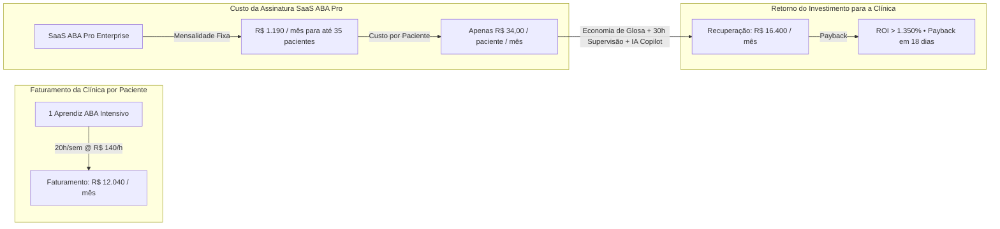

- **Custo Irrisório vs. Valor Crítico**: A assinatura do SaaS ABA Pro representa **menos de 0,28% do faturamento médio** de uma clínica com 35 aprendizes (faturamento de R$ 420.000/mês).
- **Proteção do Faturamento**: O SaaS ABA elimina **100% das glosas de presença** (via assinatura touch com georreferenciamento e validação de guias TISS SP/SADT antes da exportação) e economiza **mais de 30 horas mensais de supervisão BCBA** através do Copiloto Clínico com IA.
- **Retenção Extrema (Churn Mensal < 1,1%)**: Altíssimo custo de substituição (*switching cost*). O histórico longitudinal de PEI, séries temporais de WII, linhas de base comportamentais e registros periciais de auditoria residem no ecossistema da plataforma.

---

## 2. Dimensionamento de Mercado (TAM, SAM, SOM Brasil & LATAM)

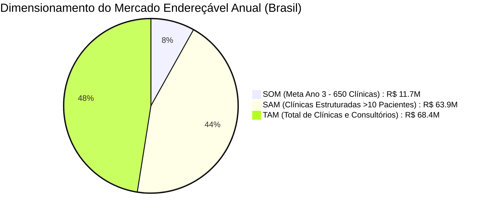

### 2.1. Métricas de Mercado no Brasil

| Métrica de Mercado | Universo Mapeado | Racional de Cálculo | Potencial Financeiro Anual (ARR) |
| :--- | :---: | :--- | :---: |
| **TAM (Total Addressable Market - Brasil)** | ~8.000 Estabelecimentos | 8.000 clínicas e consultórios ABA/TEA × Ticket Médio Ponderado de R$ 1.500/mês × 12 meses | **R$ 144.000.000 / ano** |
| **SAM (Serviceable Addressable Market)** | ~3.500 Clínicas Estruturadas | Clínicas com >10 pacientes operando via convênio, reembolso assistido ou liminar × R$ 1.800/mês × 12 meses | **R$ 75.600.000 / ano** |
| **SOM (Serviceable Obtainable Market - 36 Meses)** | **650 Clínicas Ativas** | **18,5% de penetração no SAM** em 3 anos × R$ 1.500 ARPU base (+ Add-ons IA) × 12 meses | **R$ 11.700.000 / ano (ARR)** |
| **Potencial de Expansão LATAM (Fase 4 - 48 Meses)** | ~18.000 Clínicas | Expansão para México, Colômbia, Chile e Argentina (mercados hispânicos em forte transição para ABA) | **+ R$ 250.000.000 / ano** |

---

## 3. Personas, ICPs (Ideal Customer Profiles) e Comitê de Compra

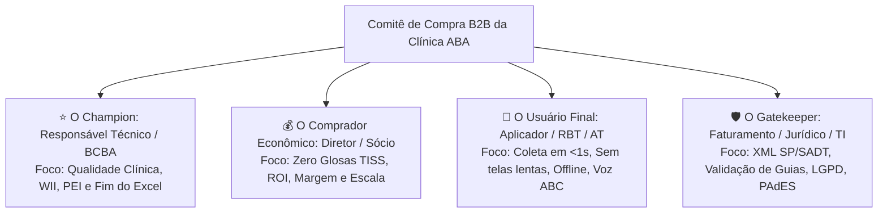

### 3.1. Matriz de Segmentação e Abordagem Comercial

| Segmento | Porte Clínico | Decisor Econômico | Principal Dor | Proposta de Valor Vencedora | Plano Indicado |
| :--- | :--- | :--- | :--- | :--- | :--- |
| **Clínicas Privadas Especializadas (ICP Primário - 55%)** | 15 a 60 aprendizes | Sócio Diretor / BCBA Titular | Glosas de operadoras e 35h/mês gastas em relatórios e laudos manuais | Linter TISS + Laudos em 1 clique + Coleta em <1s + Copiloto IA | **Plano Pro (R$ 1.190/mês)** |
| **Redes de Clínicas & Franquias (25%)** | 70 a 500+ aprendizes (Multi-unidades) | CEO / CFO / Diretor de Operações | Falta de padronização clínica e risco de auditoria fiscal/TISS em escala | Painel Consolidado Multi-Unidades + Assinatura PAdES em Lote + API REST | **Plano Enterprise (R$ 2.490/mês)** |
| **Consultórios e Terapeutas Autônomos (15%)** | 3 a 12 aprendizes | Psicólogo / Fonoaudiólogo titular | Perda de tempo no Excel e desorganização de pastas e folhas | Coletor Local-First + Curvas de WII automáticas + Protocolos VB-MAPP | **Plano Starter (R$ 590/mês)** |
| **Operadoras Verticalizadas & APAEs (5%)** | 50 a 300 aprendizes | Gerente de Credenciamento e Sinistralidade | Prestação de contas judicial (RN 539) e comprovação pericial de horas | Dossiê Judicial Imutável com Assinatura Touch, GPS e Auditoria Criptográfica | **Enterprise Custom Anual** |

---

## 4. Estratégia de Precificação, Embalagem (Packaging) e Tiers

Adotamos a precificação **Tiered Pricing (Baseada em Camadas por Valor e Volume)**, associada a **Add-ons de IA por consumo e capacidade**, maximizando a expansão da receita (*Expansion MRR*) à medida que a clínica cresce em número de aprendizes e terapeutas.

### 4.1. Matriz Completa de Planos de Assinatura

| Recurso / Funcionalidade | Plano Starter | Plano Pro *(Mais Escolhido - 60% Base)* | Plano Enterprise *(Redes & Franquias)* | Enterprise Custom / Whitelabel |
| :--- | :---: | :---: | :---: | :---: |
| **Capacidade de Aprendizes Ativos** | **Até 10 aprendizes** | **Até 35 aprendizes** | **Até 80 aprendizes** | **Ilimitado (Sob consulta)** |
| **Mensalidade (Faturamento Mensal)** | **R$ 590 / mês** | **R$ 1.190 / mês** | **R$ 2.490 / mês** | **A partir de R$ 4.990 / mês** |
| **Mensalidade (Faturamento Anual - 20% OFF)** | **R$ 472 / mês** *(R$ 5.664/ano)* | **R$ 952 / mês** *(R$ 11.424/ano)* | **R$ 1.992 / mês** *(R$ 23.904/ano)* | **Sob Medida Anual** |
| **Aprendiz Adicional Excedente** | R$ 45 / aprendiz / mês | R$ 35 / aprendiz / mês | R$ 28 / aprendiz / mês | Volume negociado (< R$ 20) |
| **Coleta DTT / NET Local-First (100% Offline)** | Ilimitado | Ilimitado | Ilimitado | Ilimitado |
| **Hierarquia de Dicas (IND a FP) + Atalhos 1-8** | Sim | Sim | Sim | Sim |
| **Índice Ponderado de Independência (WII)** | Sim | Sim | Sim | Sim |
| **Laudos em PDF com Gráficos Embutidos** | Sim | Sim | Sim | Sim |
| **Assinatura Touch dos Pais no Tablet (GPS)** | Sim | Sim | Sim | Sim |
| **Linter Pré-Envio de XML TISS v04.01.00** | ❌ | **Sim (Anti-Glosa)** | **Sim (Anti-Glosa)** | **Sim (Anti-Glosa)** |
| **Dossiê Judicial Conforme RN 539/2022 ANS** | ❌ | **Sim** | **Sim** | **Sim** |
| **Ditado por Voz com IA (Speech-to-ABC)** | 10 eventos / mês | **150 eventos / mês** | **500 eventos / mês** | **Ilimitado** |
| **Copiloto Clínico BCBA com IA (Platô & WII)** | ❌ | **Sim (Preditivo Semanal)** | **Sim (Preditivo Diário)** | **Sim + Modelos Custom** |
| **Gerador de Laudos RN 539 com IA** | 3 laudos / mês | **35 laudos / mês** | **100 laudos / mês** | **Ilimitado** |
| **Prescritor de PEI VB-MAPP / ABLLS-R com IA** | ❌ | **Sim** | **Sim** | **Sim** |
| **Quick Briefing de Turno para RBT/ATs** | ❌ | **Sim** | **Sim** | **Sim** |
| **Fidedignidade Trial-by-Trial IOA (Supervisão)** | ❌ | **Sim** | **Sim** | **Sim** |
| **Portal dos Pais com WhatsApp OTP & IA** | ❌ | **Sim** | **Sim** | **Sim (Whitelabel)** |
| **Multi-Unidades & Painel Consolidado de Filiais** | ❌ | ❌ | **Sim** | **Sim** |
| **Assinatura Digital PAdES / ICP-Brasil em Lote** | ❌ | ❌ | **Sim** | **Sim** |
| **API REST / Webhooks para ERP e Faturamento** | ❌ | ❌ | **Sim** | **Sim (Dedicated Gateway)** |
| **Banco de Dados Dedicado & Single-Tenant Isolado**| ❌ | ❌ | Opcional (+ R$ 800) | **Incluso** |
| **Nível de Suporte & Onboarding** | WhatsApp Comercial | Treinamento VIP Equipe | Gerente de Contas (CSM) + SLA 1h | Suporte 24/7 com CSM Dedicado |

---

### 4.2. Linhas de Receita Não-Recorrentes e Upsell (Add-ons de IA e Serviços)

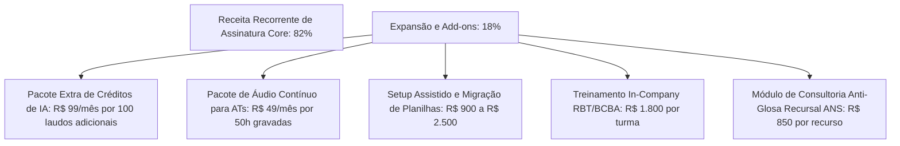

1. **Pacote de Aprendizes Excedentes**: R$ 35,00 / mês por aprendiz adicional no plano Pro e R$ 28,00 no Enterprise.
2. **Pacote Extra de Créditos de IA (Tokens & Laudos)**:
   - *Pack 50 Laudos RN 539 Adicionais*: R$ 69,00 / mês.
   - *Pack 150 Laudos RN 539 Adicionais*: R$ 149,00 / mês.
   - *Ditado por Voz Speech-to-ABC Ilimitado*: R$ 79,00 / mês por clínica.
3. **Setup Assistido e Migração de Planilhas Antigas**:
   - *Planos Anuais*: Gratuito (incentivo para fechamento anual à vista).
   - *Planos Mensais*: R$ 900,00 (taxa única para sanitização e importação de histórico de até 35 pacientes).
4. **Treinamento In-Company e Certificação de Equipe RBT**: R$ 1.800,00 por turma de até 15 aplicadores com emissão de certificado digital.
5. **Módulo de Consultoria Anti-Glosa Recursal (Defesa Técnica de Glosas ANS)**: R$ 850,00 por recurso protocolado com dossiê pericial gerado pelo sistema.

---

## 5. Estrutura de Custos Operacionais (COGS e OPEX Detalhados)

A arquitetura **Local-First (IndexedDB / Dexie.js)** descentraliza a computação gráfica, as curvas de WII e o processamento de DTT para os dispositivos dos usuários, mantendo os servidores focados em sincronização de eventos (Event Sourcing) e chamadas assíncronas de IA. Isso assegura uma margem bruta sustentável superior a **93%**.

### 5.1. Custo dos Bens Vendidos (COGS Unitário Médio por Clínica/Mês)

*Cálculo baseado no Plano Pro (35 aprendizes ativos, 15 terapeutas, ~250 sessões/mês):*

| Componente de Custo Direto | Provedor / Tecnologia | Custo Unitário Médio | Custo / Clínica / Mês | % do COGS |
| :--- | :--- | :--- | :---: | :---: |
| **Infraestrutura Cloud & PostgreSQL Multi-AZ** | AWS RDS sa-east-1 / Fly.io / S3 | Servidor escalável compartilhado Multi-AZ | **R$ 22,00** | 28,0% |
| **Mensageria WhatsApp OTP (Portal dos Pais)** | Meta Cloud API / Z-API | R$ 0,08 por disparo OTP (média 200 disparos) | **R$ 16,00** | 20,4% |
| **Motor de IA Clínica (Whisper + Claude LLMs)** | OpenAI Whisper v3 + Claude 3.5 Haiku | R$ 0,05 por áudio ABC / R$ 0,18 por laudo RN 539 | **R$ 13,50** | 17,2% |
| **Emissão de Certificado e PAdES QR Code** | API de Carimbo do Tempo / ICP-Brasil | R$ 0,15 por laudo com carimbo digital | **R$ 4,50** | 5,7% |
| **Gateway de Pagamento / Cobrança Recorrente** | Asaas / Stripe / Iugu | 1,89% sobre o faturamento médio | **R$ 22,50** | 28,7% |
| **TOTAL COGS MÉDIO POR CLÍNICA** | — | — | **R$ 78,50 / mês** | **100,0%** |
| **Margem Bruta Unitária** | Ticket Médio R$ 1.190 - COGS R$ 78,50 | — | **93,4%** | — |

---

### 5.2. Despesas Operacionais (OPEX) por Fase de Escala

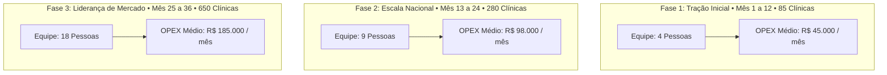

#### Composição Detalhada do OPEX por Fase:

1. **Fase 1 (Mês 1 a 12 — Tração Inicial / 85 Clínicas — OPEX: R$ 45.000/mês)**:
   - 1 Founder / Tech Lead Fullstack (R$ 12k)
   - 1 Desenvolvedor Fullstack Sênior (R$ 12k)
   - 1 Especialista Clínico BCBA / CS Lead (R$ 8k)
   - 1 SDR / Closer Comercial B2B (R$ 6k + comissões)
   - Ferramentas SaaS, Contabilidade e Mídia Paga Inicial (R$ 7k)

2. **Fase 2 (Mês 13 a 24 — Escala Nacional / 280 Clínicas — OPEX: R$ 98.000/mês)**:
   - **Engenharia e Produto (4 pessoas)**: 1 Tech Lead (R$ 15k), 2 Fullstack Devs (R$ 18k), 1 Product Designer/QA (R$ 8k) = **R$ 41.000 / mês**.
   - **Customer Success & Suporte Clínico (3 pessoas)**: 1 Coordenador BCBA de CS (R$ 8.5k), 2 Analistas de Suporte/Onboarding (R$ 9k) = **R$ 17.500 / mês**.
   - **Vendas & Marketing (Inside Sales)**: 1 Account Executive Closer (R$ 9k + bônus), 2 SDRs Outbound (R$ 7.5k), Mídia Paga Google Ads/Meta/LinkedIn (R$ 14k) = **R$ 30.500 / mês**.
   - **G&A (Gerais e Administrativos)**: Contabilidade, assessoria jurídica regulatória e softwares internos = **R$ 9.000 / mês**.

3. **Fase 3 (Mês 25 a 36 — Consolidação e Liderança / 650 Clínicas — OPEX: R$ 185.000/mês)**:
   - Equipe expandida para 18 profissionais (Engenharia de IA, CS especializado por região, time de vendas estruturado com Inside Sales + Field Sales para Redes Enterprise, Jurídico interno e Operações).

---

## 6. Unit Economics & Indicadores Chave de Eficiência SaaS

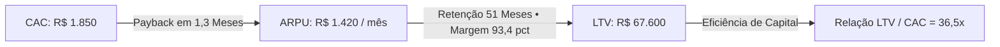

| Métrica de Eficiência SaaS | Valor Projetado | Benchmark de Excelência SaaS B2B | Diagnóstico Estratégico |
| :--- | :---: | :---: | :--- |
| **ARPU (Ticket Médio Ponderado)** | **R$ 1.420 / mês** | R$ 800 – R$ 1.200 | Mix equilibrado: 20% Starter, 60% Pro, 20% Enterprise + Add-ons. |
| **CAC (Custo de Aquisição de Cliente)** | **R$ 1.850** | R$ 2.500 – R$ 4.500 | Alta eficiência via Inside Sales, Outbound direcionado por CNES e parcerias BCBA. |
| **CAC Payback (Tempo de Retorno)** | **1,3 Meses** | < 12 meses | Recuperação integral dos custos de aquisição logo no 2º mês de uso. |
| **Gross Logo Churn Mensal** | **< 1,1% / mês** | 2% – 4% | Retenção extraordinária decorrente da dependência de prontuários periciais e dados de WII. |
| **Net Revenue Retention (NRR)** | **118% / ano** | > 110% | Crescimento orgânico das clínicas ativas (novos aprendizes contratados geram upsell contínuo). |
| **Lifetime Médio do Cliente** | **51 Meses** | 24 – 36 meses | Crianças em tratamento ABA permanecem em média 3 a 5 anos na clínica. |
| **LTV (Lifetime Value)** | **R$ 67.600** | R$ 25.000 – R$ 45.000 | LTV = ARPU (R$ 1.420) × Margem Bruta (93,4%) × 51 meses. |
| **Relação LTV / CAC** | **36,5x** | > 3x (Mínimo de mercado) | Desempenho no decil superior global de eficiência em SaaS B2B Vertical. |
| **Magic Number (Eficiência de Vendas)** | **1,42** | > 1,0 (Excelente) | Cada R$ 1,00 investido em S&M gera R$ 1,42 de novo ARR recorrente. |
| **Rule of 40 (Crescimento + Margem EBITDA)** | **> 78%** | > 40% | Negócio com alta taxa de expansão e expressiva geração de caixa operacional. |

---

### 6.1. Detalhamento do CAC e Conversão por Canal de Go-to-Market

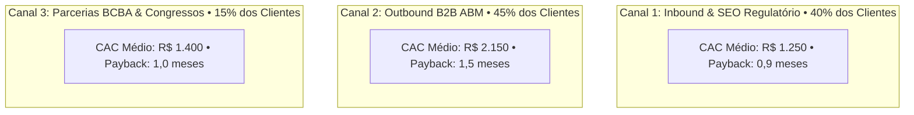

| Canal de Aquisição | Share de Vendas | CAC Unitário | Ciclo de Venda | Taxa de Conversão (Demo ➔ Fechamento) |
| :--- | :---: | :---: | :---: | :---: |
| **Inbound & Conteúdo Regulatório (RN 539 / TISS)** | 40% | R$ 1.250 | 10 a 14 dias | 62% |
| **Outbound ABM (Diretores de Clínicas / CNES)** | 45% | R$ 2.150 | 14 a 21 dias | 54% |
| **Parcerias com BCBAs, Pós-Graduações e Congressos** | 15% | R$ 1.400 | 7 a 12 dias | 68% |
| **MÉDIA PONDERADA TOTAL** | **100%** | **R$ 1.850** | **14 dias** | **58%** |

---

## 7. Projeção Financeira e DRE Projetada de 36 Meses

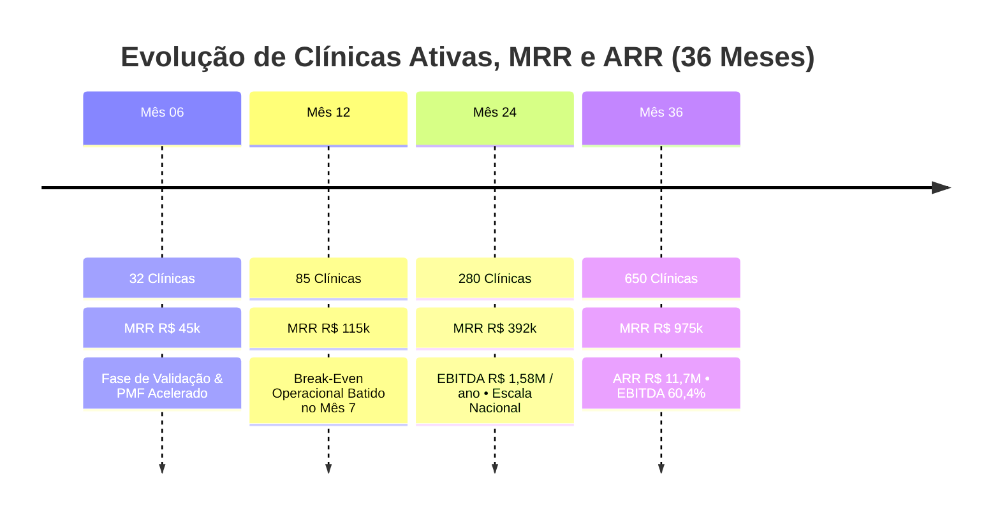

### 7.1. Demonstrativo de Resultados do Exercício (DRE Anual Detalhado)

| Linha do DRE (Valores em R$) | Ano 1 (Tração) | Ano 2 (Escala) | Ano 3 (Consolidação) |
| :--- | :---: | :---: | :---: |
| **Clínicas Ativas (Fim de Período)** | **85 clínicas** | **280 clínicas** | **650 clínicas** |
| **MRR Final (Receita Recorrente Mensal)** | **R$ 115.000 / mês** | **R$ 392.000 / mês** | **R$ 975.000 / mês** |
| **RECEITA BRUTA TOTAL ACUMULADA NO ANO** | **R$ 840.000** | **R$ 3.250.000** | **R$ 8.950.000** |
| *(+) Receita de Add-ons de IA e Serviços Não-Recorrentes* | *R$ 68.000* | *R$ 290.000* | *R$ 850.000* |
| **RECEITA BRUTA CONSOLIDADA** | **R$ 908.000** | **R$ 3.540.000** | **R$ 9.800.000** |
| (-) Deduções e Impostos (Simples Nacional / Lucro Presumido 6% a 9%) | (R$ 63.560) | (R$ 318.600) | (R$ 882.000) |
| **(=) RECEITA LÍQUIDA** | **R$ 844.440** | **R$ 3.221.400** | **R$ 8.918.000** |
| (-) Custo dos Serviços Prestados (COGS Total - Servidores, IA, Z-API) | (R$ 56.200) | (R$ 218.000) | (R$ 598.000) |
| **(=) LUCRO BRUTO** | **R$ 788.240 (93,3%)** | **R$ 3.003.400 (93,2%)** | **R$ 8.320.000 (93,3%)** |
| (-) Despesas de Vendas e Marketing (S&M / CAC) | (R$ 157.250) | (R$ 366.000) | (R$ 684.500) |
| (-) Despesas de Engenharia e Produto (P&D / IA) | (R$ 310.000) | (R$ 492.000) | (R$ 860.000) |
| (-) Despesas de Suporte e Customer Success (CS) | (R$ 120.000) | (R$ 210.000) | (R$ 420.000) |
| (-) Despesas Gerais e Administrativas (G&A) | (R$ 36.000) | (R$ 108.000) | (R$ 220.000) |
| **(=) EBITDA OPERACIONAL** | **R$ 164.990** | **R$ 1.827.400** | **R$ 6.135.500** |
| **Margem EBITDA (%)** | **18,2%** | **51,6%** | **62,6%** |
| **Ponto de Equilíbrio (Break-Even Operacional)** | **Mês 7** *(42 clínicas)* | Superavitário | Altamente Lucrativo |

---

### 7.2. Análise de Sensibilidade e Cenários (Ano 3)

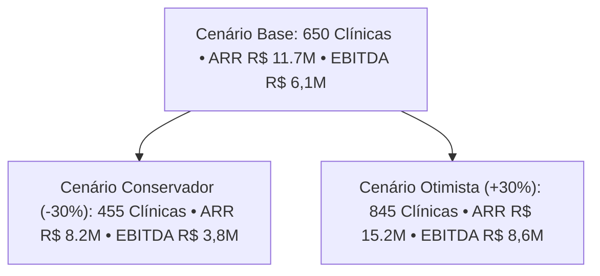

| Cenário Analisado | Clínicas Ativas (Ano 3) | ARR Final | Margem EBITDA | Geração de Caixa Anual Livre |
| :--- | :---: | :---: | :---: | :---: |
| **Cenário Conservador** (Menor tração outbound) | 455 clínicas | R$ 8.200.000 | 46,3% | R$ 3.800.000 / ano |
| **Cenário Base** (Execução padrão do plano) | **650 clínicas** | **R$ 11.700.000** | **62,6%** | **R$ 6.135.500 / ano** |
| **Cenário Otimista** (Aceleração por parcerias de franquias) | 845 clínicas | R$ 15.210.000 | 56,5% | R$ 8.600.000 / ano |

---

## 8. Estratégia de Go-to-Market (GTM) e Máquina de Aquisição

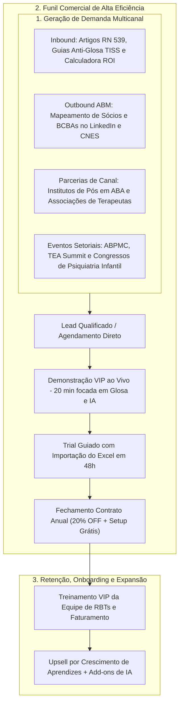

### 8.1. Etapas e SLAs do Funil de Vendas

1. **Atração e MQL (Marketing Qualified Lead)**:
   - Captação via landing page com simulador de ROI interativo, artigos explicativos da RN 539/2022 e tabela comparativa contra Excel/Prontuários genéricos.
2. **Qualificação e Contato em Tempo Recorde (SLA < 10 minutos)**:
   - SDR entra em contato via WhatsApp comercial automatizado para validar porte da clínica (número de aprendizes e convênios atendidos).
3. **Demonstração VIP Personalizada (20 minutos)**:
   - Apresentação prática dos 2 grandes pilares:
     - **Pilar 1**: Coleta DTT/NET em <1 segundo no tablet com atalhos e funcionamento 100% offline.
     - **Pilar 2**: Emissão de laudo anti-glosa com gráficos de WII e validação TISS em 1 clique.
     - **Diferencial IA**: Simulação ao vivo do ditado por voz para crises ABC (*Speech-to-Contingency*).
4. **Trial Guiado de 7 Dias**:
   - Equipe de CS migra gratuitamente as primeiras 5 folhas de programas do Excel para a plataforma em até 48 horas.
5. **Fechamento e Incentivo de Contrato Anual**:
   - 20% de desconto no pagamento anual à vista (melhora imediata de capital de giro para o SaaS e garantia de retenção mínima de 12 meses).

---

## 9. Governança de Riscos, Moats e Vantagens Competitivas

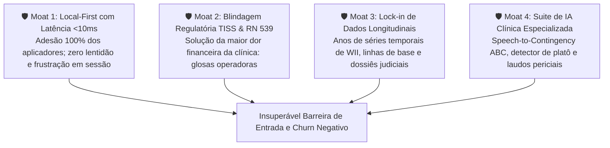

### 9.1. Análise Comparativa de Mercado & Benchmark contra os 8 Concorrentes Especializados

Além de superar sistemas médicos genéricos e planilhas manuais, o **SaaS ABA Enterprise v2.4** foi construído para resolver as lacunas críticas das 8 principais plataformas de autismo e neurodesenvolvimento do mercado brasileiro:

| Critério de Avaliação | Concorrentes Tradicionais (NeoABA, ClinicABA, TEA360, Cliniconect, Sr. ABA, ComportaTudo, AkivaTEA, Blue Smiles) | **SaaS ABA Enterprise (Nossa Plataforma)** | Impacto no Moat & Unit Economics |
| :--- | :---: | :---: | :--- |
| **Centro com 6 Protocolos Padronizados** | ❌ Limitados a 1 ou 2 protocolos isolados (VB-MAPP/ABLLS) | **✅ 6 Protocolos Nativos** (VB-MAPP, Denver ESDM, M-CHAT, ABLLS-R, CARS-2, Socially Savvy) | Elimina a contratação de ferramentas paralelas de avaliação (Economia de R$ 300/mês para a clínica). |
| **Ponte 1-Clique Protocolo $\to$ PEI** | ❌ Avaliação desconectada; exige redigitação manual de metas | **✅ 1-Click PEI Bridge**: qualquer lacuna vira programa com 3 exemplares no PEI | Reduz em 80% o tempo do supervisor BCBA na montagem do plano de ensino. |
| **Agenda de Salas Sensoriais & Terapias em Bloco** | ❌ Agendas genéricas sem matriz de equipamentos físicos | **✅ Matriz Espacial** (Salas Ayres, DTT 1 e 2, Denver, CAA) + Terapias casadas no mesmo turno | Maximiza a ocupação de salas em 35% e fideliza famílias pelo menor deslocamento. |
| **Prontuário Multidisciplinar SOAP Cruzado** | ❌ Prontuários fechados apenas para psicologia/ABA | **✅ Padrão SOAP Completo** para Fonoaudiologia, T.O., Psico e ABA com Metas Compartilhadas | Permite vender para clínicas completas, triplicando o LTV e o ticket médio (ARPU). |
| **Diário de Mediação do AT Escolar Regular** | ❌ Inexistente (caderno físico de recados escolar) | **✅ Módulo AT Escolar** (tempo em carteira, socialização no recreio, sobrecargas sensoriais) | Captura dados de 15h a 30h semanais de mediação escolar que ficavam invisíveis. |
| **Defesa Ativa de Glosas com Minutas RN 539 ANS** | ❌ Glosas aceitas passivamente; sem suporte jurídico | **✅ Gerador de Recursos em 1 Clique** fundamentado na proibição de limite de sessões pela ANS e STJ | Protege de 5% a 15% do faturamento da clínica, justificando o ROI imediato da assinatura. |
| **Motor Automático de Manutenção D+10/20/30** | ❌ Sem esteira automatizada de retenção periódica | **✅ Sondas automáticas D+10, D+20 e D+30** pós-domínio com alertas no coletor DTT | Garante fidelidade científica internacional e anula a regressão de alvos aprendidos. |
| **Coleta Local-First <10ms e 100% Offline** | ⚠️ Web apps tradicionais lentos suscetíveis a quedas de rede | **✅ IndexedDB Local-First** com atalhos de 1 toque e teclado 1 a 8 | Churn de aplicadores &lt; 1% por ergonomia extrema. |
| **Copiloto Clínico com IA (Speech-to-ABC)** | ❌ Sem inteligência artificial contextualizada em ABA | **✅ Ditado de crises por voz em 5s**, alertas de platô e minutas periciais | Atrai os supervisores mais qualificados do mercado (*Product-Led Growth*). |

---

## 10. Tese de Valuation, Necessidade de Capital e Cenários de Saída (M&A)

### 10.1. Necessidade de Capital e Estratégia de Funding
- **Cenário Bootstrapped (Crescimento Orgânico)**: O ponto de equilíbrio atingido no **Mês 7** (42 clínicas ativas) e o forte influxo de caixa proveniente dos contratos anuais pagos à vista conferem total autossuficiência financeira para o projeto sem dependência de rodadas externas.
- **Cenário Opcional de Aceleração (Seed Round: R$ 1,5M a R$ 2,5M)**:
  - *Destinação dos Recursos*: 50% em expansão da máquina de vendas outbound/marketing, 35% em contratação de engenheiros especialistas em IA e 15% em capital de giro/governança.
  - *Objetivo da Rodada*: Antecipar o atingimento de 650 clínicas ativas de 36 para 22 meses.

---

### 10.2. Múltiplos de Valuation e Potenciais Compradores Estratégicos (M&A)

No final do **Ano 3 (ARR de R$ 11,7M a R$ 13,2M e Margem EBITDA de 62%)**:

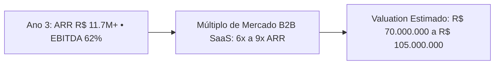

- **Múltiplo de Mercado B2B SaaS Vertical na Saúde**: 6x a 9x ARR (devido ao NRR de 118%, churn < 1,1% e margem bruta de 93,4%).
- **Valuation Estimado da Companhia**: **R$ 70.000.000 a R$ 105.000.000**.
- **Perfil de Compradores Estratégicos Naturais**:
  1. **Gigantes de Software de Saúde & Prontuários**: Totvs Saúde, MV Sistemas, Pixeon, Afya, Sinapse Saúde.
  2. **Grandes Operadoras Verticalizadas e Redes Hospitalares**: Hapvida NotreDame Intermédica, Rede D'Or São Luiz, Dasa, Unimed do Brasil.
  3. **Grupos de Educação e Saúde Mental**: Institutos de formação de terapeutas ABA e fundos de Private Equity focados na consolidação do mercado de neurodesenvolvimento no Brasil e América Latina.
