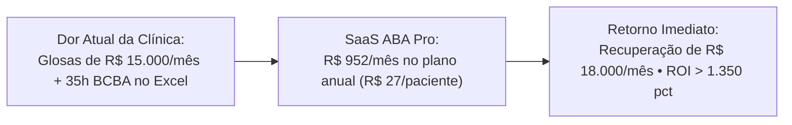
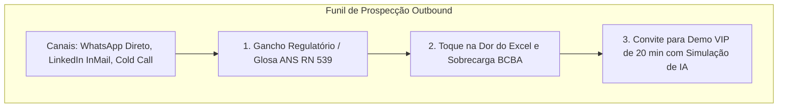
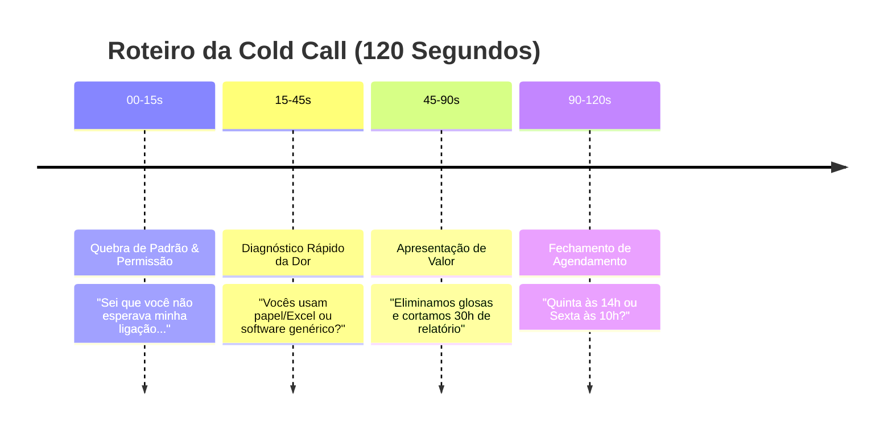
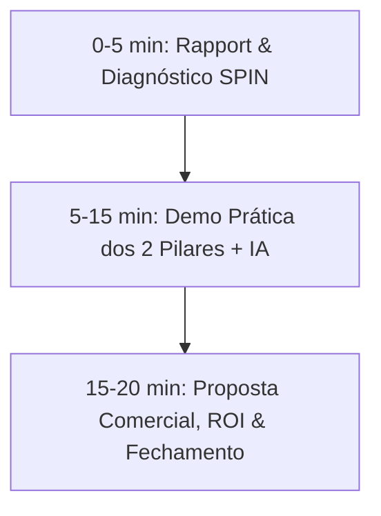
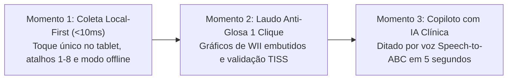
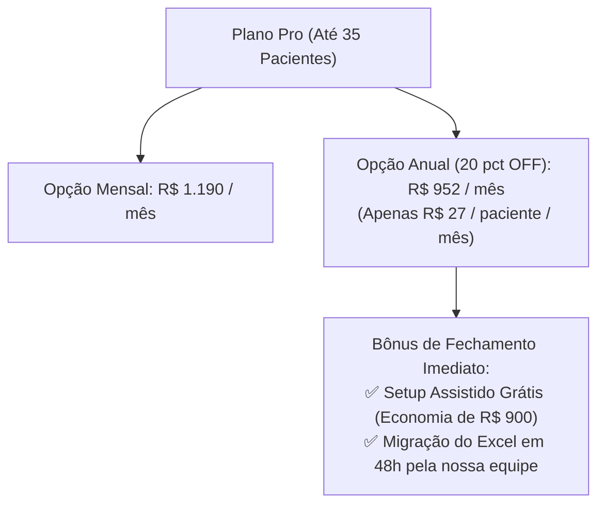
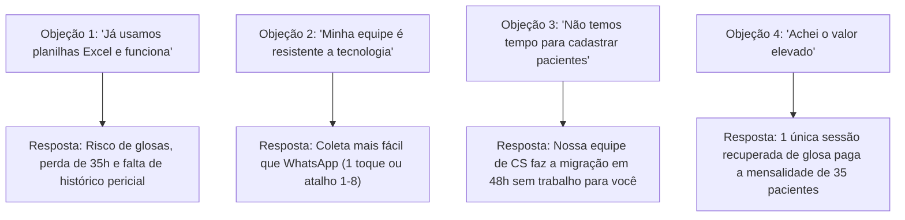
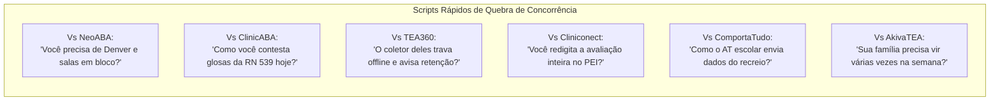
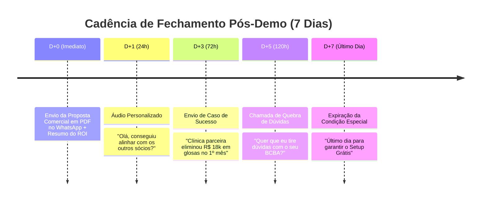

# 🎯 SaaS ABA — Playbook de Vendas, Scripts de Abordagem & Roteiro de Chamada Comercial

> **Guia Tático Comercial para Prospecção Outbound, Qualificação, Roteiro de Demonstração VIP de 20 Minutos, Matriz de Quebra de Objeções e Fechamento de Contratos Anuais**  
> *Versão 2.4 Enterprise — Outubro / 2026*

---

## 1. O Gancho Comercial Central & Pitch de 30 Segundos

### 1.1. O Pitch de Elevador (One-Liner de Alto Impacto)
> *"Nós ajudamos clínicas de neurodesenvolvimento e autismo a **eliminar 100% das glosas de convênios**, cortar **30 horas mensais de trabalho manual no Excel por supervisor BCBA** e garantir que os aplicadores coletem dados de DTT em **menos de 1 segundo no tablet, mesmo 100% offline**."*

### 1.2. A Equação Irrecusável de Retorno sobre Investimento (ROI)

- **Racional de Venda**: Uma única hora de terapia ABA (em média **R$ 140,00 a R$ 180,00/h**) recuperada de glosa por semana paga mais de **50% da mensalidade** de toda a clínica.

---

## 2. Scripts de Prospecção e Abordagem Outbound (WhatsApp, Cold Call, LinkedIn & E-mail)

---

### 2.1. Template 1: WhatsApp Comercial (Direto para Sócio / Diretor de Clínica)
*Gatilho: Risco de glosas, RN 539 da ANS e produtividade da equipe.*

> **Mensagem WhatsApp:**  
> *"Olá, **[Nome do Sócio/Diretor]**, tudo bem? Vi que a **[Nome da Clínica]** é referência no atendimento de crianças com TEA aí em **[Cidade]**.*  
>  
> *Estou entrando em contato porque a maioria dos diretores de clínicas com quem conversamos está enfrentando dois grandes problemas este ano: **glosas abusivas de convênios por falta de assinatura georreferenciada** e **supervisores BCBA sobrecarregados gastando mais de 30h por mês compilando gráficos no Excel**.*  
>  
> *Desenvolvemos o **SaaS ABA**, a única plataforma nacional que roda 100% offline no tablet (coleta em <1s) e gera **laudos periciais anti-glosa com gráficos de WII e validação TISS em 1 único clique**.*  
>  
> *Consigo te mostrar uma demonstração rápida de 15 minutos nesta **[Dia da Semana]** às **[Horário 1]** ou **[Horário 2]**? Se fizer sentido, nós mesmos migramos suas planilhas antigas gratuitamente em 48h."*

---

### 2.2. Template 2: LinkedIn InMail (Para Coordenador Clínico / Supervisor BCBA)
*Gatilho: Fim do trabalho braçal no Excel, cálculo automático de WII e IA para crises.*

> **Mensagem LinkedIn:**  
> *"Olá, **[Nome do BCBA]**, parabéns pelo trabalho com intervenção comportamental na **[Nome da Clínica]**!*  
>  
> *Sei o quanto a rotina de supervisor é puxada: parametrizar PEI, analisar folhas de tentativas discretas, calcular índice de independência (WII) e redigir relatórios evolutivos consome noites inteiras.*  
>  
> *Criamos o **SaaS ABA**, onde o supervisor prescreve o PEI e o sistema calcula o WII em 8 níveis de dicas automaticamente, dispara alertas preditivos de platô de aprendizagem e tem até **ditado de crise ABC por voz com IA** para os aplicadores não perderem tempo preenchendo fichas.*  
>  
> *Você teria 15 minutos esta semana para ver o sistema rodando na prática? Prometo que vai transformar a rotina da sua equipe técnica."*

---

### 2.3. Template 3: Cold Call Telefônica Estruturada (2 Minutos)

- **Abertura (0 a 15s)**:  
  *"Oi, **[Nome]**, bom dia! Aqui é o **[Seu Nome]** do SaaS ABA. Sei que você não estava esperando minha ligação, você tem 1 minuto para eu te explicar o motivo do contato e você me dizer se faz sentido continuarmos?"*
- **Apresentação do Problema (15 a 45s)**:  
  *"Perfeito! Nós desenvolvemos a primeira plataforma especializada em clínicas ABA que elimina o caos de planilhas Excel e resolve de vez as glosas de convênios com a RN 539 da ANS. Hoje na **[Nome da Clínica]**, vocês ainda usam papel e Excel ou já usam algum software para registro de tentativas discretas?"*
- **Pergunta de Implicação (45 a 75s)**:  
  *"Entendi. A maioria dos sócios nos conta que os aplicadores têm dificuldade com softwares que travam na sessão e que os supervisores perdem o fim de semana montando gráficos de WII na mão. Nós criamos um app que roda 100% offline no tablet em <1 segundo e emite o laudo completo em 1 clique."*
- **Chamada para Agendamento (75 a 120s)**:  
  *"Quero te propor o seguinte: uma demonstração ao vivo de 20 minutos com você e seu supervisor clínico. Nós mostramos o sistema e, se gostarem, migramos 5 pacientes do Excel gratuitamente para vocês testarem. Fica melhor para você **[Quinta-feira às 14h]** ou **[Sexta-feira às 10h]**?"*

---

## 3. Roteiro da Reunião Comercial de Demonstração VIP (20 Minutos)

---

### ⏱️ Etapa 1: Diagnóstico SPIN Selling (Minuto 0 ao 5)

Faça perguntas abertas para que o cliente verbalize a dor financeira e operacional:

1. **Situação**: *"Quantos aprendizes vocês atendem hoje na clínica? Quantos aplicadores/ATs estão na ponta?"*
2. **Problema**: *"Quanto tempo em média seu supervisor BCBA gasta por mês para compilar dados do Excel e emitir laudos para convênios ou processos judiciais?"*
3. **Implicação**: *"Quando uma operadora glosa um relatório por falta de assinatura com geolocalização ou por inconsistência na guia TISS, quanto dinheiro fica retido e quanto tempo vocês perdem recorrendo?"*
4. **Necessidade**: *"Se você tivesse uma ferramenta onde o aplicador coleta em menos de 1 segundo sem travar, os pais assinam na tela do tablet com GPS e o laudo com gráficos de WII sai pronto em 1 clique, que impacto isso traria no faturamento e na expansão da clínica?"*

---

### ⏱️ Etapa 2: Demonstração Prática de Alto Impacto (Minuto 5 ao 15)

Não faça um tour genérico de telas. Vá direto para os **3 momentos mágicos (*Aha! Moments*)**:

1. **Demonstração do Pilar 1 (O Coletor sem Fricção)**:
   - Abra a tela do coletor de tentativas DTT. Mostre o *Quick Briefing* de 3 segundos (reforçadores e gatilhos da criança).
   - Aperte as teclas `1` a `8` ou toque rapidamente na hierarquia de dicas (`IND`, `GP`, `VP`, `FP`).
   - Mostre o som e o feedback tátil instantâneo.
   - **Frase de Impacto**: *"O aplicador nunca tira os olhos da criança. Zero telas de carregamento, zero frustração."*

2. **Demonstração do Pilar 2 (Laudo Pericial & Blindagem Anti-Glosa)**:
   - Abra a aba do laudo do paciente. Clique no botão `"Gerar Laudo Anti-Glosa em 1 Clique"`.
   - Mostre o PDF gerado em 3 segundos com gráficos de WII embutidos, histórico de linhas de base, folhas de presença assinadas com geolocalização e carimbo PAdES/ICP-Brasil.
   - **Frase de Impacto**: *"Aquele relatório que o BCBA demorava 4 horas para montar no Word e Excel sai perfeito, auditado e blindado contra qualquer glosa da ANS."*

3. **Demonstração do Diferencial IA (Ditado de Crise ABC)**:
   - Clique no botão de microfone e dite: *"Enzo teve crise de choro e se jogou no chão quando tirei o brinquedo; fiz redirecionamento para o pareamento."*
   - Mostre a IA estruturando instantaneamente: Antecedente, Comportamento, Consequência e Hipótese de Função (Acesso/Fuga).
   - **Frase de Impacto**: *"O aplicador registra a crise em 5 segundos por voz enquanto acalma a criança. Nunca mais teremos relatórios incompletos no fim do turno."*

---

### ⏱️ Etapa 3: Apresentação de Preço, ROI & Fechamento (Minuto 15 ao 20)

Apresente a proposta ancorando o valor no faturamento da clínica:

- **Script de Fechamento**:  
  *"Para atender todos os seus **[X]** aprendizes e toda a sua equipe com acessos ilimitados, o plano ideal é o **Plano Pro**. No faturamento mensal ele fica em R$ 1.190/mês. Porém, no plano anual você tem **20% de desconto**, ficando apenas **R$ 952/mês** — isso representa menos de **R$ 27 por paciente por mês**.*  
  *E para começarmos hoje, eu vou incluir o **Setup Assistido e a Migração de dados do seu Excel 100% gratuita** (que custa R$ 900). Nossa equipe faz toda a importação em até 48 horas.*  
  *Podemos emitir a assinatura no CNPJ da clínica para começarmos o treinamento da equipe na próxima semana?"*

---

## 4. Matriz de Quebra de Objeções (Objection Handling)

### 1. *"Já usamos planilhas Excel e nunca tivemos grandes problemas."*
- **Resposta Matadora**:  
  *"Compreendo perfeitamente, o Excel é muito flexível no começo. Mas o risco é silencioso: uma planilha corrompida perde anos de histórico de WII, e as operadoras de saúde agora exigem o padrão TISS v04.01.00 e comprovação por assinatura com GPS conforme a RN 539. Se você tiver **uma única glosa de 10 horas de atendimento**, você perde mais de **R$ 1.400 em um único mês** — mais do que o custo do SaaS ABA para 35 pacientes inteiros. Vale a pena correr esse risco?"*

### 2. *"Minha equipe de terapeutas aplicadores tem resistência a novos sistemas."*
- **Resposta Matadora**:  
  *"Essa é a nossa maior preocupação também. Por isso construímos o sistema com a regra dos **< 1 segundo**: a tela não tem dropdowns complexos nem menus lentos. O terapeuta só aperta 1 botão gigante ou as teclas de 1 a 8 no teclado. A adesão dos estagiários e aplicadores é de 100% porque é mais rápido do que anotar no papel e não trava nunca."*

### 3. *"Estamos sem tempo agora para cadastrar todos os programas e aprendizes."*
- **Resposta Matadora**:  
  *"Você não precisa se preocupar com isso! Fechando o plano anual hoje, a nossa equipe técnica de Customer Success recebe as suas planilhas e cadastra todo o histórico de PEI e aprendizes em até **48 horas**. Você e sua equipe só entram na plataforma com tudo pronto para usar."*

### 4. *"Achei o valor da assinatura alto para o nosso momento."*
- **Resposta Matadora**:  
  *"Vamos analisar os números juntos: uma clínica com 30 pacientes fatura em média R$ 360.000 por mês. A assinatura Pro anual de R$ 952/mês representa **menos de 0,26% do seu faturamento**. Além disso, o supervisor economiza mais de 30 horas no mês (o que equivale a mais de R$ 3.000 em hora clínica) e zera as glosas de presença. O sistema não é um custo, é uma máquina de proteção e recuperação de receita."*

### 5. *"Já usamos outro software de TEA (NeoABA, ClinicABA, TEA360, Cliniconect ou ComportaTudo)."*
- **Resposta Matadora**:  
  *"Excelente que você já digitalizou a clínica! Mais de 40% das clínicas que migraram para o SaaS ABA vieram justamente dessas plataformas. A razão da migração é simples: esses sistemas foram criados apenas para tabular VB-MAPP ou emitir guias comuns. Nenhum deles tem o **Centro com 6 Protocolos com 1-Click PEI Bridge**, nenhum tem **agenda matricial de salas sensoriais (Ayres) com agendamento em bloco**, nenhum tem **prontuário transdisciplinar SOAP integrado (Fono, T.O. e Psico)** e nenhum possui o **gerador ativo de minutas de recurso contra glosas da RN 539/2022 da ANS**. Nós fazemos a migração de todo o histórico do seu sistema atual gratuitamente em 48 horas. Topa ver uma comparação lado a lado de 15 minutos?"*

---

## 4.5. Battlecards de Vendas: Como Desbancar os 8 Concorrentes Nacionais

| Concorrente | O Ponto Fraco Real da Concorrência | A Pergunta Armadilha do Vendedor (*Trap Question*) | O Golpe de Misericórdia do SaaS ABA |
| :--- | :--- | :--- | :--- |
| **NeoABA** | Preso ao modelo de prancheta VB-MAPP/ABLLS; sem Denver, M-CHAT ou salas sensoriais | *"Quando um neuropediatra pede a triagem M-CHAT ou relatório Denver, você faz fora do sistema?"* | *"No SaaS ABA você tem 6 protocolos nativos e importa qualquer lacuna para o PEI em 1 clique."* |
| **ClinicABA** | Prontuário PTABA rígido; fonoaudiologia e T.O. isoladas; aceita glosas passivamente | *"Quando o plano de saúde glosa sessões alegando limite contratual, quem redige a minuta jurídica?"* | *"Nosso gestor ativo gera o recurso completo fundamentado na RN 539 da ANS em 1 clique com gráficos."* |
| **TEA360** | Sistema web pesado; sem atalhos ergonômicos e sem motor de manutenção temporal | *"O aplicador consegue registrar a tentativa no tablet em menos de 1 segundo sem olhar para a tela?"* | *"Nosso coletor roda 100% offline via IndexedDB e agenda automaticamente sondas D+10, D+20 e D+30."* |
| **Cliniconect** | ERP tradicional adaptado; desconexão entre avaliação e execução prática | *"Quanto tempo seu supervisor perde redigitando as respostas da avaliação diagnóstica para criar o PEI?"* | *"Nossa Ponte PEI transforma qualquer marco não atingido em 3 exemplares parametrizados instantaneamente."* |
| **Sr. ABA / BPA** | Foco formativo/educacional; agenda sem mapeamento de salas e equipamentos | *"Como você controla para dois terapeutas não disputarem a mesma sala de integração sensorial de Ayres?"* | *"Temos matriz espacial física com bloqueio de choque de balanço, tirolesa e sala DTT."* |
| **ComportaTudo** | Fechado na clínica; sem canal estruturado para o Acompanhante Terapêutico escolar | *"Como o seu AT que está lá na escola regular te reporta o tempo em carteira e as crises no recreio?"* | *"Módulo dedicado ao AT Escolar com registro de permanência, interações sociais e adaptações pedagógicas."* |
| **AkivaTEA** | Terapias desarticuladas no dia a dia; repasses calculados em planilhas à parte | *"Quantas vezes na semana a mãe do seu aprendiz precisa se deslocar até a clínica para fazer fono e ABA?"* | *"Agendamento em bloco de terapias casadas no mesmo turno e extrato de repasse por hora automatizado."* |
| **Blue Smiles** | Aplicativo focado na família mas com limitações de protocolos clínicos complexos | *"Sua equipe consegue rodar CARS-2 e Socially Savvy com cruzamento de metas de T.O. no mesmo prontuário?"* | *"Prontuário SOAP multiprofissional com metas transdisciplinares e dieta sensorial compartilhada."* |

---

## 5. Cadência de Follow-Up Pós-Demonstração (Régua de Contato)

---

## 6. Template de Proposta Comercial Pronta (Para Envio pós-Demo)

> **Proposta Comercial — SaaS ABA Enterprise**  
> **Cliente:** Clínica [Nome da Clínica]  
> **Responsável:** [Nome do Sócio / BCBA]  
> **Data:** [Data de Envio]  
>  
> **Plano Recomendado:** **Plano Pro (Até 35 Aprendizes Ativos)**  
> - Coleta DTT/NET Local-First 100% Offline (Latência <10ms).  
> - Linter Pré-Envio de XML TISS v04.01.00 (Anti-Glosa SP/SADT).  
> - Laudo Pericial RN 539 da ANS em 1 clique com gráficos de WII embutidos.  
> - Copiloto de IA: Ditado de Crises por Voz (*Speech-to-Contingency*) + Alertas de Platô.  
> - Assinatura Touch dos Pais com carimbo de GPS e data/hora.  
> - Portal dos Pais com WhatsApp OTP.  
> - Acessos ilimitados para toda a equipe técnica e aplicadores.  
>  
> **Condições Comerciais Especiais:**  
> - **Plano Mensal:** R$ 1.190,00 / mês.  
> - **Plano Anual (20% OFF):** **12x de R$ 952,00** *(ou R$ 11.424,00 à vista)*.  
> - **BÔNUS EXCLUSIVO DE FECHAMENTO (Válido por 5 dias):**  
>   - ✅ **Setup Assistido e Migração de Planilhas Antigas:** **GRATUITO** *(De R$ 900 por R$ 0)*.  
>   - ✅ **Treinamento VIP da Equipe de Terapeutas:** Incluso.  
>   - ✅ **Garantia Incondicional de Satisfação:** 30 dias para testar na prática.  
>  
> *Para aprovar a proposta e agendar a migração, basta responder "APROVADO" neste WhatsApp ou assinar digitalmente o contrato.*
