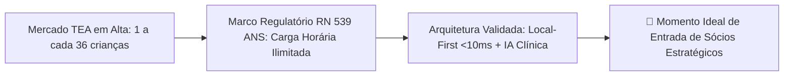
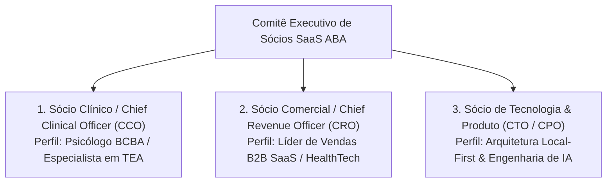
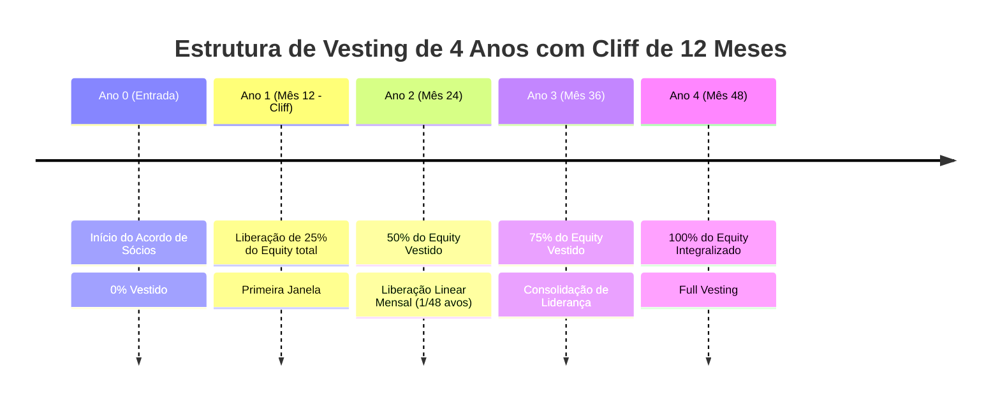
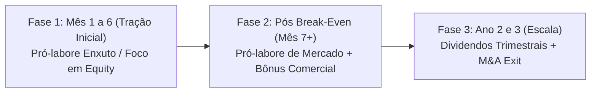
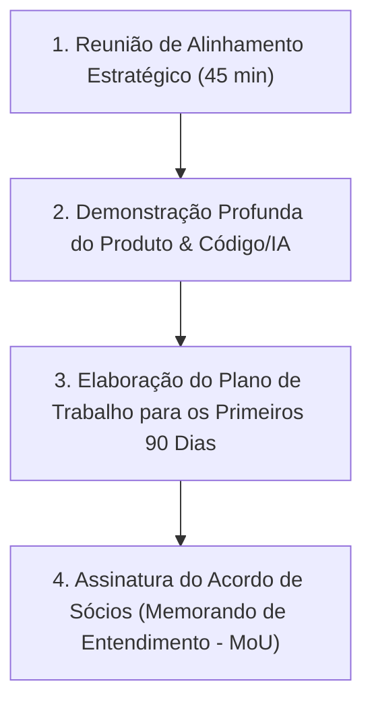

# 🤝 SaaS ABA — Proposta Executiva para Entrada de Sócios & Co-Founders

> **Documento Confidencial de Parceria Estratégica, Alocação de Equity, Governança e Atração de Sócios Fundadores (*Co-Founders*)**  
> *Versão 2.4 Enterprise — Outubro / 2026*

---

## 1. Visão da Oportunidade & O Momento (*Why Now?*)

O **SaaS ABA** nasce para liderar a modernização tecnológica da intervenção no **Transtorno do Espectro Autista (TEA)** e atrasos do neurodesenvolvimento no Brasil e América Latina.

### O Estado Atual do Projeto:
- **Tecnologia 100% Funcional e Pronta**: Arquitetura *Local-First* com sincronização em segundo plano (*IndexedDB / Dexie.js + React 19*), operando totalmente offline no tablet.
- **Centro de 6 Protocolos com 1-Click PEI Bridge**: VB-MAPP, Denver ESDM, M-CHAT-R/F, ABLLS-R, CARS-2 e Socially Savvy com importação automatizada de lacunas para o PEI.
- **Ecossistema Multidisciplinar Completo**: Agenda com matriz espacial de salas sensoriais (Ayres) em bloco, prontuário multidisciplinar SOAP (Fono, T.O., Psico e ABA) e diário de bordo do AT escolar regular.
- **Suite de IA & Blindagem Regulatória**: Módulos de *Speech-to-Contingency* (ditado de crises ABC por voz), detector preditivo de platô (WII), linter TISS XML v04.01.00 e gerador de minutas de recurso contra glosas fundamentadas na RN 539/2022 da ANS.
- **Economia de Escala Provada**: Margem bruta unitária de **93,4%**, custo de infraestrutura de apenas **R$ 78,50/mês por clínica**, retenção estimada de **51 meses (LTV R$ 67.600)** e relação **LTV/CAC de 36,5x**.

---

## 2. Perfis de Sócios Buscados & Responsabilidades

Estamos formando um comitê fundador complementar e de alta performance. Buscamos sócios para 2 posições-chave:

---

### Perfil 1: Sócio Clínico / Chief Clinical Officer (CCO)
*Ideal para: Psicólogo(a) com certificação BCBA/QBA, Doutor/Mestre em Análise do Comportamento ou Diretor Clínico de referência.*

- **Atribuições Principais**:
  1. **Homologação e Rigor Científico**: Validar protocolos (VB-MAPP, ABLLS-R, AFLS, Denver/ESDM), parametrização de algoritmos de dicas (*Least-to-Most / Most-to-Least*) e índices de WII.
  2. **Embaixador Institucional (*Key Opinion Leader*)**: Representar o SaaS ABA perante conselhos de classe (CFP, CRP, CFFa, CREFITO), associações científicas (ABPMC) e congressos nacionais.
  3. **Curadoria do Treinamento de IA**: Apoiar a engenharia no refinamento dos *prompts* e *guardrails* clínicos dos laudos e do ditado ABC.
  4. **Relacionamento com a Comunidade BCBA**: Liderar o conselho consultivo e canal de indicação/parcerias com supervisores clínicos.

---

### Perfil 2: Sócio Comercial / Chief Revenue Officer (CRO)
*Ideal para: Executivo(a) com histórico comprovado de tração em SaaS B2B, vendas para clínicas de saúde, operadoras ou franquias.*

- **Atribuições Principais**:
  1. **Estruturação da Máquina de Vendas**: Implementar e liderar os times de *Inbound*, *Outbound ABM por CNES* e *Inside Sales*.
  2. **Negociação Enterprise & Franquias**: Fechamento de contratos anuais com redes multi-unidades (planos Enterprise e Whitelabel).
  3. **Parcerias Estratégicas de Canal**: Acordos com institutos de pós-graduação em ABA, consultorias de faturamento TISS e distribuidoras de tecnologia médica.
  4. **Customer Success & Retenção**: Garantir a esteira de migração do Excel em 48h e manter o *Gross Churn* abaixo de 1,1% ao mês.

---

## 3. Modelo de Equity, Vesting e Governança

Para garantir o alinhamento de longo prazo e a segurança jurídica de todos os fundadores, a alocação de equity seguirá os padrões internacionais de venture capital (*Y Combinator / Silicon Valley Standard*):

### 3.1. Parâmetros da Proposta de Participação

| Item de Governança | Parâmetro Proposto | Justificativa / Proteção |
| :--- | :---: | :--- |
| **Faixa de Equity Ofertada** | **5% a 15%** (por sócio) | Proporcional à dedicação (Full-time vs Part-time de transição) e senioridade de mercado. |
| **Período de Vesting** | **48 Meses (4 Anos)** | Alinhamento de longo prazo para construção de valor e preparação para Série A/Exit. |
| **Cliff Inicial** | **12 Meses** | Carência mínima para validação de fit cultural, entrega e comprometimento com o negócio. |
| **Dedicação Exigida** | Transição para **Full-Time** | Possibilidade de dedicação parcial nos primeiros 3 a 6 meses até o atingimento de marcos. |
| **Cláusula de Good / Bad Leaver** | Inclusa no Acordo | Regras claras de recompra de quotas a valor nominal em caso de saída voluntária ou quebra de conduta. |
| **Cessão de Propriedade Intelectual** | 100% para a Empresa | Todo código, protocolo, modelo e método desenvolvido pertence integralmente ao SaaS ABA. |

---

## 4. Remuneração, Pró-Labore e Distribuição de Resultados

1. **Fase 1 (Mês 1 a 6 — Validação e PMF)**: Pró-labore simbólico/operacional para focar a queima de caixa no produto e marketing.
2. **Fase 2 (Mês 7 a 18 — Superávit Operacional)**: Pró-labore nivelado aos padrões de startups de saúde com bônus atrelado a metas de ARR e retenção.
3. **Fase 3 (Ano 2 e 3 — Lucratividade e M&A)**: Distribuição trimestral de lucros (margem EBITDA > 50%) e liquidez na eventual venda de participação na Série A ou no M&A definitivo.

---

## 5. Simulação de Retorno Financeiro para os Sócios (Upside Potencial)

Cenário baseado no cumprimento do plano de 36 meses (**650 clínicas ativas • ARR R$ 11,7M a R$ 13,2M • EBITDA R$ 6,13M**):

| Cenário de Saída / Valuation | Participação (10% Equity) | Participação (15% Equity) | Retorno em Dividendos Anuais (Ano 3) |
| :--- | :---: | :---: | :---: |
| **Valuation Conservador (R$ 50.000.000)** | **R$ 5.000.000** | **R$ 7.500.000** | R$ 300.000 a R$ 450.000 / ano |
| **Valuation Base (R$ 75.000.000)** | **R$ 7.500.000** | **R$ 11.250.000** | R$ 450.000 a R$ 675.000 / ano |
| **Valuation Otimista (R$ 105.000.000)** | **R$ 10.500.000** | **R$ 15.750.000** | R$ 600.000 a R$ 900.000 / ano |

---

## 6. Próximos Passos para os Candidatos a Sócio

1. **Reunião de Alinhamento de Visão (45 min)**: Discussão sobre modelo de negócio, cultura, sinergia pessoal e expectativas de dedicação.
2. **Acesso ao Data Room Completo**:
   - [Memorando de Investimento Executivo (Seed Round)](file:///Users/calvin/source/SaaSABA/MEMORANDO_INVESTIMENTO_EXECUTIVE_DECK_SAAS_ABA.md)
   - [Plano Comercial, DRE Projetada e Unit Economics](file:///Users/calvin/source/SaaSABA/PLANO_COMERCIAL_FINANCEIRO_SAAS_ABA.md)
   - [Arquitetura da IA Clínica e Speech-to-ABC](file:///Users/calvin/source/SaaSABA/ARQUITETURA_IA_CLINICA_SAAS_ABA.md)
   - [Documentação Técnica e Clínica Completa v2.4](file:///Users/calvin/source/SaaSABA/DOCUMENTACAO_COMPLETA_SAAS_ABA.md)
3. **Plano de 90 Dias**: Construção conjunta do plano de execução dos primeiros 3 meses.
4. **Formalização Jurídica**: Assinatura do MoU (*Memorandum of Understanding*) e início imediato do *Vesting*.
