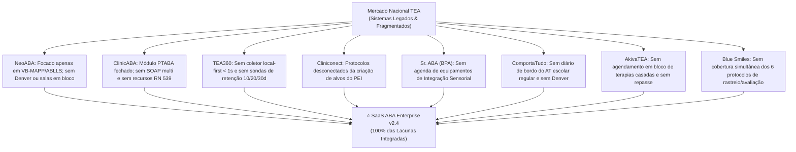

# 🧠 SaaS ABA — Plataforma Enterprise de Gestão Clínica, Coleta Multimodal & Ecossistema Multidisciplinar TEA

[](https://react.dev/)
[](https://www.typescriptlang.org/)
[](https://vitejs.dev/)
[](https://tailwindcss.com/)
[](https://www.gov.br/ans/pt-br)
[](https://www.gov.br/ans/pt-br)
[](https://www.iti.gov.br/)

> **A plataforma definitiva para clínicas de autismo e neurodesenvolvimento no Brasil.**  
> Projetada sob uma rigorosa engenharia científica e jurídica: coleta multimodal ergonômica em menos de 1 segundo (local-first e 100% offline), centro de 6 protocolos padronizados com conversão para o PEI em 1 clique, agenda matricial de salas de integração sensorial em bloco, prontuário SOAP transdisciplinar e blindagem total contra glosas de planos de saúde com base na Resolução Normativa nº 539/2022 da ANS.

---

## 🏆 Benchmark Nacional de Mercado & Superação de Lacunas

O **SaaS ABA Enterprise** foi auditado e desenhado para superar as limitações encontradas nas 8 maiores soluções de gestão TEA do Brasil:



| Solução de Mercado | Foco Tradicional | Lacuna Identificada | Como o SaaS ABA Enterprise Superou |
| :--- | :--- | :--- | :--- |
| **NeoABA** | VB-MAPP e ABLLS-R | Sem protocolo Denver ESDM, sem M-CHAT e sem salas sensoriais | **Centro com 6 Protocolos** integrados com PEI e agenda de salas sensoriais |
| **ClinicABA** | Prontuário PTABA e guias | Prontuário fechado sem padrão SOAP e sem contestação ativa RN 539 | **Prontuário Multidisciplinar SOAP** e **Gestor Ativo de Glosas ANS** |
| **TEA360** | Gestão de equipe | Coletor web convencional; sem automação de retenção periódica | **Coletor Local-First &lt; 1s** e **Motor Automático de Manutenção D+10/20/30** |
| **Cliniconect** | ERP hospitalar adaptado | Avaliação não gera PEI de forma automatizada (trabalho duplicado) | **1-Click PEI Bridge**: marco não atingido vira programa com 3 exemplares |
| **Sr. ABA / BPA** | Capacitação e rotinas | Agenda simples sem mapeamento de equipamentos sensoriais | **Matriz Espacial de Salas Sensoriais** (Ayres, DTT, Denver, CAA) |
| **ComportaTudo** | Terapia comportamental | Sem canal de mediação pedagógica do Acompanhante Terapêutico (AT) | **Diário de Bordo do AT Escolar** (recreio, carteira, adaptação curricular) |
| **AkivaTEA** | Gestão operacional | Terapias isoladas gerando choques de agenda e deslocamento da família | **Agendamento em Bloco** (ABA+TO+Fono casados no mesmo turno) |
| **Blue Smiles** | Rede de clínicas e app | Falta de múltiplos protocolos de triagem precoce simultâneos | Suporte integrado a **M-CHAT-R/F, CARS-2, Socially Savvy, Denver, etc.** |

---

## 🏛️ Os 6 Grandes Subsistemas da Plataforma

### 1. Centro de 6 Protocolos Padronizados com 1-Click PEI Bridge
- **Protocolos Nativos:**
  1. **VB-MAPP:** 170 marcos evolutivos em 3 níveis (Mando, Tato, Ecoico, Intraverbal, Imitação, etc.).
  2. **Modelo Denver (ESDM):** Intervenção precoce naturalista em comunicação receptiva e expressiva.
  3. **M-CHAT-R/F:** Triagem precoce (16 a 30 meses) com estratificação imediata de risco (Baixo, Médio, Alto).
  4. **ABLLS-R:** 25 áreas funcionais acadêmicas, motoras e de autocuidado.
  5. **CARS-2:** Escala de gravidade dos sintomas do espectro autista.
  6. **Socially Savvy:** Currículo de habilidades e interações sociais com pares.
- **Ponte PEI em 1 Clique:** Qualquer marco com pontuação inferior a 1.0 (ou identificador de lacuna) é convertido em um programa de ensino individualizado ativo com exemplares parametrizados e critérios de maestria.

### 2. Agenda Multidisciplinar Inteligente com Gestão de Salas Sensoriais & Agendamento em Bloco
- **Matriz Espacial de Salas:**
  - *Sala de Integração Sensorial de Ayres:* Balanços, tirolesa, piscina de bolinhas, túnel propioceptivo.
  - *Salas de DTT 1 e 2:* Ambientes estruturados de baixo estímulo com isolamento acústico.
  - *Sala Denver / NET:* Espaço lúdico com cantos temáticos para estimulação incidental.
  - *Sala de Fonoaudiologia & CAA:* Pranchas de comunicação aumentativa e recursos orofaciais.
- **Agendamento em Bloco:** Permite alocar sessões casadas no mesmo turno (ex: 50m ABA + 50m T.O. + 50m Fono) para reduzir o desgaste da família, com detecção automática de conflito de recursos físicos e disparo de lembretes via WhatsApp.

### 3. Prontuário Multidisciplinar SOAP & Metas Transdisciplinares
- **Padrão SOAP Estruturado:**
  - **S (Subjetivo):** Estado de regulação emocional e relato da família na transição.
  - **O (Objetivo):** Procedimentos, alvos executados e percentuais de independência.
  - **A (Avaliação):** Resposta aos estímulos, sobrecargas sensoriais e engajamento.
  - **P (Plano):** Conduta para o próximo atendimento e orientações domiciliares.
- **Especialidades Integradas:** Fonoaudiologia, Terapia Ocupacional, Psicologia, Fisioterapia e Análise do Comportamento Aplicada (ABA).
- **Recursos Exclusivos:** Dieta Sensorial estruturada, assinatura digital no padrão ICP-Brasil e alinhamento de metas transdisciplinares comuns entre terapeutas.

### 4. Portal da Família ("Comunidade") & Diário de Bordo do AT Escolar
- **Portal da Família:** Linha do tempo de conquistas com botão de celebração para engajamento dos pais e **Diário de Generalização Domiciliar**, permitindo que a família registre mandos e comportamentos funcionais ocorridos em casa para avaliação do supervisor BCBA.
- **Diário de Mediação do AT Escolar:** Registro diário pelo acompanhante terapêutico na escola regular:
  - Tempo de permanência em carteira (minutos).
  - Interações sociais espontâneas com pares no recreio.
  - Gatilhos de sobrecarga sensorial no ambiente escolar.
  - Adaptações pedagógicas e curriculares realizadas.

### 5. Central Financeira, Repasse a Terapeutas & Defesa Ativa de Glosas RN 539/2022
- **Extrato Automatizado de Repasse:** Cálculo consolidado de horas clínicas executadas, horas de supervisão e retenção tributária (ISS).
- **Gestor Ativo de Glosas ANS:** Reconhece códigos de glosa (ex: *Glosa 1801 - Limite de sessões atingido*) e gera em 1 clique a **Minuta Completa de Recurso Administrativo** fundamentada na Resolução Normativa nº 539/2022 da ANS (que vedou o limite de sessões para TEA) e na jurisprudência do Superior Tribunal de Justiça (STJ).
- **Pacotes Particulares:** Geração instantânea de cobrança com chave PIX copia-e-cola.

### 6. Motor Automático de Sondas de Manutenção (10, 20 e 30 Dias)
- **Promoção Automática para Maestria:** Quando o aprendiz atinge $\ge 80\%$ de respostas independentes em 3 sessões consecutivas ($\ge 5$ tentativas), o alvo é promovido para *Mastered*.
- **Esteira de Retenção:** Agendamento automático das sondas em **D+10**, **D+20** e **D+30**.
- **Alertas no Coletor:** Banner visual e feedback sonoro informam o aplicador durante a sessão de que um exemplar está em sonda de manutenção sem ajuda, garantindo que habilidades dominadas não sofram regressão.

---

## ⚡ Os Dois Pilares Técnicos Inegociáveis

1. **A Regra dos &lt; 1 Segundo de Coleta (Local-First):**
   - Aplicadores operam sem tirar os olhos da criança.
   - Gravação instantânea no `IndexedDB` com latência zero (&lt; 10ms).
   - Modo 100% offline resiliente a quedas de conexão.
   - Atalhos de teclado ergonômicos de `1` a `8`.
   - Ditado de crises comportamentais (ABC) por voz com inteligência artificial.

2. **Dossiê Anti-Glosa em 1 Clique (Proteção B2B):**
   - Gráficos de aquisição, curvas cumulativas e Índice WII renderizados diretamente no laudo em PDF.
   - Folha de presença diária com assinatura touch do responsável, geolocalização e carimbo temporal imutável.
   - Linter semântico pré-envio de XML TISS v04.01.00 (SP/SADT) com validação de CNES e conselhos de classe (CRP, CRFa, CREFITO).

---

## 💻 Arquitetura e Tecnologias

- **Frontend:** React 19, TypeScript 5, Vite 8, Tailwind CSS v4, Lucide React, Canvas Confetti.
- **Armazenamento Local:** IndexedDB com sincronização reativa em background.
- **Qualidade e Estilo:** Oxlint com regras estritas de tipagem e React Compiler friendly.
- **Acessibilidade e Inclusão:** Modo Baixo Estímulo Sensorial (`lowSensoryMode`) para ambientes clínicos.

---

## 🚀 Instalação e Execução

### Pré-requisitos
- Node.js $\ge 18.x$
- npm $\ge 9.x$

### Comandos de Inicialização

```bash
# 1. Clonar e entrar no repositório
cd source/SaaSABA

# 2. Instalar dependências
npm install

# 3. Executar servidor de desenvolvimento com HMR
npm run dev

# 4. Executar verificação de linter (Oxlint)
npm run lint

# 5. Gerar build de produção otimizado
npm run build
```

---

## 📁 Estrutura de Diretórios

```
src/
├── components/
│   ├── abc/            # Registro ABC com ditado por voz e contingências comportamentais
│   ├── ai/             # Copiloto Clínico com IA e análise preditiva de platô
│   ├── analytics/      # Gráficos clínicos (Curvas cumulativas, Linha de Fase, WII)
│   ├── dashboard/      # Visão geral da clínica e métricas operacionais
│   ├── dtt/            # Coletor DTT/NET Local-First < 1s e motor de sondas D+10/20/30
│   ├── family/         # Portal da Família & Diário de Bordo do AT Escolar
│   ├── financial/      # Gestor de Glosas RN 539 e Extrato de Repasse por Terapeuta
│   ├── landing/        # Landing page comercial e comparativo com os 8 concorrentes
│   ├── layout/         # Navbar institucional com seletor de aprendiz e timer
│   ├── programs/       # Gestor de Programas PEI e esteira de manutenção
│   ├── prontuario/     # Prontuário Multidisciplinar SOAP & Metas Compartilhadas
│   ├── protocols/      # Centro de 6 Protocolos Padronizados & 1-Click PEI Bridge
│   ├── reports/        # Gerador de Laudos Periciais Anti-Glosa com gráficos embutidos
│   └── schedule/       # Agenda Multidisciplinar & Salas Sensoriais (Ayres, DTT, CAA)
├── data/               # Datasets mock padronizados de aprendizes e protocolos
├── types/              # Definições estritas de domínio clínico TypeScript (aba.ts)
└── utils/              # Calculadores de WII, constantes comportamentais e áudio feedback
```

---

## 📜 Licença e Propriedade Intelectual

SaaS ABA Enterprise — Todos os direitos reservados.  
Desenvolvido em conformidade com as diretrizes do CFP, CREFITO, CFFa, CFM e Lei Geral de Proteção de Dados (LGPD - Lei nº 13.709/2018).
